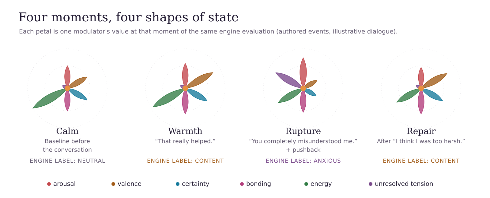
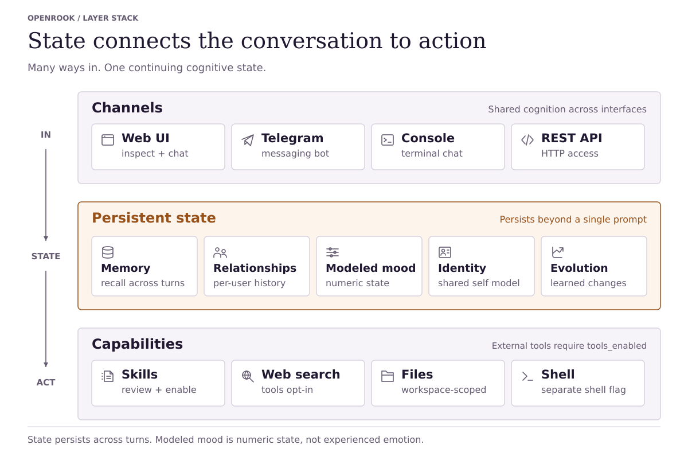

<p align="center">
  <picture>
    <source media="(prefers-color-scheme: dark)" srcset="docs/diagrams/wordmark-dark.svg">
    
  </picture>
</p>

<p align="center">
  <strong>LLMs forget. OpenRook remembers.</strong>
</p>

An open-source runtime for LLM agents with persistent memory, relationship history, modeled mood, and evolving identity. OpenRook carries that state across conversations into prompts for supported LLM backends.

Character choice now belongs to the runtime's versioned willingness policy.
Perception estimates meaning and request consequences; a pure utility calculation
uses authored dispositions, values, resources, trust and relationship history to
commit a continuous stance and separate grants for each request component.
Pride, patience, forgiveness and assertiveness are editable in Settings and
`soul.yaml`. The shipped seed declines degrading-role requests in the offline
32-seed transcript probe; owners can author deferential characters. Courtesy,
bluntness and swearing are personality choices.

Tools, generated artifacts, inspections, continuations and conversational learning
consume committed grants before execution. Operator permissions still apply.
Expression receives the frozen decision and grounded receipts. Review reports
`pass`, `violation` or `unknown`, with one rewrite for ordinary defects and up to
two for critical role assent or persistently stale candidates within the five-call
base budget. Stale drafts are supplied as forbidden-to-repeat context. Candidates are ranked
by verdict and violation severity before issue count. Unknown expression is
delivered with its review record. If correction fails, the best
nonempty reviewed expression is delivered as `delivered_degraded`, with its
violations retained. There are no canned social fallback replies. Only
runtime-selected silence is an empty successful reply; exhausted empty or
marker-only generations surface a service error.

The offline factorial sweep measures variation in the preference model, not
human feelings or live language behavior. See [Phase 1 implementation and
measurements](docs/development/phase1-willingness.md) for results, validation limits
and remaining work. Earlier [dignity replay reports](docs/development/dignity-replay/README.md)
measure the previous policy and are historical.

```bash
python3 -m pip install "git+https://github.com/balfiky/openrook.git"
export OPENROOK_CONFIG_DIR=~/.config/openrook
mkdir -p "$OPENROOK_CONFIG_DIR"
openrook-setup
openrook-web
```

Setup includes Codex CLI and an optional live model check with recovery steps.
In the browser, Settings shows the last connection test or error; “Not tested”
means a backend is configured but has not yet been checked. Hosted, Codex, and
OpenRouter backends receive prompts and relevant stored context; local storage
does not make those model calls local.

Slow local CPU generation can use a longer **Request timeout (seconds)** in
Settings > LLM (the LLM Backend section), or `llm_request_timeout_seconds` in
your runtime YAML. The default is **600 seconds**, with a minimum of one second.
Save Settings to reload the runtime; restart after editing YAML directly.
HTTP timeouts apply per request attempt. Optional inference automatically uses
the larger of eight seconds, one quarter of the configured request deadline,
and twice the latest successful generation latency, capped by the request
deadline. Set `llm_auxiliary_timeout_seconds` to a finite deadline of at least
one second to override adaptation (`null` restores automatic timing). Two
consecutive timeouts pause that phase for `llm_auxiliary_cooldown_seconds`
(default 30; zero disables the pause). Primary generation and research limits
remain independent. Ordinary conversation uses one expression call,
or two calls with semantic appraisal. Constrained expression adds a review;
ordinary correction adds generation and review. Critical assent or uniformly stale drafts can use the last
call for a second rewrite with local review and explicit semantic uncertainty.
Conversational turns have a five-call base budget, including supplemental tool
inference, with calls reserved for expression. Each granted atomic task also has
one protected primary tool selection (at most eight per turn), recorded separately.
Explicit literal file operations need no model selection. Backend
failures are recorded separately from character-selected silence. Declared
research resource limits still apply.

Compatible backends request `reasoning_effort: "none"` and
`chat_template_kwargs: {enable_thinking: false}` without selecting by model name.
Rejected controls are removed on HTTP 400/422 and remembered for that backend
instance; bounded research requests retain their declared payload.
`reasoning_effort` is documented by [Ollama](https://docs.ollama.com/api/openai-compatibility)
and [vLLM](https://docs.vllm.ai/en/stable/features/reasoning_outputs/), with support
depending on the server and its template. Separate reasoning fields and complete
or truncated thinking blocks are excluded from reply text and reply checks;
provider token usage still includes any reasoning the server performed.

Try sharing a preference, then choose **End Session** to consolidate the
conversation and clear short-term context. Stored memories and preferences
remain available when you ask “What do you remember about me?” later. The UI
confirms whether new summary memories were written; it does not retain the
visible transcript after a page reload.

For terminal chat, run `openrook`; `/help` lists local commands immediately.

<p align="center">
  <picture>
    <source media="(prefers-color-scheme: dark)" srcset="docs/diagrams/how-it-works-dark.svg">
    
  </picture>
</p>

## Why OpenRook?

- **Memory across sessions:** saves conversation memories and retrieves relevant context for later replies.
- **Relationship history:** tracks misunderstandings, repairs, and commitments to follow up, then carries that context into later prompts.
- **Modeled mood:** internal values shift with events and decay over time, shaping prompts without implying feelings.
- **An evolving identity:** self-observations and explicit learning can update identity state. Learning from salient sessions is opt-in in ordinary chat.
- **Inspectable state:** stored memories, identity changes, and turn traces show what the runtime carried forward.

<p align="center">
  <a href="https://github.com/balfiky/openrook/actions/workflows/ci.yml"></a>
  <a href="LICENSE"></a>
  <a href="pyproject.toml"></a>
  <a href="#configure-an-llm"></a>
</p>

[Quickstart](#quickstart) · [Under the hood](#under-the-hood-one-conversation-six-state-variables) · [Research runtime](docs/RESEARCH_RUNTIME.md) · [Docs](#start-here)

> **Honest scope.** OpenRook is an experimental runtime — not a therapist, not an AGI claim, not a consciousness claim. It is engineered scaffolding that holds *the state behind* an LLM's words across turns, sessions, and time. Memory and identity state live under `data/` — use it with consent when other people are involved. See [PRIVACY.md](PRIVACY.md) for inspection, export, and deletion.

For autonomous agents and unattended behavioral experiments, see the opt-in
[Autonomous research runtime](docs/RESEARCH_RUNTIME.md). The research preset
provides one persistent subject, independent activity, uncorrected expression,
passive observation, and recorded transition replay.

## Current Development Status

- **Independent activity:** the opt-in research runtime owns one persistent subject,
  including background deliberation, self-selected goals, refusal, and rest.
- **Experience-grounded behavior:** resumable actions, evidence-checked completion,
  outcome learning, revisable expectations, and functional appraisal controls.
- **Auditable studies:** frozen protocols, isolated subjects, resource limits,
  recorded model/tool outcomes, restart checks, and side-effect-free replay.
- **Completed behavioral acceptance:** the preregistered retained-choice study
  finished 28 subjects / 14 pairs. The history-dependent choice difference was
  0.7143 (95% paired interval 0.2857–1.1429), above the declared 0.2 threshold;
  1,344 transitions passed the then-current state replay checks. Both arms used
  runtime-computed partner estimates and procedures, and restart meant rebuilding
  the manager in the same process. This is task-specific runtime-plus-model
  evidence, not isolated model learning or proof of human equivalence.

<p align="center">
  <picture>
    <source media="(prefers-color-scheme: dark)" srcset="docs/diagrams/retained-choice-dark.svg">
    
  </picture>
</p>

See the [development summary](docs/DEVELOPMENT_SUMMARY.md) for major fixes and
the [dated validation record](docs/plans/behavioral_validation_v4.md#completed-confirmation-and-closeout)
for the study conditions, errors, and evidence boundaries. Renaming does not rerun
or alter that historical study.

The [research review corrections](docs/REVIEW_FIXES.md) document stricter request
replay, expression and resource-stop fixes, real process-restart coverage, and a
raw-experience ablation whose live comparison has not been run.

<picture>
  <source media="(prefers-color-scheme: dark)" srcset="docs/diagrams/research-runtime-autonomy-dark.svg">
  
</picture>

The research loop runs within declared tools and resource limits. Its receipts,
verification, and replay make activity inspectable; they do not establish human
emotion or unrestricted autonomy. See [research operation](docs/RESEARCH_RUNTIME.md).

## Under the hood: one conversation, six state variables

Read left to right through 90 minutes; each line is an internal value on a 0–1 scale.
In this authored sequence, a rupture lowers valence (modeled mood) and raises tension; the repair clears this example’s unresolved tension.
These are heuristic engine values, not feelings: the events and dialogue are illustrative, and no LLM is called.

<p align="center">
  <picture>
    <source media="(prefers-color-scheme: dark)" srcset="docs/diagrams/emotional-arc-dark.svg">
    
  </picture>
</p>

## What State Looks Like Across Turns

<p align="center">
  <picture>
    <source media="(prefers-color-scheme: dark)" srcset="docs/diagrams/emotional-fingerprints-dark.svg">
    
  </picture>
</p>

Illustrative dialogue and state annotations, not transcripts from a recorded run:

```text
─── Relational arc (relationship memory + arc tracking) ───
Day 1
You:  You completely misunderstood me.
OpenRook:  You're right. I missed what mattered there.
                                  # rupture recorded · trust drops · open loop created

Day 3
You:  I think I was too harsh earlier.
OpenRook:  I remember that moment. We don't have to ignore it.
                                  # repair detected · loop begins to close

Day 10
You:  This feels easier now.
OpenRook:  It does. There was tension here before, and it softened.
                                  # relationship arc persists across sessions

─── Identity arc (life-history ingest + belief revision + drive drift) ───
Mon
You:  Learn from this paper: <url>
OpenRook:  Recorded. Three beliefs shifted, one drive intensified.
                                  # life-history event written · evolution trace emitted

Wed (next ordinary-mode session opens)
                                  # elapsed-time metabolism: weak beliefs decayed
                                  #                  recurring theme promoted to belief
                                  #                  drive-gap question opened

Fri
You:  Why did you push back on that?
OpenRook:  A belief I formed Monday is shaping how I read this. Want to see it?
                                  # constitution + current beliefs surfaced for "why"
```

The LLM writes language and helps digest experiences and classify evidence for
belief revision. Storage, retrieval, bounded update arithmetic, decay, and safety
gates live outside the model. In ordinary mode, elapsed metabolism is applied
when a session opens or an operator requests a tick; unattended activity belongs
to the opt-in research runtime. The assistant's stance accumulates instead of resetting.

## Runtime Layers

| Layer | What it does | Where it lives |
|---|---|---|
| **Short-term memory** | Hot turn-level memory inside the running session | in-process |
| **Long-term memory** | Distilled summaries with valence + spike flags; retrieval is valence-weighted | `data/<user>/openrook.db` |
| **Relationship arc** | Rupture, repair, recurring tension, commitments, open loops; cross-session | `data/<user>/openrook.db` |
| **Semantic memory** | Preferences, decisions, facts; topic-scoped retrieval | `data/<user>/openrook.db` |
| **Life History** | Identity-level experience ledger; beliefs, drives, evolution events, themes | `data/shared/life_history.db` |
| **Constitution** | Configured-mode stable orientation rendered above evolving beliefs | `data/shared/life_history.db` |
| **Self-evolution** | Wall-clock metabolism: belief decay, theme→belief promotion, drive-gap detection | `runtime/life_history.py` |
| **Open questions** | Reflection-emitted queue (contradiction / low-confidence / drive-gap) with operator lifecycle | `data/shared/life_history.db` |
| **Ask-user surfacing** | Drive-gated mid-conversation question with daily budget (LearningBudget) | `runtime/learning/surface.py` |
| **Trigger-time skills** | Skills declaring `applies_when` load by matching chat hints; enabled skills without it remain always-on | `runtime/skills.py` |
| **Modulators** | Six-dim affective state (arousal, valence, certainty, bonding, energy, resolution); decay over time, shift on events | `core/emotional_engine.py`, session state file |
| **Tool gates** | Read-only by default; assisted autonomy needs confirmation; shell is a separate opt-in | `core/dual_process/tool_loop.py` |

Every layer above is inspectable through `/settings#observability` and the OpenAPI surface at `/docs`.

## Where OpenRook Sits

OpenRook is in the **cognitive runtime / agent memory** reference class, not the conversational-AI / companion class. The LLM still writes language; OpenRook is the engineered layer that holds *what to write against*.

| Reference class | What they store | OpenRook also stores |
|---|---|---|
| Vector RAG | document chunks · embeddings | — |
| MemGPT / Letta / mem0 | conversation summaries · facts · preferences | ✓ via long-term + semantic memory |
| LangGraph (with persistence) | turn-graph state · scratchpad | ✓ via session state + per-turn debug trace |
| **OpenRook — the additional layers** | | |
| Relational continuity | | rupture · repair · commitments · open loops |
| Identity continuity | | constitution · beliefs · drives · self-traits |
| Self-evolution | | wall-clock decay · theme→belief promotion · drive-gap detection |
| Affective state | | six modulators with deterministic decay · valence-weighted retrieval |
| Open-question lifecycle | | epistemic gaps surfaced for operator review |

Every layer above is inspectable, decayable, and testable. None of them require the LLM to "feel" anything.

<details>
<summary><strong>Life History and identity continuity</strong> — formative experiences that bias future behavior</summary>

OpenRook has an early **Life History** layer for formative material: pasted texts, notes, essays, browser-uploaded text/Markdown files, and explicit chat requests like "learn from this project: <url>". This is not just a summarizer. It records an experience, then writes an inspectable evolution trace: belief shifts, drive changes, self-trait observations, and future behavior tendencies.

That means the project has two distinct continuity layers:

- **Relational continuity** — how OpenRook remembers people, tension, repair, and unfinished business.
- **Identity continuity** — how OpenRook records experiences that may change its worldview, motivations, and self-model over time.

It is observable in `/settings` → **Life History** and stored under `data/shared/life_history.db`. The settings workspace includes an evolution snapshot: first/latest experience, strongest drive drift, dominant drive pressure, and change-type mix. Runtime sessions load a compact slice of current beliefs, shifted drives, and recent evolution into generation, so formative experiences can bias OpenRook's perspective without dumping raw source material into every prompt.

When a user explicitly asks OpenRook to learn from a URL, the runtime fetches readable text, preserves the source reference, writes the Life History event, and appends a short learning receipt. Ordinary browsing does not by itself mutate identity. With `autobiographical_learning` enabled, salient sessions also contribute distilled experiences at session end; research mode enables that path automatically.

</details>

## Quickstart

Install OpenRook from this repository; these instructions do not assume a PyPI
release.
Existing installations should follow the [migration guide](docs/OPENROOK_MIGRATION.md)
to replace the old distribution without deleting their workspace.

```bash
python3 -m venv .venv
source .venv/bin/activate
python3 -m pip install --upgrade pip
python3 -m pip install "git+https://github.com/balfiky/openrook.git"
export OPENROOK_CONFIG_DIR=~/.config/openrook
mkdir -p "$OPENROOK_CONFIG_DIR"
openrook-setup
```

Set `OPENROOK_CONFIG_DIR` before either setup wizard, and preserve it in later
shells or service configuration so identity edits stay outside the installed package.
For an existing customized installation, copy its current `soul.yaml` and any
other edited YAML or `prompts/` files into the same relative paths under this
directory **before upgrading or rerunning setup**. The existing files may be
under the installed package's `config/` directory or a previous override directory.
Creating an empty override directory does not migrate them; missing files fall
back to packaged defaults. See the [migration guide](docs/OPENROOK_MIGRATION.md).

`openrook-setup` is terminal-native by default. It prompts for model backend,
identity, Telegram, and tool settings, then creates `runtime_config.yaml`,
local data/workspace folders, and marks setup complete. It does **not** launch a
browser.

If you'd rather skip the terminal prompts, `openrook-web` works on a clean
install too — it auto-creates `runtime_config.yaml` with no model selected
on first run, then opens the browser setup wizard at `/` that walks you
through model, identity, and tool settings.

The runtime config is local and gitignored; it is not shipped in the repository.
Choose a model from those served by your backend during setup or in Settings.
The tracked references are [`runtime_config.example.yaml`](runtime_config.example.yaml)
and [`runtime_config.research.example.yaml`](runtime_config.research.example.yaml);
neither preselects a model.

Start the browser UI only when you ask for it:

```bash
openrook-web --config runtime_config.yaml
```

If you prefer the browser wizard instead of terminal prompts, run it explicitly:

```bash
openrook-setup --web --config runtime_config.yaml
```

For a LAN/public bind, point `openrook-web` at a public host:

```bash
openrook-web --host 0.0.0.0 --port 8000 --config runtime_config.yaml
```

Authentication is opt-in. With no `api_key` set in `runtime_config.yaml`,
the surface is open — same convention as Ollama, LM Studio, and Jupyter
defaults. `openrook-web` prints a one-screen warning to stderr when binding
to a non-loopback host without a token, so you know the surface is
reachable from the network.

If you want bearer-token auth (e.g., when exposing to a tailnet that has
more than just you on it, or to the public internet), set
`api_key: <a-strong-token>` in `runtime_config.yaml` and restart. Clients
then send `Authorization: Bearer <api_key>` against `/chat`, `/admin/*`,
`/v1/*`, `/ws`, and other protected endpoints. The `/admin → API Token`
button stores the token in the browser session.

To remove a local OpenRook workspace:

```bash
openrook-uninstall --dry-run
openrook-uninstall
python3 -m pip uninstall openrook
```

`openrook-uninstall` removes the runtime config and local data directory after a
confirmation prompt. It keeps external tool workspaces and `$OPENROOK_CONFIG_DIR`
identity files unless you explicitly pass the removal flags shown in
`openrook-uninstall --help`.

### From Source

```bash
git clone https://github.com/balfiky/openrook.git
cd openrook
python3 -m pip install -e ".[dev]"
export OPENROOK_CONFIG_DIR=~/.config/openrook
mkdir -p "$OPENROOK_CONFIG_DIR"
openrook-web                    # web UI at :8000
openrook-setup                  # terminal setup
openrook-setup --web            # browser setup wizard
openrook-uninstall              # remove local config/data after confirmation
openrook-validate --mode full   # local release-readiness validation
openrook                        # console runtime
```

A fresh checkout has no `runtime_config.yaml`. The first `openrook-web` run or
`openrook-setup` creates it; `openrook-setup --init-only` creates a starter without
prompts. For manual setup, copy `runtime_config.example.yaml` to
`runtime_config.yaml`, then configure your backend and choose one of its served
models before chatting. The local file is gitignored and existing files are
reused. Tests and quick/CI validation do not need a local runtime config.

Before updating an older clone that still tracks `runtime_config.yaml`, back up
the file outside the checkout. Git may remove an unchanged tracked copy when
applying the tracking removal; restore your backup afterward if needed.

<details>
<summary><strong>What's new</strong> — OpenRook and experience-grounded autonomy (full notes in <a href="CHANGELOG.md">CHANGELOG.md</a>)</summary>

- **OpenRook branding** — new package, commands, UI, and Python API names, with legacy command/import/environment compatibility.
- **Persistent research subject** — uncommitted birth policy, autonomous background activity, passive observation, and uncorrected expression.
- **Closed-loop action and learning** — durable goals, action receipts, verified outcomes, revisable procedures, and history-conditioned choices.
- **Functional affect controls** — compare expression-only appraisal, retrieval-connected appraisal, and a label-free numerical control.
- **Reliability fixes** — first-use identity storage, inference outside SQLite write transactions, legacy theme preservation, and optional appraisal fallback.
- **Completed validation** — preregistered retained-choice confirmation, independent raw-ledger audit, and historical transition/state replay under the then-current checks. See [replay limitations](docs/REVIEW_FIXES.md#f2-replay-checks-the-request-not-just-the-returned-output).

</details>

## Start Here

| Need | Document |
|---|---|
| Major implementation changes and measured results | [docs/DEVELOPMENT_SUMMARY.md](docs/DEVELOPMENT_SUMMARY.md) |
| Upgrade an existing installation without losing state | [docs/OPENROOK_MIGRATION.md](docs/OPENROOK_MIGRATION.md) |
| Product/concept overview | [docs/OVERVIEW.md](docs/OVERVIEW.md) |
| Reviewer study guide | [docs/STUDY_GUIDE.md](docs/STUDY_GUIDE.md) |
| Runtime architecture | [docs/ARCHITECTURE.md](docs/ARCHITECTURE.md) |
| Live acceptance testing | [docs/UAT.md](docs/UAT.md) |
| Install, admin, deployment | [docs/DEPLOYMENT_AND_ADMIN.md](docs/DEPLOYMENT_AND_ADMIN.md) |
| Security model | [SECURITY.md](SECURITY.md) |
| Privacy and data deletion | [PRIVACY.md](PRIVACY.md) |
| Release history | [CHANGELOG.md](CHANGELOG.md) |
| Contributing | [CONTRIBUTING.md](CONTRIBUTING.md) |

## Validation

Use `openrook-validate` before publishing or tagging releases. In a source checkout
it runs repository checks; in an installed workspace it automatically switches
to installed-package checks.

```bash
openrook-validate --mode quick    # static metadata/docs/config checks
openrook-validate --mode full     # quick + pytest + wheel/package-data checks
openrook-validate --mode release  # full + tag and install-smoke checks
```

CI runs `openrook-validate --mode ci` plus the full pytest suite on Python 3.10,
3.11, and 3.12.

## Configure an LLM

The setup wizard or `/settings` workspace is the preferred path.
OpenRook does not supply a default model. Choose your backend, enter its base
URL and API key if required, then choose a model the server actually provides.

| Backend | Use case |
|---|---|
| `provider` | Hosted OpenAI-compatible gateways |
| `openai_compatible` | Local/remote servers (Ollama, LM Studio, vLLM) |
| `codex` | Local Codex CLI session using your existing Codex login |

The conversation and research runtimes require a real LLM — configure one of the
options above before running. The checkout evaluation harness separately provides
an eval-only `mock` backend for structural assertions; it is not a runtime backend.

Terminal setup lists discovered models by number; select a number or type a model
ID. The browser wizard and Settings provide a model dropdown, a **Refresh** button,
and a field for entering a model ID manually. When the server lists exactly one
model, it is visibly preselected; multiple models require your choice. An existing
configured model is preserved in Settings and when terminal setup reuses the same
backend URL.

Discovery uses Ollama's `/api/tags` or an OpenAI-compatible `/models` endpoint,
including for vLLM, LM Studio, hosted gateways, and OpenRouter. It lists models
without generating a reply. If discovery fails, check the URL and credentials,
refresh, or enter a model ID manually. If Ollama has no installed models, choose
one from [the Ollama library](https://ollama.com/library), run
`ollama pull <model>`, then rerun setup or refresh models in Settings.

For `codex`, install/login to the Codex CLI first. OpenRook runs `codex exec` in
read-only ephemeral mode. Setup and Settings load the installed Codex model
catalog; the **Codex default** option leaves model selection to Codex itself.

Runtime config is `runtime_config.yaml` in the current working directory. Identity is `config/soul.yaml`, or `$OPENROOK_CONFIG_DIR/soul.yaml` when the override is set.

## Architecture At A Glance

<p align="center">
  <picture>
    <source media="(prefers-color-scheme: dark)" srcset="docs/diagrams/feature-overview-dark.svg">
    
  </picture>
</p>

Three layers: **Channels** bring input from Web UI, Telegram, Console, and REST API;
**Persistent state** carries memory, relationships, modeled mood, identity, and
evolution across turns; **Capabilities** provide skills, web access, files, and
shell through the runtime's tool policy.
Telegram uses long polling with an allowlist and per-update deduplication;
sessions use per-user locking and bounded queues for backpressure. See [runtime topology](docs/ARCHITECTURE.md#runtime-topology)
and [deployment](docs/DEPLOYMENT_AND_ADMIN.md) for channel configuration.

Modeled mood uses six numeric modulators. Memory includes short-term, long-term,
relationship, and semantic stores, alongside the identity-level Life History
ledger. Identity includes constitution, beliefs, drives, and self-traits;
evolution includes metabolism, open questions, and skill-to-Life-History migration.
These mechanisms model state and behavior, not experienced emotion.

A conversation turn observes meaning and request components, updates continuous
relationship state, commits one willingness decision, executes granted work,
then generates and reviews expression. Inner dialogue and defense filters do
not make a second conversational choice. CPU/RAM/disk requests have deterministic
tool routing; their grants, shell allowlist and operator autonomy still apply,
and verified results reach the character's expression through receipts.

Ordinary conversation uses one expression call, or two with semantic appraisal.
Constrained expression adds review; correction uses the remaining budget, with
up to two rewrites for critical role assent or persistently stale candidates and
local review of every candidate. The base budget is five calls, including
supplemental tool-selection and learning inference; each granted task also has
one protected primary selection. Turn details expose each call's phase, duration,
outcome and primary-selection accounting.
Session-end digestion and independent activities have separate inference costs.
With `tools_enabled: false`, external tools are disabled while internal skill
registry tools remain subject to their own permissions and the turn's grants.
Research inference retains its declared resource limits and request logging.

For the full code-level component map (LLM backends, persistence files, tool executor wiring) and the per-turn cognitive flow diagram, see [docs/ARCHITECTURE.md](docs/ARCHITECTURE.md).

## API Quick Tour

```bash
# Health, no auth required
curl http://127.0.0.1:8000/v1/health

# Chat, auth optional unless api_key is configured
curl -X POST http://127.0.0.1:8000/v1/chat \
  -H 'Content-Type: application/json' \
  -d '{"message":"hello","user_id":"demo","chat_id":"main"}'

# With auth enabled
curl -X POST http://127.0.0.1:8000/v1/chat \
  -H 'Authorization: Bearer YOUR_TOKEN' \
  -H 'Content-Type: application/json' \
  -d '{"message":"hello","user_id":"demo","chat_id":"main"}'
```

OpenAPI docs at http://127.0.0.1:8000/docs when the server is running.

## Production Posture

Before exposing OpenRook beyond localhost:

- Set `api_key` so admin and chat endpoints require bearer auth
- Keep `tools_enabled: false` and `shell_tool_enabled: false` unless explicitly needed
- Use first-class read-only tools for routine host facts; shell is a separate local-command surface
- Set Telegram allowlists before enabling a bot
- Treat `data/`, `runtime_config.yaml`, and backups as sensitive
- Read [docs/DEPLOYMENT_AND_ADMIN.md](docs/DEPLOYMENT_AND_ADMIN.md), [SECURITY.md](SECURITY.md), and [PRIVACY.md](PRIVACY.md)

## Common Commands

```bash
make test                                        # unit/integration suite
make uat                                         # UAT against a live LLM
make uat-comprehensive                           # one PASS/FAIL aggregator over the full UAT suite
python3 -m pytest tests/test_interface.py -q     # focused interface tests
python3 -m evals --backend openai_compat --tag phase11  # behavioral eval pack
python3 -m build --sdist --wheel                 # build wheel and sdist
```

`make uat` defaults to the Codex CLI backend. Override with
`OPENROOK_UAT_BACKEND=openai_compatible OPENROOK_UAT_BASE_URL=... OPENROOK_UAT_MODEL=... make uat`.
For backend selection, headed mode, artifact paths, and the comprehensive
aggregator pattern, see [docs/UAT.md](docs/UAT.md).

## Repository Layout

```text
config/     YAML config and prompt templates
core/       Cognitive state, appraisal, memory, profiles, dual process
runtime/    Runtime config, channels, session lifecycle, tool factory
interface/  FastAPI app, /v1 API, client, bundled web UI
evals/      Behavioral scenario and ablation harness
tests/      Unit, integration, regression, runtime, and API tests
docs/       Public docs, design docs, diagrams, research notes
```

## Current Status

Version `0.37.0`; the OpenRook rename and research milestones are recorded
under **Unreleased** in [CHANGELOG.md](CHANGELOG.md). The
[development summary](docs/DEVELOPMENT_SUMMARY.md) is the current implementation
and evidence index, including the completed retained-choice confirmation.

CI runs unit/integration checks, package validation, UAT collection, and a fresh
web-server boot check. The separate 67-test browser/UAT suite requires a real
backend and is opt-in, not part of every push. Run `make uat-comprehensive` when
performing that live acceptance check; see [docs/UAT.md](docs/UAT.md).

### Known Gaps

- `character_independence` alone does not freeze administrative identity edits.
  The implemented unattended-subject and read-only-observation behavior is
  selected by `research_mode`; see [research configuration](docs/RESEARCH_RUNTIME.md).
- No skill-from-URL download. Skills are imported via paste, file path, or zip upload only.
- Autobiographical learning is opt-in for ordinary chat and enabled in research
  mode. It ingests salient distilled sessions, not every raw conversational turn.
