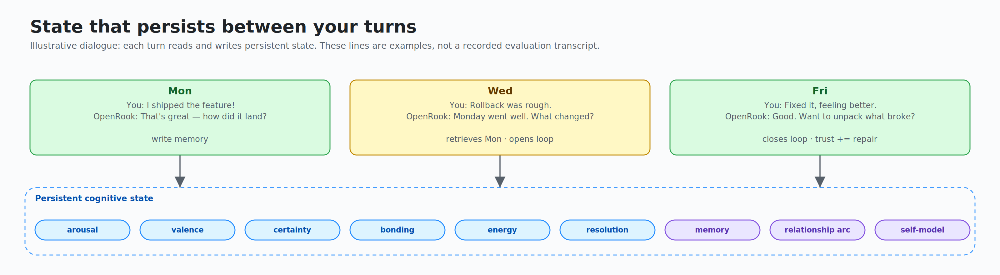
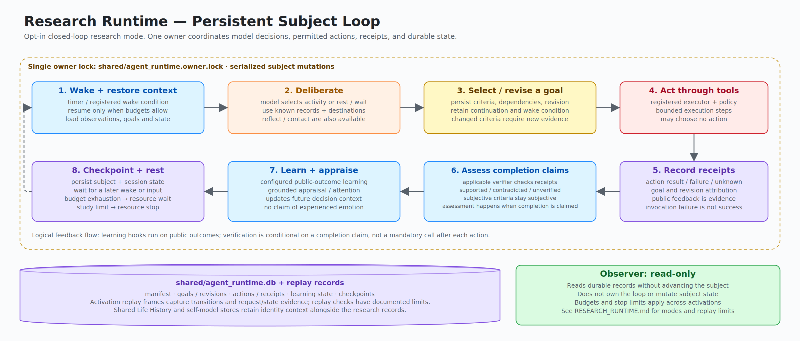
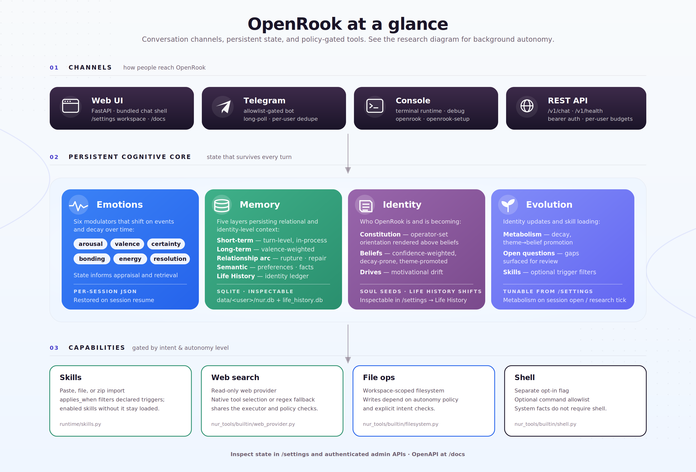

<p align="center">
  <picture>
    <source media="(prefers-color-scheme: dark)" srcset="docs/diagrams/wordmark-dark.svg">
    
  </picture>
</p>

<p align="center">
  <strong>Persistent state, evolving identity, accumulated learning — for any LLM.</strong>
</p>

<p align="center">
  <a href="https://github.com/balfiky/nur/actions/workflows/ci.yml"></a>
  <a href="LICENSE"></a>
  <a href="pyproject.toml"></a>
  <a href="CHANGELOG.md"></a>
</p>

<p align="center">
  <a href="docs/UAT.md"></a>
  <a href="docs/ARCHITECTURE.md"></a>
  <a href="docs/OVERVIEW.md"></a>
  <a href="#configure-an-llm"></a>
</p>

**OpenRook — a history of its own.** Formerly Nūr.

A cognitive runtime for persistent agents, not just another assistant interface.

Memory, beliefs, drives, mood, learned skills, and the long arc of a relationship live as runtime state — inspectable, persistent, decaying, testable. The LLM still writes the words. OpenRook changes the state those words come from.

OpenRook combines **identity continuity** (constitution, beliefs, drives, self-traits) and **relational continuity** (rupture, repair, open commitments) with conventional memory and self-directed activity.

[Quickstart](#quickstart) · [What's Changed](docs/DEVELOPMENT_SUMMARY.md) · [Migration](docs/OPENROOK_MIGRATION.md) · [Overview](docs/OVERVIEW.md) · [Architecture](docs/ARCHITECTURE.md) · [Admin & Deploy](docs/DEPLOYMENT_AND_ADMIN.md) · [Privacy](PRIVACY.md) · [Changelog](CHANGELOG.md)

For unattended behavioral experiments, see [Autonomous research runtime](docs/RESEARCH_RUNTIME.md).
The research preset provides one persistent subject, independent activity,
uncorrected expression, passive observation, and recorded transition replay.

---

<p align="center">
  
</p>

> **Honest scope.** OpenRook is an experimental runtime — not a therapist, not an AGI claim, not a consciousness claim. It is engineered scaffolding that holds *the state behind* an LLM's words across turns, sessions, and time. Memory and identity state live under `data/` — use it with consent when other people are involved. See [PRIVACY.md](PRIVACY.md) for inspection, export, and deletion.

## Current Development Status

- **Independent activity:** the opt-in research runtime owns one persistent subject,
  including background deliberation, self-selected goals, refusal, and rest.
- **Experience-grounded behavior:** resumable actions, evidence-checked completion,
  outcome learning, revisable expectations, and functional appraisal controls.
- **Auditable studies:** frozen protocols, isolated subjects, resource limits,
  recorded model/tool outcomes, restart checks, and side-effect-free replay.
- **Completed behavioral acceptance:** the preregistered retained-choice study
  finished 28 subjects / 14 pairs. The history-dependent choice difference was
  0.7143 (95% paired interval 0.2857–1.1429), above the declared 0.2 threshold;
  1,344 transitions passed the then-current state replay checks. Both arms used
  runtime-computed partner estimates and procedures, and restart meant rebuilding
  the manager in the same process. This is task-specific runtime-plus-model
  evidence, not isolated model learning or proof of human equivalence.

See the [development summary](docs/DEVELOPMENT_SUMMARY.md) for major fixes and
the [dated validation record](docs/plans/behavioral_validation_v4.md#completed-confirmation-and-closeout)
for the study conditions, errors, and evidence boundaries. Renaming does not rerun
or alter that historical study.

The [research review corrections](docs/REVIEW_FIXES.md) document stricter request
replay, expression and resource-stop fixes, real process-restart coverage, and a
raw-experience ablation whose live comparison has not been run.



The research loop runs within declared tools and resource limits. Its receipts,
verification, and replay make activity inspectable; they do not establish human
emotion or unrestricted autonomy. See [research operation](docs/RESEARCH_RUNTIME.md).

## What State Looks Like Across Turns

Illustrative dialogue and state annotations, not transcripts from a recorded run:

```text
─── Relational arc (relationship memory + arc tracking) ───
Day 1
You:  You completely misunderstood me.
OpenRook:  You're right. I missed what mattered there.
                                  # rupture recorded · trust drops · open loop created

Day 3
You:  I think I was too harsh earlier.
OpenRook:  I remember that moment. We don't have to ignore it.
                                  # repair detected · loop begins to close

Day 10
You:  This feels easier now.
OpenRook:  It does. There was tension here before, and it softened.
                                  # relationship arc persists across sessions

─── Identity arc (life-history ingest + belief revision + drive drift) ───
Mon
You:  Learn from this paper: <url>
OpenRook:  Recorded. Three beliefs shifted, one drive intensified.
                                  # life-history event written · evolution trace emitted

Wed (next ordinary-mode session opens)
                                  # elapsed-time metabolism: weak beliefs decayed
                                  #                  recurring theme promoted to belief
                                  #                  drive-gap question opened

Fri
You:  Why did you push back on that?
OpenRook:  A belief I formed Monday is shaping how I read this. Want to see it?
                                  # constitution + current beliefs surfaced for "why"
```

The LLM writes language and helps digest experiences and classify evidence for
belief revision. Storage, retrieval, bounded update arithmetic, decay, and safety
gates live outside the model. In ordinary mode, elapsed metabolism is applied
when a session opens or an operator requests a tick; unattended activity belongs
to the opt-in research runtime. The assistant's stance accumulates instead of resetting.

## Runtime Layers

| Layer | What it does | Where it lives |
|---|---|---|
| **Short-term memory** | Hot turn-level memory inside the running session | in-process |
| **Long-term memory** | Distilled summaries with valence + spike flags; retrieval is valence-weighted | `data/<user>/nur.db` |
| **Relationship arc** | Rupture, repair, recurring tension, commitments, open loops; cross-session | `data/<user>/nur.db` |
| **Semantic memory** | Preferences, decisions, facts; topic-scoped retrieval | `data/<user>/nur.db` |
| **Life History** | Identity-level experience ledger; beliefs, drives, evolution events, themes | `data/shared/life_history.db` |
| **Constitution** | Configured-mode stable orientation rendered above evolving beliefs | `data/shared/life_history.db` |
| **Self-evolution** | Wall-clock metabolism: belief decay, theme→belief promotion, drive-gap detection | `runtime/life_history.py` |
| **Open questions** | Reflection-emitted queue (contradiction / low-confidence / drive-gap) with operator lifecycle | `data/shared/life_history.db` |
| **Ask-user surfacing** | Drive-gated mid-conversation question with daily budget (LearningBudget) | `runtime/learning/surface.py` |
| **Trigger-time skills** | Skills declaring `applies_when` load by matching chat hints; enabled skills without it remain always-on | `runtime/skills.py` |
| **Modulators** | Six-dim affective state (arousal, valence, certainty, bonding, energy, resolution); decay over time, shift on events | `core/emotional_engine.py`, session state file |
| **Tool gates** | Read-only by default; assisted autonomy needs confirmation; shell is a separate opt-in | `core/dual_process/tool_loop.py` |

Every layer above is inspectable through `/settings#observability` and the OpenAPI surface at `/docs`.

## Where OpenRook Sits

OpenRook is in the **cognitive runtime / agent memory** reference class, not the conversational-AI / companion class. The LLM still writes language; OpenRook is the engineered layer that holds *what to write against*.

| Reference class | What they store | OpenRook also stores |
|---|---|---|
| Vector RAG | document chunks · embeddings | — |
| MemGPT / Letta / mem0 | conversation summaries · facts · preferences | ✓ via long-term + semantic memory |
| LangGraph (with persistence) | turn-graph state · scratchpad | ✓ via session state + per-turn debug trace |
| **OpenRook — the additional layers** | | |
| Relational continuity | | rupture · repair · commitments · open loops |
| Identity continuity | | constitution · beliefs · drives · self-traits |
| Self-evolution | | wall-clock decay · theme→belief promotion · drive-gap detection |
| Affective state | | six modulators with deterministic decay · valence-weighted retrieval |
| Open-question lifecycle | | epistemic gaps surfaced for operator review |

Every layer above is inspectable, decayable, and testable. None of them require the LLM to "feel" anything.

<details>
<summary><strong>Life History and identity continuity</strong> — formative experiences that bias future behavior</summary>

OpenRook has an early **Life History** layer for formative material: pasted texts, notes, essays, browser-uploaded text/Markdown files, and explicit chat requests like "learn from this project: <url>". This is not just a summarizer. It records an experience, then writes an inspectable evolution trace: belief shifts, drive changes, self-trait observations, and future behavior tendencies.

That means the project has two distinct continuity layers:

- **Relational continuity** — how OpenRook remembers people, tension, repair, and unfinished business.
- **Identity continuity** — how OpenRook records experiences that may change its worldview, motivations, and self-model over time.

It is observable in `/settings` → **Life History** and stored under `data/shared/life_history.db`. The settings workspace includes an evolution snapshot: first/latest experience, strongest drive drift, dominant drive pressure, and change-type mix. Runtime sessions load a compact slice of current beliefs, shifted drives, and recent evolution into generation, so formative experiences can bias OpenRook's perspective without dumping raw source material into every prompt.

When a user explicitly asks OpenRook to learn from a URL, the runtime fetches readable text, preserves the source reference, writes the Life History event, and appends a short learning receipt. Ordinary browsing does not by itself mutate identity. With `autobiographical_learning` enabled, salient sessions also contribute distilled experiences at session end; research mode enables that path automatically.

</details>

## Quickstart

Install OpenRook from this repository; these instructions do not assume a PyPI
release. The hosted repository currently retains its `balfiky/nur` URL.
Existing installations should follow the [migration guide](docs/OPENROOK_MIGRATION.md)
to replace the old distribution without deleting their workspace.

```bash
python3 -m venv .venv
source .venv/bin/activate
python3 -m pip install --upgrade pip
python3 -m pip install "git+https://github.com/balfiky/nur.git"
export OPENROOK_CONFIG_DIR=~/.config/openrook
mkdir -p "$OPENROOK_CONFIG_DIR"
openrook-setup
```

Set `OPENROOK_CONFIG_DIR` before either setup wizard, and preserve it in later
shells or service configuration so identity edits stay outside the installed package.
For an existing customized installation, copy its current `soul.yaml` and any
other edited YAML or `prompts/` files into the same relative paths under this
directory **before upgrading or rerunning setup**. The existing files may be
under the installed package's `config/` directory or a previous override directory.
Creating an empty override directory does not migrate them; missing files fall
back to packaged defaults. See the [migration guide](docs/OPENROOK_MIGRATION.md).

`openrook-setup` is terminal-native by default. It prompts for model backend,
identity, Telegram, and tool settings, then creates `runtime_config.yaml`,
local data/workspace folders, and marks setup complete. It does **not** launch a
browser.

If you'd rather skip the terminal prompts, `openrook-web` works on a clean
install too — it auto-creates `runtime_config.yaml` with safe defaults
on first run, then opens the browser setup wizard at `/` that walks you
through model, identity, and tool settings.

Start the browser UI only when you ask for it:

```bash
openrook-web --config runtime_config.yaml
```

If you prefer the browser wizard instead of terminal prompts, run it explicitly:

```bash
openrook-setup --web --config runtime_config.yaml
```

For a LAN/public bind, point `openrook-web` at a public host:

```bash
openrook-web --host 0.0.0.0 --port 8000 --config runtime_config.yaml
```

Authentication is opt-in. With no `api_key` set in `runtime_config.yaml`,
the surface is open — same convention as Ollama, LM Studio, and Jupyter
defaults. `openrook-web` prints a one-screen warning to stderr when binding
to a non-loopback host without a token, so you know the surface is
reachable from the network.

If you want bearer-token auth (e.g., when exposing to a tailnet that has
more than just you on it, or to the public internet), set
`api_key: <a-strong-token>` in `runtime_config.yaml` and restart. Clients
then send `Authorization: Bearer <api_key>` against `/chat`, `/admin/*`,
`/v1/*`, `/ws`, and other protected endpoints. The `/admin → API Token`
button stores the token in the browser session.

To remove a local OpenRook workspace:

```bash
openrook-uninstall --dry-run
openrook-uninstall
python3 -m pip uninstall openrook
```

`openrook-uninstall` removes the runtime config and local data directory after a
confirmation prompt. It keeps external tool workspaces and `$OPENROOK_CONFIG_DIR`
identity files unless you explicitly pass the removal flags shown in
`openrook-uninstall --help`.

### From Source

```bash
git clone https://github.com/balfiky/nur.git openrook
cd openrook
python3 -m pip install -e ".[dev]"
export OPENROOK_CONFIG_DIR=~/.config/openrook
mkdir -p "$OPENROOK_CONFIG_DIR"
openrook-web                    # web UI at :8000
openrook-setup                  # terminal setup
openrook-setup --web            # browser setup wizard
openrook-uninstall              # remove local config/data after confirmation
openrook-validate --mode full   # local release-readiness validation
openrook                        # console runtime
```

<details>
<summary><strong>What's new</strong> — OpenRook and experience-grounded autonomy (full notes in <a href="CHANGELOG.md">CHANGELOG.md</a>)</summary>

- **OpenRook branding** — new package, commands, UI, and Python API names, with legacy command/import/environment compatibility.
- **Persistent research subject** — uncommitted birth policy, autonomous background activity, passive observation, and uncorrected expression.
- **Closed-loop action and learning** — durable goals, action receipts, verified outcomes, revisable procedures, and history-conditioned choices.
- **Functional affect controls** — compare expression-only appraisal, retrieval-connected appraisal, and a label-free numerical control.
- **Reliability fixes** — first-use identity storage, inference outside SQLite write transactions, legacy theme preservation, and optional appraisal fallback.
- **Completed validation** — preregistered retained-choice confirmation, independent raw-ledger audit, and historical transition/state replay under the then-current checks. See [replay limitations](docs/REVIEW_FIXES.md#f2-replay-checks-the-request-not-just-the-returned-output).

</details>

## Start Here

| Need | Document |
|---|---|
| Major implementation changes and measured results | [docs/DEVELOPMENT_SUMMARY.md](docs/DEVELOPMENT_SUMMARY.md) |
| Upgrade from Nūr without losing state | [docs/OPENROOK_MIGRATION.md](docs/OPENROOK_MIGRATION.md) |
| Product/concept overview | [docs/OVERVIEW.md](docs/OVERVIEW.md) |
| Reviewer study guide | [docs/STUDY_GUIDE.md](docs/STUDY_GUIDE.md) |
| Runtime architecture | [docs/ARCHITECTURE.md](docs/ARCHITECTURE.md) |
| Install, admin, deployment | [docs/DEPLOYMENT_AND_ADMIN.md](docs/DEPLOYMENT_AND_ADMIN.md) |
| Security model | [SECURITY.md](SECURITY.md) |
| Privacy and data deletion | [PRIVACY.md](PRIVACY.md) |
| Release history | [CHANGELOG.md](CHANGELOG.md) |
| Contributing | [CONTRIBUTING.md](CONTRIBUTING.md) |

## Validation

Use `openrook-validate` before publishing or tagging releases. In a source checkout
it runs repository checks; in an installed workspace it automatically switches
to installed-package checks.

```bash
openrook-validate --mode quick    # static metadata/docs/config checks
openrook-validate --mode full     # quick + pytest + wheel/package-data checks
openrook-validate --mode release  # full + tag and install-smoke checks
```

CI runs `openrook-validate --mode ci` plus the full pytest suite on Python 3.10,
3.11, and 3.12.

## Configure An LLM

The setup wizard or `/settings` workspace is the preferred path.

| Backend | Use case |
|---|---|
| `provider` | Hosted OpenAI-compatible gateways |
| `openai_compatible` | Local/remote servers (Ollama, LM Studio, vLLM) |
| `codex` | Local Codex CLI session using your existing Codex login |

The conversation and research runtimes require a real LLM — configure one of the
options above before running. The checkout evaluation harness separately provides
an eval-only `mock` backend for structural assertions; it is not a runtime backend.

For `codex`, install/login to the Codex CLI first. OpenRook runs `codex exec` in
read-only ephemeral mode. In `/settings`, choosing Codex CLI loads the installed
Codex model catalog into the model dropdown; leave the model blank to use
Codex's default.

Runtime config is `runtime_config.yaml` in the current working directory. Identity is `config/soul.yaml`, or `$OPENROOK_CONFIG_DIR/soul.yaml` when the override is set.

## Architecture At A Glance

<p align="center">
  
</p>

Three bands: **Channels** speak in (Web UI, Telegram, Console, REST API) → **Persistent Cognitive Core** holds state across turns (Emotions · Memory · Identity · Self-evolution) → **Capabilities** act, each gated by intent and autonomy level (Skills · Web search · File ops · Shell).

A conversation turn runs five stages internally: pre-pass (including optional
model-backed appraisal) → gated deliberation (inner dialogue, tool loop, defense
shaping) → master LLM generation → conditional self-check → post-processing
(per-turn memory writes, energy drain, debug trace). Session-end digestion and
optional autobiographical ingestion are separate and can call the model.
Call costs depend on the enabled paths. With `tools_enabled: false`, external
tools are disabled but internal skill-registry tools remain available.

For the full code-level component map (LLM backends, persistence files, tool executor wiring) and the per-turn cognitive flow diagram, see [docs/ARCHITECTURE.md](docs/ARCHITECTURE.md).

## API Quick Tour

```bash
# Health, no auth required
curl http://127.0.0.1:8000/v1/health

# Chat, auth optional unless api_key is configured
curl -X POST http://127.0.0.1:8000/v1/chat \
  -H 'Content-Type: application/json' \
  -d '{"message":"hello","user_id":"demo","chat_id":"main"}'

# With auth enabled
curl -X POST http://127.0.0.1:8000/v1/chat \
  -H 'Authorization: Bearer YOUR_TOKEN' \
  -H 'Content-Type: application/json' \
  -d '{"message":"hello","user_id":"demo","chat_id":"main"}'
```

OpenAPI docs at http://127.0.0.1:8000/docs when the server is running.

## Production Posture

Before exposing OpenRook beyond localhost:

- Set `api_key` so admin and chat endpoints require bearer auth
- Keep `tools_enabled: false` and `shell_tool_enabled: false` unless explicitly needed
- Use first-class read-only tools for routine host facts; shell is a separate local-command surface
- Set Telegram allowlists before enabling a bot
- Treat `data/`, `runtime_config.yaml`, and backups as sensitive
- Read [docs/DEPLOYMENT_AND_ADMIN.md](docs/DEPLOYMENT_AND_ADMIN.md), [SECURITY.md](SECURITY.md), and [PRIVACY.md](PRIVACY.md)

## Common Commands

```bash
make test                                        # unit/integration suite
make uat                                         # UAT against a live LLM
make uat-comprehensive                           # one PASS/FAIL aggregator over the full UAT suite
python3 -m pytest tests/test_interface.py -q     # focused interface tests
python3 -m evals --backend openai_compat --tag phase11  # behavioral eval pack
python3 -m build --sdist --wheel                 # build wheel and sdist
```

`make uat` defaults to the Codex CLI backend. Override with
`OPENROOK_UAT_BACKEND=openai_compatible OPENROOK_UAT_BASE_URL=... OPENROOK_UAT_MODEL=... make uat`.
For backend selection, headed mode, artifact paths, and the comprehensive
aggregator pattern, see [docs/UAT.md](docs/UAT.md).

## Repository Layout

```text
config/     YAML config and prompt templates
core/       Cognitive state, appraisal, memory, profiles, dual process
runtime/    Runtime config, channels, session lifecycle, tool factory
interface/  FastAPI app, /v1 API, client, bundled web UI
evals/      Behavioral scenario and ablation harness
tests/      Unit, integration, regression, runtime, and API tests
docs/       Public docs, design docs, diagrams, research notes
```

## Current Status

Version `0.37.0`; the OpenRook rename and research milestones are recorded
under **Unreleased** in [CHANGELOG.md](CHANGELOG.md). The
[development summary](docs/DEVELOPMENT_SUMMARY.md) is the current implementation
and evidence index, including the completed retained-choice confirmation.

CI runs unit/integration checks, package validation, UAT collection, and a fresh
web-server boot check. The separate 67-test browser/UAT suite requires a real
backend and is opt-in, not part of every push. Run `make uat-comprehensive` when
performing that live acceptance check; see [docs/UAT.md](docs/UAT.md).

### Known Gaps

- `character_independence` alone does not freeze administrative identity edits.
  The implemented unattended-subject and read-only-observation behavior is
  selected by `research_mode`; see [research configuration](docs/RESEARCH_RUNTIME.md).
- No skill-from-URL download. Skills are imported via paste, file path, or zip upload only.
- Autobiographical learning is opt-in for ordinary chat and enabled in research
  mode. It ingests salient distilled sessions, not every raw conversational turn.
