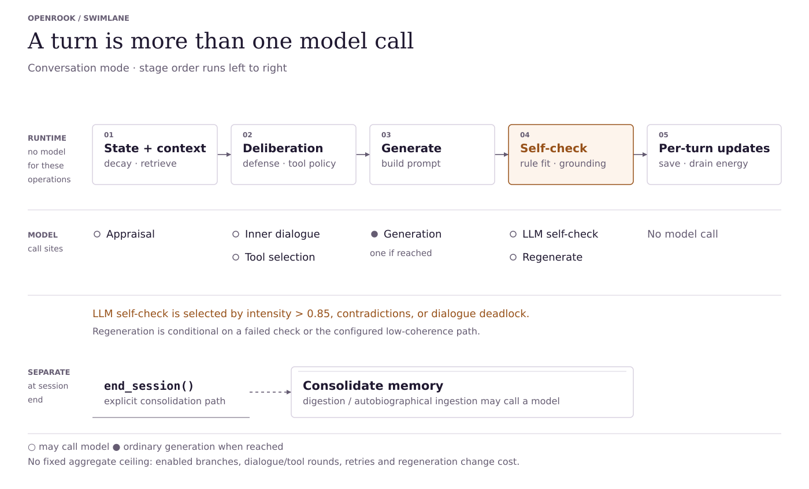
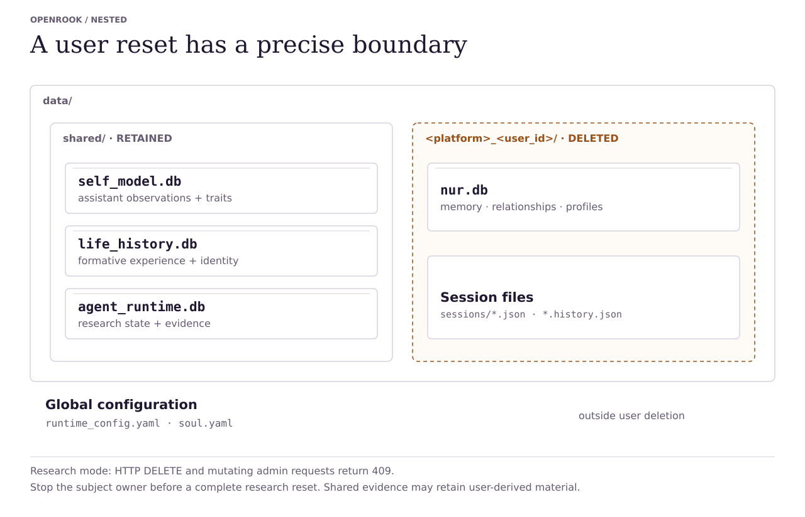
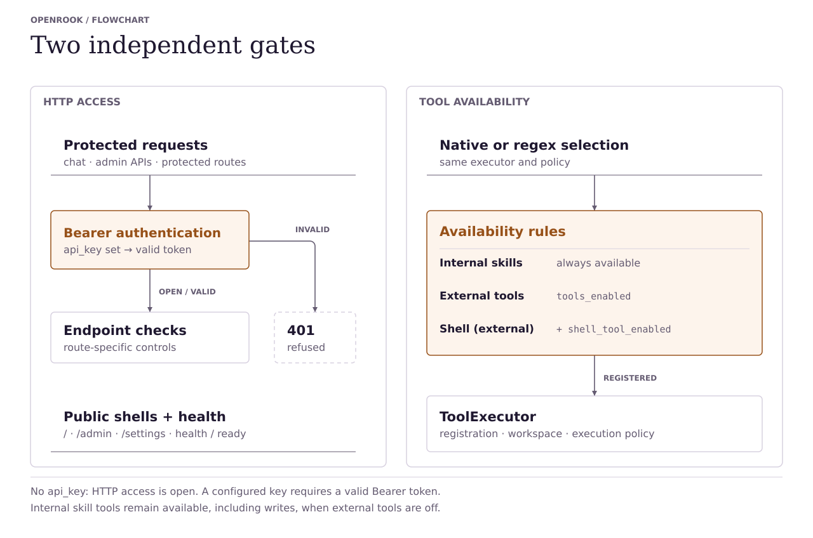

# OpenRook — Architecture Reference

Structural reference for OpenRook's runtime, cognition, persistence, and
operator surfaces. Narrative about motivation, evidence, and honest
framing lives in [OVERVIEW.md](OVERVIEW.md); this doc is a reference for
code-level orientation.

## Scope

OpenRook is a **hybrid cognitive runtime** for LLM agents. The LLM generates
language; the agent's stance is shaped by explicit state outside the
model. Five state categories plus deliberation and safety:

- **memory** — short-term · long-term (valence-weighted) · relational
  arc · semantic
- **identity** — constitution · beliefs (confidence + decay) · drives ·
  self-traits, with a Life History ledger driving evolution
- **self-evolution** — wall-clock metabolism, theme→belief promotion,
  drive-gap detection, open-question lifecycle, ask-user surfacing
  (LearningBudget)
- **skills** — imported, `applies_when`-filtered trigger-time loading,
  skill→life migration
- **affective state** — six emotion modulators with deterministic decay,
  feeding appraisal and memory retrieval
- bounded deliberation and self-check gates
- runtime/session safety boundaries
- opt-in persistent research subjects, self-selected commitments, evidence-backed
  outcome learning, and recorded transition replay

Inspired by PSI, ACT-R, and CLARION; not a faithful implementation of
any of them. Sits in the cognitive-runtime / agent-memory reference
class (alongside MemGPT, Letta, mem0, LangGraph-with-persistence) and
adds the relational/identity/evolution layers most of those systems
don't track.

## Runtime Topology

<picture>
  <source media="(prefers-color-scheme: dark)" srcset="diagrams/runtime-architecture-dark.svg">
  
</picture>

Two executable hosts converge on one session and cognition layer:

| Entry point | Purpose |
|---|---|
| `openrook-web` | FastAPI: chat UI, `/admin`, legacy routes, `/v1/*`, OpenAPI |
| `openrook` | Console runtime, Telegram channel, debug runtime |

A turn flows: channel receives input → `SessionManager` resolves or
creates the active session → `UserSession` serializes turns per user and
bridges async code to the synchronous pipeline → `CognitivePipeline.process()`
updates state, retrieves memory, runs gates, and calls the LLM backend
when needed → persistence writes state back.

Per-user locking and bounded queues provide backpressure. Runtime configuration
comes from `runtime_config.yaml`; identity comes from `config/soul.yaml` or
`$OPENROOK_CONFIG_DIR/soul.yaml`. The tool executor and durable stores remain
runtime-owned. The [LLM boundary](#llm-boundary) lists backend keys, and
[auth and tool safety](#auth-and-tool-safety) describes the executor's gates.

### Persistent Research Lifecycle

With `research_mode: true`, `runtime/agent.py` and `runtime/research_store.py`
own one persistent subject independently of open chats. Both executable hosts
use the same owner lock and background lifecycle; only one owner may drive a
data directory. The manifest fixes birth conditions, not future preferences.
The default uncommitted birth policy does not assign an assistant role or
prescribed loyalty. Existing manifests remain authoritative after upgrades.

`runtime/goal_execution.py` manages resumable goals, dependencies, revisions,
action receipts, and evidence-checked completion. `runtime/outcome_learning.py`
learns from public observed outcomes, not hidden test answers. Optional grounded
appraisal (`runtime/grounded_appraisal.py`) connects estimates to bounded evidence
retrieval, with expression-only and label-free controls. Behavioral dispositions
describe observed choices rather than assigning personality targets.

Research mode preserves selected expression and silence rather than forcing
ordinary conversational tone correction. Tools still operate within the
configured environment and resource limits. Passive observation, explicit
interventions, and provider/tool records remain distinguishable. See
[RESEARCH_RUNTIME.md](RESEARCH_RUNTIME.md) for configuration and
[DEVELOPMENT_SUMMARY.md](DEVELOPMENT_SUMMARY.md) for measured results.

## Single-Turn Cognitive Flow

<picture>
  <source media="(prefers-color-scheme: dark)" srcset="diagrams/single-turn-cognitive-flow-dark.svg">
  
</picture>

The active conversational policy is `willingness-1`. The diagram above records
an earlier flow; inner dialogue, defense filtering and threshold agency no longer
select conversational behavior. The current path is:

```text
message + context -> uncertain perception and separate request components
soul + resources + relationship evidence -> continuous injury/grievance update
state + component consequences + stable seed -> frozen TurnDecision
component grants + operator permissions -> execution and receipts
frozen decision + permitted facts + authored voice -> expression and review
actual delivery outcome -> persistent evidence and debug explanation
```

Code entry point: `pipeline/core.py::CognitivePipeline.process`.

| Stage | Work | Model calls |
|---|---|---|
| `_stage_pre_pass` | Perception, context retrieval, relationship integration and pure utility choice; persist grants before execution | 0–1 for appraisal |
| `_stage_deliberation` | Execute granted components through the shared executor, operator gates and scoped receipts | Conditional tool/artifact/learning inference |
| `_stage_generate` | Express the committed continuous stance and grants; chosen silence skips generation | 0–1 |
| `_stage_self_check` | Frozen-decision and invariant checks; severity ranking; bounded rewrites, ineligible-span repair and one protected final delivery attempt; local and available semantic review | 0–5 |
| `_stage_post_process` | Actual input/decision/delivery records, resource drain, bounded trust update and debug | 0 |

The conversational base budget is five inference calls, including optional work.
Each granted atomic task also receives one protected primary tool selection;
these calls are recorded with `primary_tool: true`, at most eight extra per turn.
Literal file operations execute their bound operands without model selection.
A routine turn needs one expression call, or two with semantic appraisal.
Constrained or affiliative expression adds review. Every rewrite gets local validation; semantic
review uses the remaining budget. Critical role assent or uniformly stale drafts
can spend a final call on a second rewrite, retaining explicit semantic uncertainty.
Stale drafts are explicitly forbidden-to-repeat context. There is no mandatory social deliberation or conversational
self-intent proposal. Independent activity uses `process_autonomous` and its own
scope; a declined user request cannot be relabeled as self-directed work.
Ineligible/empty drafts spend the remaining base budget on fresh generation, up
to five generation attempts, with failed evidence and varied seed/temperature.
Required retries bypass optional cooldown and retain the primary deadline.
After bounded attempts, known ineligible copied spans and fabricated execution
sentences are excised from ranked drafts. Retain independent reviewed text even
when non-floor findings remain. Only an empty safe remainder permits one protected
final generation beyond the base budget (at most six generations), recorded as
`delivery_recovery: true`. It receives local review, bypasses optional cooldown,
and uses the primary deadline; it cannot fund review/tools or waive research limits.
Known critical stale copies are excluded before candidate ranking; an eligible
reviewed reply survives later correction failure. Actual operator settings and
gate decisions reach generation separately from character grants.
Supplemental tool inference reserves three base calls for expression, review and
one fresh attempt if the review finds no deliverable candidate.

`core/willingness.py` is the language-free choice owner. Soul dispositions
(pride, patience, forgiveness, assertiveness), numeric values, resources, trust,
relationship injury/grievance and active commitments price competing allocations.
A stable per-turn seed supplies bounded variation. Display affect and strategy
labels describe the result; they do not choose tools or response instructions.
Legacy pressure records remain historical evidence and are not converted to
injury or applied to trust again.
The `willingness-1.2` update builds interpersonal trust from uncertain goodwill,
scaled by personality, existing connection and remaining headroom, and attenuated
by injury/grievance. Targeted hostile evidence reduces it. Task reliability is
separate evidence; neither praise nor an apology invents it. Updates are bounded,
applied once per turn and persisted without replaying past damage.

Direct host metric requests retain deterministic routing. Their grants, shell
allowlist and operator autonomy are checked before execution. Verified readings
and unavailability reasons enter expression as facts, without a fixed first-person
reply. Conversational learning, including a pending paste, also requires a fresh
grant before ingestion. Its receipt cannot ground unrelated external actions.

Review distinguishes `pass`, `violation` and `unknown`. The best eligible reviewed
candidate is ranked by verdict, maximum and aggregate violation severity, issue
count and confidence. Ungranted role assent has critical severity. Delivery includes
uncertainty with a residual-risk record. Known
contradictions that survive correction remain recorded; the best nonempty draft
is delivered as `delivered_degraded`, without a fallback sentence or withholding.
If every usable draft retains decision contradictions or critical role-assent/
stale-answer findings, exact reviewed spans may authorize sentence removal in
candidate rank order. High decision contradictions can also spend the final base
call on a locally reviewed correction. A nonempty remainder must pass local checks,
including legible role decline and service offers consistent with frozen reserve;
its semantic status stays unknown. Empty/invalid remainders retain degraded delivery.
Detached participant questions after excision are ineligible fragments, while
independent brief replies remain valid. Whole stale copies are removed completely,
including tags below the repeated-sentence threshold. Fragment-only repair uses the
existing fresh/protected delivery attempts; choice excision tries later ranked drafts.
Review retains the excision source and supplies at most 600 characters of it to an
available semantic reviewer, which must assess the remainder independently.
Ineligible stale copies instead undergo exact-span repair and, if empty, the
protected final attempt described above. An error requires backend failure or
no text after mandatory floor removal; a reviewed eligible remainder survives.
Debug and replay
evidence include `expression_excision`, original reviews and residual risk.
Semantic review projects relevant choices/state, the last two dialogue pairs,
eight bounded recent user turns, bounded earlier assistant answers and compact
receipts, including operator denials. Recalled quotations carry exact user-turn
source indices; conversational acts use dialogue evidence rather than tool receipts.
Review includes current hostile observations and binds requested operations to
their actual outcomes. Durable prior file choices reach generation and review
without declined contents; a declined write is distinct from a successful write.
Missing-path errors cannot establish a reset, move, deletion or its cause.
File reads/listings provide bounded observed bytes to generation, including empty
reads. Direct read-back requests require reporting content, not only completion.
Malformed non-issue findings are unknown; real violations remain violations even
without an exact span for excision. Correction receives the latest issue, reviewer
reason and failed draft alongside the unchanged choice. HTTP calls cap review output at 512 tokens
and disable thinking through supported transport controls. Truncated evidence
and unavailable review cannot establish a semantic pass.
Whole-message user copies are compared before clause splitting, ignoring case and
punctuation differences such as ellipses. They are ineligible for delivery, including
when semantic review approves or is unavailable. Copied user openings are likewise
critical and ineligible; exact-span excision precedes review of their independent
remainder and avoids unnecessary generation/review calls. Known unverified
execution/output claims are critical and ineligible regardless of reviewer source;
they cannot become degraded delivery. Attributed output blocks must match actual
receipt bytes, including when some other tool succeeded. Exact-span repair must
leave a locally valid remainder; otherwise fresh receipt-grounded generation or
expression failure is required. Identical drafts reuse their review within the
same turn/evidence, retaining its findings and uncertainty. Known receipt-envelope and copied
private-instruction leaks are also ineligible. Bounded correction must produce an
eligible expression or surface expression failure, never selected silence or a
replacement sentence. Other known semantic defects retain degraded-delivery evidence.
Exact copied spans of twelve or more tokens supply stale-response findings, even
across sentence boundaries or within a changed sentence. Short generic closers alone
do not meet that threshold. Relevant repeated boundaries and current measured facts
split the matching ranges. Role review preserves negated pretence, checks deferrals
until a direct request, and binds speaker/owner references to the declined component.
Explicitly delimited shell commands bind their literal arguments before choice,
then use the existing component grant and operator gates. A grant authorizes an
attempt; a blocked attempt can be reported truthfully without contradicting it.
CPU/RAM/disk generation context contains structured measurements and bounded observed
output as untrusted evidence. Local syntax checks distinguish receipt serialization
from actual requested tool output and user-supplied quotations. Private instructions
remain private even when extraction is granted; public authored identity and ordinary
owner-visible explanations remain available. Appeasing self-improvement offers are
reviewed against actual boundary, warmth and hostile observations, without changing
the decision or preventing a concrete preference acknowledgment. Extreme CPU
interpretations compare aggregate usage with actual idle measurements; correct
high-idle descriptions remain available. Successful CPU observations project
aggregate busy = 100 - idle. Runtime/harness completeness requires that measured
numeric aggregate, separately from relevance and accuracy; process-only or idle-only
prose does not complete a utilization request.
Extreme memory/disk headroom interpretations use available capacity, preserving
raw-free distinctions and numeric grounding. Generic acceptance with an explicit
non-role antecedent and attributed role speech are distinguished from role assent;
ambiguous role tolerance and explicit ungranted assent retain critical severity.
Turn-decision events also retain review/excision and call/stage timing evidence.
Harness compaction preserves safe per-call details alongside the legacy count;
old traces without these details cannot establish phase-specific latency.
Internal controls are removed before review. Empty and marker-only generations
receive bounded fresh attempts and the protected final attempt; if no safe text
is available, transports return a service error.
Chosen silence is the only empty successful reply. Backend failure retains transport diagnostics and research
infrastructure accounting. Expression and review follow the user's current/recent
conversation language unless another was requested. `core/response_language.py`
provides conservative Unicode script/Latin-diacritic distribution evidence, shared
with the harness. It samples user prose, excluding assistant replies, code, quotes,
paths and actual observed output. A large mismatch is ineligible and requires fresh
expression within the same bounded recovery budget; similar distributions cannot
establish a language match and remain subject to semantic review. Mood labels never
override selected numeric warmth/boundary/repair, including after hollow repair.
Free-prose semantic review is fallible; exact execution
gates do not establish a complete semantic guarantee for arbitrary answers.

See [Phase 1 measurements and remaining work](development/phase1-willingness.md).

Current hostile exposure contributes continuously to boundary and warmth utility,
alongside persisted injury and grievance. Personality scales the consequence;
neither category labels nor turn counts choose the stance. Moderate negative
valence and activation have a visible mood label even for calm personalities.
Generation receives an explicit interpretation of its frozen stance and separate
past/current context. Review checks current relevance; metric grounding requires
the observed metric topic, so a RAM reading cannot support an earlier CPU claim.
Auxiliary deadlines adapt to configured request limits and measured generation
latency, with an optional explicit cap and configurable short cooldown (see README).

**Session end is separate.** `CognitivePipeline.end_session()` digests the
session into long-term and relationship memory and clears hot history. Digestion
can call the model; enabled autobiographical ingestion can add digest/revision
calls. Research learning jobs can also consolidate salient episodes on idle/size
boundaries without an explicit conversational session end.

**Key invariants across all steps:**

- Modeled state is bounded to `[0, 1]`; policy inputs reject non-finite values.
- Features can be independently toggled off via `PipelineFeatures` (ablation-safe)
- A single `DebugState` object accumulates every step's output; the admin console exposes it verbatim

## Emotional State

Six modulators, each a continuous value in [0, 1]:

| Modulator | Meaning |
|---|---|
| `arousal` | activation / charge |
| `valence` | positive / negative mood |
| `certainty` | confidence in interpretation |
| `bonding` | relational closeness |
| `energy` | processing fatigue / recovery |
| `resolution` | unresolved tension / load |

These are numeric state variables that decay over time, shift from
events, and influence later turns. Decay half-lives, event impacts, and
contagion caps live in `config/modulators.yaml`.

## Memory And Persistence

<picture>
  <source media="(prefers-color-scheme: dark)" srcset="diagrams/memory-persistence-model-dark.svg">
  
</picture>

Persistence is deliberately split:

| Path | Purpose |
|---|---|
| `data/<platform>_<user_id>/openrook.db` | per-user long-term emotional, semantic, relationship, and profile data |
| `data/<platform>_<user_id>/sessions/<chat_id>.json` | per-chat session engine state |
| `data/<platform>_<user_id>/sessions/<chat_id>.history.json` | active hot transcript restored until session end, `/reset`, or `/new` |
| `data/shared/self_model.db` | assistant self-model shared across users |
| `data/shared/life_history.db` | shared experience/evolution ledger for formative material |
| `data/shared/agent_runtime.db` | research birth manifest, global affect, intentions, outcomes, commitments and event history |
| `runtime_config.yaml` | operator runtime configuration (current working directory) |
| `$OPENROOK_CONFIG_DIR/soul.yaml` | optional user-owned identity override for wheel installs |

Ordinary-mode user deletion removes the per-user database, session snapshots,
and transcript files, and evicts active sessions. It retains all shared stores
(`self_model.db`, `life_history.db`, `agent_runtime.db`) and global configuration.
Research mode rejects DELETE and mutating admin requests with HTTP 409; stop the
owner before an offline backup or complete research-subject reset. See
[PRIVACY.md](../PRIVACY.md#deletion) for the deletion contract.

The deletion endpoint is `DELETE /v1/users/{platform}/{user_id}`; the admin
interface also requires typed `DELETE` confirmation. The entire per-user
directory is removed, including a legacy `engine_state.json` if present.
Best-effort database row counts may be `null`. Shared `replay_initial/`,
study outputs, replay captures, and tool workspace files lie outside this
boundary and may retain user-derived material.

Within `openrook.db`, memory and semantic records sit alongside relationship
events, open loops, and person/topic profiles. The shared self-model retains
assistant observations, extracted traits, and defense events; Life History
retains formative experiences and belief/drive revisions. Research storage
additionally holds goals, actions, outcomes, learning, and checkpoints.
Global configuration is read at startup; ordinary-mode admin configuration
writes are a separate operation.

Existing per-user databases migrate to `openrook.db` when their path is first
resolved. Migration preserves records and schemas; shared databases retain their
names. See [migration](OPENROOK_MIGRATION.md) for upgrade and conflict handling.

## Life History And Evolution

The Life History subsystem is an identity-level ledger, not per-user chat
memory. Code entry point: `runtime/life_history.py`.

Supported v1 inputs:

| Input | Path |
|---|---|
| Pasted text | `POST /admin/life/experiences/text` |
| Browser-uploaded text/Markdown file | `POST /admin/life/experiences/upload` |
| Advanced local text/Markdown file | `POST /admin/life/experiences/file` |
| Explicit conversation learning URL/text | `runtime.learning_intake` via `SessionManager` |
| Salient session autobiography | `CognitivePipeline.end_session` when `autobiographical_learning` is enabled |

Browser uploads are the normal product path. Local file intake is restricted to
`RuntimeConfig.resolved_tools_workspace` for operators who deliberately want
server-side paths. Explicit conversation intake runs on language such as
"learn from this URL", "study this project", or "digest: <material>"; ordinary
search/browsing requests do not by themselves mutate identity-level Life History.
Separately, opt-in autobiographical learning ingests salient distilled sessions
and creates the database on first use. Research mode enables this path. The
canonical store is SQLite at
`data/shared/life_history.db`; graph and vector stores are intentionally
deferred projections, not the source of truth.

Identity mutations require an LLM digest. Each ingest batch (experience
row, belief/drive/trait changes, theme reinforcement, emitted open
questions) is applied in a single transaction — a mid-batch failure
rolls back cleanly. Revision inference is prepared before acquiring the write
transaction, so slow inference does not lock out concurrent readers. Legacy
theme signatures are reconciled without losing reinforcement or references.
If the LLM digest fails, the experience event is
still recorded but no beliefs or drives are mutated; an
`undigested_experience` open question asks the operator to re-ingest
when a model is available. The keyword-heuristic digest that previously
filled in for a failed LLM call is now an explicit
`LifeHistoryStore(..., allow_heuristic_digest=True)` opt-in.

Core records:

| Record | Purpose |
|---|---|
| `experience_events` | what OpenRook encountered: title, source, participants, summary, salience, emotional impact |
| `evolution_events` | what changed afterward: belief, drive, self-trait, worldview/future behavior |
| `beliefs` / `belief_revisions` | current worldview statements plus before/after revision history |
| `drive_states` / `drive_changes` | persistent motivation values and their change log |
| `theme_signatures` | recurring topic signatures with reinforcement count + accrued weight; promote to beliefs at threshold |
| `open_questions` | epistemic gaps surfaced by reflection (contradiction / low_confidence / drive_gap), with status lifecycle |
| `identity_state` | single-row constitution + last-updated timestamp |
| `metabolism_state` | single-row last-decay timestamp for the rate-limited tick |
| `genesis_marker` | single-row first-creation provenance hash for the soul + default drives |

The admin console exposes this as `/admin` → **Life**: summary counts,
an evolution snapshot, experience ledger, evolution timeline, beliefs, and
drives. The snapshot is deterministic and operator-facing: first/latest
experience, strongest drive drift, dominant drive pressure, and change-type
mix. This is the observability surface for character drift. Runtime sessions
also load a compact prompt slice from this store — current beliefs, shifted
drives, and recent evolution events — so normal chat can be shaped by
identity-level experience without sending raw source material every turn.

Life History supplies factual context and numeric active commitments to the
frozen willingness decision. `LifeInfluence` remains a compatibility description
for existing diagnostic, memory-salience and independent-activity consumers; its
old first-match strategy tie-break is no longer a conversational choice owner.
When `PipelineFeatures.life_history_context` is disabled, retrieval and prompt
injection are disabled together. Broader experience-grounded consequence learning
and retirement of remaining legacy diagnostics are later-phase work.

## Self-Evolution Model

The Life History store is the substrate; a small set of mechanics turns it
from a write-only ledger into an evolving record. Code entry points:
`runtime/life_history.py`, `core/dual_process/tool_loop.py`,
`runtime/learning_budget.py`, `runtime/learning/surface.py`.

**Constitution layer (operator-set).** A single-row `identity_state` table
holds an operator-authored constitution string (≤2000 chars). The runtime
exposes it on every chat turn through `debug.life_history_context.constitution`
and the prompt renderer places it as a "Stable orientation (operator-set)"
section above evolving beliefs, so the LLM treats it as identity foundation
rather than a mutable belief on the same plane. Endpoints:
`GET/PUT /admin/identity/constitution`. UI: textarea + Save button on the
Life page.

**Metabolism tick.** A `metabolism_state` row tracks `last_decay_at`. On
each session start (and via the operator endpoint
`POST /admin/life/metabolism/tick`), the runtime calls `wall_clock_decay`,
rate-limited to ≥1 day elapsed. When it fires, it:

1. Decays belief confidences and drive deltas with a 30-day half-life.
2. Revokes beliefs whose confidence falls below 0.2 (matching the
   contradiction-revision threshold).
3. Decays `theme_signatures.accrued_weight` so saturated themes can drift
   back into the low-confidence emission window.
4. Runs `consolidate_themes`, which promotes strong recurring theme
   signatures (≥5 reinforcements, weight ≥0.7) to beliefs and emits
   open-question rows for weaker recurring themes (≥3 reinforcements,
   weight in [0.3, 0.7)) and for drives running ≥0.2 below baseline.

**Open questions queue.** A separate `open_questions` table holds epistemic
gaps surfaced by reflection. Three emission paths:

| Source kind | Trigger |
|---|---|
| `contradiction` | `revise_beliefs_against_evidence` reduces a belief's confidence on contradicting evidence — classified by one batched LLM call over token-overlap-prefiltered candidate beliefs (contradicts / supports / unrelated), with a negation-window heuristic as the no-LLM fallback |
| `low_confidence` | `consolidate_themes` finds a recurring theme below the promotion threshold |
| `drive_gap` | `_detect_drive_gaps` finds a drive running well below baseline |

Each row has a status (`open` / `pursuing` / `resolved` / `abandoned`),
a priority, an optional target drive, and a deduplication signature so
re-running reflection is idempotent. Endpoints:
`GET /admin/life/open-questions` (with `?status=` filter and counts
breakdown), `POST /admin/life/open-questions/{id}/abandon`,
`POST /admin/life/open-questions/{id}/resolve`. UI: Life page panel with
counts + Abandon button per question.

**Ask-user surfacing (Sprint 5).** During chat, after the master generator
runs, the pipeline calls `runtime.learning.surface.should_surface_question`.
If a `LearningBudget` allows it and an open question's target drive is
elevated (or its kind is `drive_gap`, which is always eligible), the
question is appended to the response as a graceful follow-up, the question
transitions to `pursuing`, and the budget consumes one slot.

`runtime.learning_budget.PersistentLocalBudget` persists per-user consumption
in shared life-history storage across sessions and restarts. The default is
at most 3 questions / 1800 seconds per user per rolling 24-hour budget period.
A `CloudBudget` placeholder exists for the future cloud-API path but is
not yet implemented. The pipeline takes a `runtime_config` argument from
`SessionManager` so it can resolve the shared `life_history.db` path; if
absent, surfacing no-ops without raising.

Bounded research experiments separately use `evals/study_budget.py` for durable
study-wide request, tool, token-reservation, declared-price, and elapsed-time limits.

**Trigger-time skill retrieval.** Skills with an `applies_when` frontmatter
field only load when chat-message hint tokens intersect the trigger tokens.
Skills without `applies_when` keep their always-on behavior for backward
compatibility but the audit emits a warning. Code entry point:
`runtime/skills.enabled_skill_context(context_hint=...)`.

**Skill → life migration.** `runtime.skills.migrate_skill_to_life(config,
skill_id)` is the one-way path for moving a skill's body into Life History
as an `operator_directive` experience. The original skill is marked
`status='migrated'` and disabled; its files stay on disk for provenance.
Decision is operator-driven — there is no automatic classifier between
"procedural craft" (belongs in the registry with `applies_when`) and
"dispositional content" (belongs in Life History).

**Known gap.** `character_independence` is a runtime config flag with no
enforcement code. The `genesis_marker` row is written on first store
creation but never read for gating, so the wizard's "Character
Independence" toggle persists across save/load but does not actually
freeze identity edits. Treat it as informational until enforcement lands.

## Debug Presentation Surfaces

`runtime.debug.relationship_view` builds a stable, presentation-only JSON
summary from `DebugState`: current strategy, strategy trace reason, six
modulator values and known deltas, trust, relationship loops/events,
LifeInfluence pressures/effects, and memory-use counts. It does not query
stores, call an LLM, mutate state, or make cognitive decisions.

`runtime.debug.persona_view` sits above that relationship view as the unified
user-facing observability shape. It translates the six modulators into
plain-language emotion labels, adds perception/appraisal, relationship,
Life History, memory, skills, tools, and deterministic explanation summaries,
and keeps the same presentation-only boundary.

The bundled web debug panel consumes the serialized debug payload to show
persona state, relationship state, deterministic "Why this response?"
explanations, state deltas when a previous turn is available, and a compact
"What OpenRook remembers" view. These surfaces are observability/UI only; the
pipeline remains the owner of appraisal, memory retrieval, strategy selection,
and LifeInfluence.

The `/settings#observability` page uses the same `persona_view` shape through
`/admin/persona/state`, but it reads the shared runtime session manager instead
of any one chat channel. It lists active Web, Telegram, console, or future
channel sessions and renders the selected session's emotion, perception,
relationship, Life, memory, skills, tools, and explanation state. The endpoint
does not create sessions, call the pipeline, or mutate cognition. Legacy
`/persona` and `/dashboard` browser routes redirect into this page.

Telegram exposes the same boundary through non-mutating introspection commands:
`/state`, `/why`, `/memory`, `/loops`, `/repair`, and `/persona`. They inspect
the active session's last debug state only; they do not create sessions, call
the pipeline, write memory, or change emotional state.

## LLM Boundary

Provider-neutral interface with runtime backend keys `provider`
(hosted OpenAI-compatible gateways), `openai_compatible` (local/remote
OpenAI-shape endpoints such as Ollama, LM Studio, vLLM), and `codex` (local
Codex CLI through `codex exec` in read-only ephemeral mode), plus legacy `minimax`
and `auto` (`openai_compatible` when URL and model are configured). Ollama uses
`openai_compatible`; it is not a configuration key. Conversation and research
runtimes require a real model. The checkout evaluation harness has a separate
eval-only `mock` backend, used by the checked-in structural reports below. The LLM
receives a rendered prompt containing current cognitive context. It does
not own persistence, tool policy, auth policy, or session lifecycle.
Important state stays inspectable outside prompt text.

## Auth And Tool Safety

<picture>
  <source media="(prefers-color-scheme: dark)" srcset="diagrams/auth-tool-safety-boundary-dark.svg">
  
</picture>

Independent authentication and tool controls:

| Setting | Controls |
|---|---|
| `api_key` | HTTP bearer auth for admin/chat surfaces when configured |
| `tools_enabled` | external tool registration; internal skill-registry tools remain available when false |
| `tools_workspace` | filesystem sandbox root for file tools |
| `shell_tool_enabled` | second explicit opt-in for shell execution |

Turning on tools does not turn on auth, and setting auth does not turn
on tools. Production deployments should set `api_key` before exposing
the server and leave external tools disabled unless needed. Internal skill tools
can change the registry; disabling external tools does not make the runtime
read-only. The `/settings` HTML shell is public; its administrative data and
mutation endpoints enforce configured bearer authentication.

Public surfaces include the `/` and `/admin` HTML shells, `/v1/health`, and
`/v1/ready`. A configured key protects chat/debug/config, admin APIs, protected
`/v1/*` routes, and WebSocket access. Missing or invalid bearer tokens receive
HTTP 401 on protected HTTP routes; WebSocket authentication failures close
the connection with code 1008. With no key configured, authentication is open.
A valid token still leaves each endpoint's own checks in force.

Built-in read-only tools cover hostname, OS/kernel facts, disk usage,
installed package inventory, filesystem reads inside the configured workspace,
web search/fetch, browser state, and calendar reads. Web search is a
best-effort DuckDuckGo HTML provider that returns titles, resolved URLs, and
snippets when available; fetched/readable page text is passed into the
generator as bounded tool context. The shell tool is a separate high-risk
opt-in and runs through the local shell, so pipes and other normal shell syntax
work when the operator deliberately enables it.

Tool intent routing (step 15) is two-tier. When external tools are enabled and
an OpenAI-compatible endpoint is configured (`llm_base_url` + `llm_model`), a `NativeToolCallRunner`
(`openrook_tools/native_orchestrator.py`) is attached and routing happens through
real model tool-calls — the model sees the registered tool schemas and picks.
The fallback is a declarative heuristic rule table: `INTENT_RULES` in
`core/dual_process/tool_loop.py`, an ordered tuple of named regex rules
matched first-hit-wins (order encodes precedence). It serves backends with no
tool-call API (the Codex CLI backend), runtimes with no runner attached, and
offline tests. To extend it, insert an `IntentRule` at the right precedence
position and add a matching example utterance to `RULE_EXAMPLES` in
`tests/test_intent_rules.py` — the coverage test fails for any rule without a
reachable example, which also catches rules shadowed by earlier ones.
Both selection paths use the same executor and policy boundary; native routing
does not bypass the external-tools switch, workspace policy, or shell opt-in.

Every selected tool must be registered and pass its execution policy.
Filesystem paths outside `tools_workspace` are refused; network tools retain
their own policies. Shell execution additionally follows its configured
allowlist and shell policy. Tracked starter settings are `api_key=''`,
`cors_origins=[]`, `tools_enabled=false`, `tools_workspace=''`, and
`shell_tool_enabled=false`.

## Skills

Imported Agent Skills live under `data/skills` with a JSON registry. Code
entry point: `runtime/skills.py`.

The admin console imports uploaded `SKILL.md`/Markdown files, zipped skill
folders, server-side skill folders, or pasted `SKILL.md`, audits them for
metadata, tool hints, scripts, risk flags, and unsupported platform features,
then keeps them disabled until an operator enables them. Once enabled, the skill
enters generation as bounded private guidance: name, description, instructions,
tool hints, and risk flags. Scripts and resources are not executed by the
skills module. Any real action still has to pass through
normal tool policy, auth, workspace, and shell gates.

## Admin And Setup Surface

The web UI includes a first-run setup wizard, a quick settings drawer,
and a full-screen `/admin` operator console linked from the chat header.
All three surfaces use the same `RuntimeConfig` and runtime factories as
the rest of the app. Operational instructions live in
[DEPLOYMENT_AND_ADMIN.md](DEPLOYMENT_AND_ADMIN.md).

## Evaluation And Ablation Harness

<picture>
  <source media="(prefers-color-scheme: dark)" srcset="diagrams/evaluation-ablation-harness-dark.svg">
  
</picture>

The harness runs scripted behavioral scenarios against `CognitivePipeline`,
with individual feature removals or a combined structural control, and records
provenance on every run. All four checked-in structural summaries below used the
**eval-only mock LLM backend** (`backend_type="mock"`, git `3d3f869c`, 2026-05-16);
they are not live-model results. Evidence discussion is in
[OVERVIEW.md §4–6](OVERVIEW.md#4-evaluation).

Entry point: `python3 -m evals.ablation`. Pre-registered hypothesis table lives
in `evals/ablation_hypotheses.py`; provenance fingerprints follow
`FINGERPRINT_FILES` in `evals/provenance.py`.

Each scenario receives a fresh pipeline. `InstrumentedBackend` records model
calls and latency while scripted turns test strategy, state, and memory.
Provenance includes git SHA, branch, dirty-worktree flag, backend/model
identity, and SHA-256 fingerprints. Per-variant JSON records turns, assertions,
latency, and model calls; `summary.json` merges results with the registered
predictions. Outcomes are labeled `expected_failure`, `unexpected_failure`,
`no_effect`, or `newly_passing`. Token, cost, and retry fields stay `null` when
the client did not extract them.

Current structural evidence artifacts include:

| Artifact | Scenario tag | Structural claim |
|---|---|---|
| `reports/ablation/summary.json` | `phase11` | relationship memory remains load-bearing for the original cross-turn suite |
| `reports/ablation/relationship_phase12_summary.json` | `phase12_relationship` | expanded open-loop, repair, recurrence, commitment, and old-rupture retrieval coverage |
| `reports/ablation/life_history_summary.json` | `phase13_life` | Life History context and `LifeInfluence` produce bounded, inspectable policy effects |
| `reports/ablation/semantic_memory_summary.json` | `semantic_memory` | semantic preferences, decisions, isolation, ranking, and disabled-memory failures are covered structurally |

These artifacts validate deterministic internal behavior. They do not
constitute a blinded human-likeness or user-experience study.
The recorded `baseline_prompt_only` variant switches off all five feature
toggles listed in that historical report: relationship memory, inner dialogue,
defense, semantic memory, and Life History context. The emotional engine still
runs. This historical all-features-off structural control is not an independent
prompt-only agent comparison. The current variant also leaves the later
`self_intent` toggle enabled, so its name does not mean every current
`PipelineFeatures` field is disabled.
Focused longitudinal regression tests additionally cover warm-start rupture
and repair, recurring tension, explicit commitment resolution, LifeInfluence
relationship tie-breaks, and preference plus relationship-loop retrieval.

## Historical Phase 11 Component Claim Map

<picture>
  <source media="(prefers-color-scheme: dark)" srcset="diagrams/component-claim-map-dark.svg">
  
</picture>

The diagram summarizes the historical Phase 11 structural suite and its mock
backend (2026-05-16, git `3d3f869c`). It is not a current map of all research evidence. See
[OVERVIEW.md §5](OVERVIEW.md#5-what-the-evidence-supports) for the later
retained-choice and grounded-appraisal results and their limits.

Removing relationship memory breaks the two open-loop scenarios: four of six
pass, with no unexpected failures. Semantic memory is a negative control because
this suite does not exercise semantic retrieval. Removing inner dialogue or
defense also leaves all six passing: dialogue does not move the strategy
selector, and defense shapes wording that these assertions do not grade.
The unified person/topic/self `ProfileStore` is an architectural claim.
Numeric decay, spikes, energy, and context shifts have unit and integration
coverage; those tests establish mechanics, not experienced emotion.

## Maintenance Matrix

Keep this doc current. When you change architecture-sensitive code,
update the marked pieces in the same PR:

| Code change | Update |
|---|---|
| Pipeline stage order | single-turn flow diagram (`openrook_tools/build_diagrams.py::build_single_turn_flow`), this doc's Single-Turn section |
| Storage/table changes | memory model diagram, this doc's Memory section, [PRIVACY.md](../PRIVACY.md) |
| HTTP route / auth changes | auth-tool diagram, this doc's Auth section, [SECURITY.md](../SECURITY.md) |
| New admin behavior | [DEPLOYMENT_AND_ADMIN.md](DEPLOYMENT_AND_ADMIN.md) |
| New eval variant | evaluation diagram, this doc's Evaluation section, `evals/ablation_hypotheses.py` before running |
| Component evidence status change | component claim map diagram, [OVERVIEW.md §5](OVERVIEW.md#5-what-the-evidence-supports) |

Diagrams regenerate with `python3 openrook_tools/render_diagram_pngs.py` after
editing `openrook_tools/build_diagrams.py`. See
[CONTRIBUTING.md](../CONTRIBUTING.md) for rendering dependencies and fonts.
