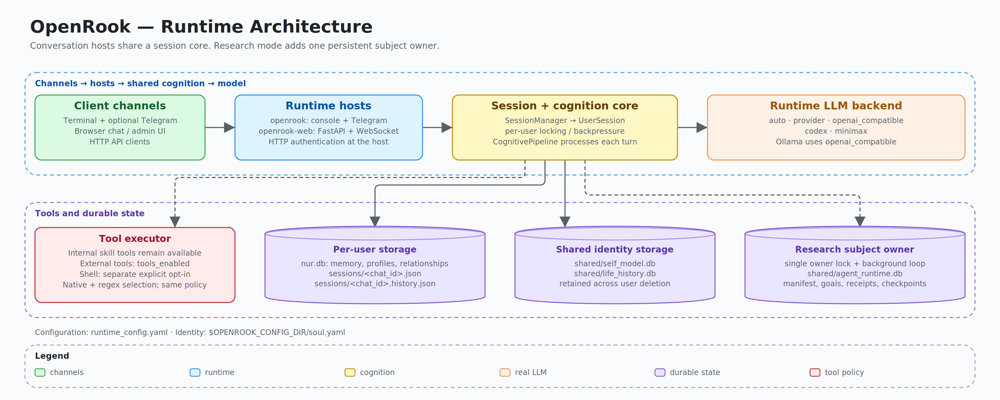
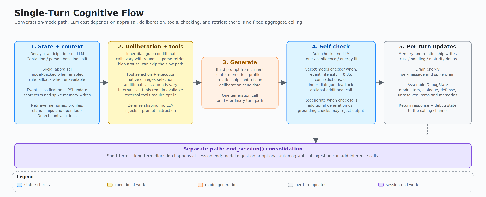
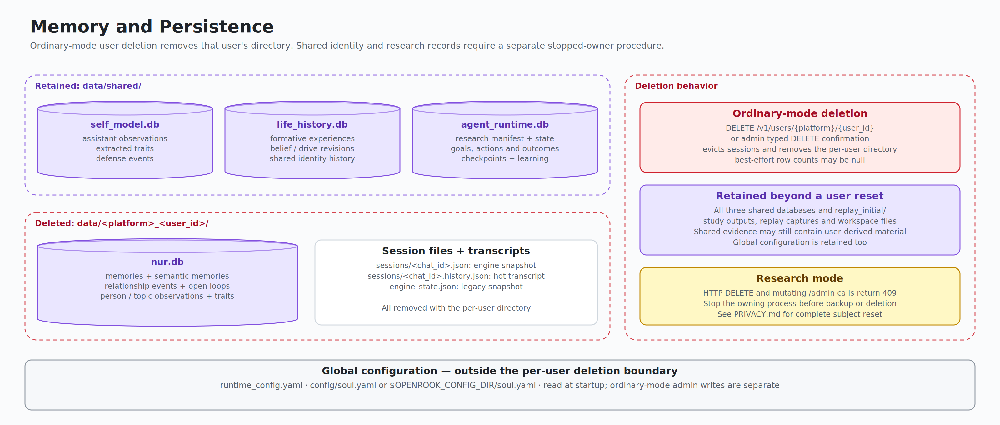
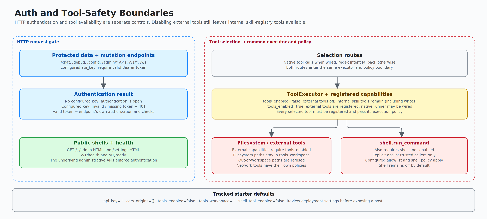
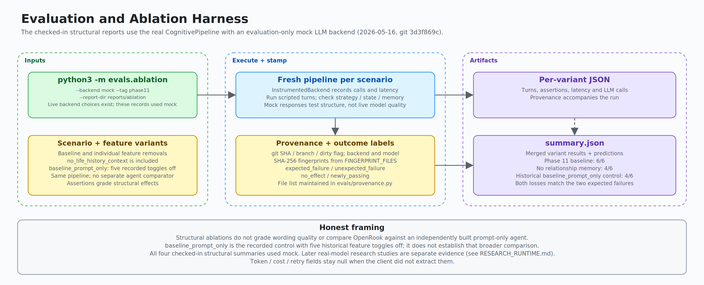
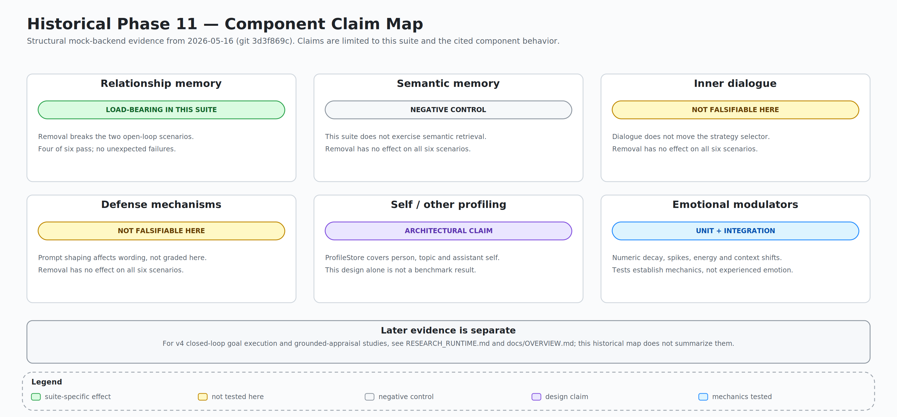

# OpenRook — Architecture Reference

Structural reference for OpenRook's runtime, cognition, persistence, and
operator surfaces. Narrative about motivation, evidence, and honest
framing lives in [OVERVIEW.md](OVERVIEW.md); this doc is a reference for
code-level orientation.

## Scope

OpenRook is a **hybrid cognitive runtime** for LLM agents. The LLM generates
language; the agent's stance is shaped by explicit state outside the
model. Five state categories plus deliberation and safety:

- **memory** — short-term · long-term (valence-weighted) · relational
  arc · semantic
- **identity** — constitution · beliefs (confidence + decay) · drives ·
  self-traits, with a Life History ledger driving evolution
- **self-evolution** — wall-clock metabolism, theme→belief promotion,
  drive-gap detection, open-question lifecycle, ask-user surfacing
  (LearningBudget)
- **skills** — imported, `applies_when`-filtered trigger-time loading,
  skill→life migration
- **affective state** — six emotion modulators with deterministic decay,
  feeding appraisal and memory retrieval
- bounded deliberation and self-check gates
- runtime/session safety boundaries
- opt-in persistent research subjects, self-selected commitments, evidence-backed
  outcome learning, and recorded transition replay

Inspired by PSI, ACT-R, and CLARION; not a faithful implementation of
any of them. Sits in the cognitive-runtime / agent-memory reference
class (alongside MemGPT, Letta, mem0, LangGraph-with-persistence) and
adds the relational/identity/evolution layers most of those systems
don't track.

## Runtime Topology

Two executable hosts converge on one session and cognition layer:

| Entry point | Purpose |
|---|---|
| `openrook-web` | FastAPI: chat UI, `/admin`, legacy routes, `/v1/*`, OpenAPI |
| `openrook` | Console runtime, Telegram channel, debug runtime |

A turn flows: channel receives input → `SessionManager` resolves or
creates the active session → `UserSession` serializes turns per user and
bridges async code to the synchronous pipeline → `CognitivePipeline.process()`
updates state, retrieves memory, runs gates, and calls the LLM backend
when needed → persistence writes state back.

### Persistent Research Lifecycle

With `research_mode: true`, `runtime/agent.py` and `runtime/research_store.py`
own one persistent subject independently of open chats. Both executable hosts
use the same owner lock and background lifecycle; only one owner may drive a
data directory. The manifest fixes birth conditions, not future preferences.
The default uncommitted birth policy does not assign an assistant role or
prescribed loyalty. Existing manifests remain authoritative after upgrades.

`runtime/goal_execution.py` manages resumable goals, dependencies, revisions,
action receipts, and evidence-checked completion. `runtime/outcome_learning.py`
learns from public observed outcomes, not hidden test answers. Optional grounded
appraisal (`runtime/grounded_appraisal.py`) connects estimates to bounded evidence
retrieval, with expression-only and label-free controls. Behavioral dispositions
describe observed choices rather than assigning personality targets.

Research mode preserves selected expression and silence rather than forcing
ordinary conversational tone correction. Tools still operate within the
configured environment and resource limits. Passive observation, explicit
interventions, and provider/tool records remain distinguishable. See
[RESEARCH_RUNTIME.md](RESEARCH_RUNTIME.md) for configuration and
[DEVELOPMENT_SUMMARY.md](DEVELOPMENT_SUMMARY.md) for measured results.

## Single-Turn Cognitive Flow

Call count depends on the enabled perception, appraisal, deliberation,
generation, verification, and tool paths; model-based appraisal adds inference
and falls back on failure. Ordinary conversational turns do not have a single
fixed call count. Bounded research protocols enforce explicit study-wide
request and time reservations, including failed attempts and configured retries.

Code entry point: `pipeline/core.py::CognitivePipeline.process`.

<strong>Detailed flow (19 steps)</strong>

The presentation "five stages" framing is now explicit in the code:
`CognitivePipeline.process()` (`pipeline/core.py`) is a short
orchestrator over five stage methods — `_stage_pre_pass`,
`_stage_deliberation` (with `_run_tool_stage` / `_run_self_intent_stage`),
`_stage_generate`, `_stage_self_check`, `_stage_post_process` — with
per-turn state carried in a `_TurnState` dataclass. The 19 ordered
steps below live inside those stage methods, each with its LLM cost,
code anchor, and what it produces.

| # | Name | LLM calls | Code anchor | Output |
|---|---|---|---|---|
| 0 | **Auto-decay** | 0 | `pipeline/core.py` | Wall-clock elapsed applied to all six modulators via `engine.decay(elapsed)` |
| 1 | **Anticipation** | 0 | `pipeline/core.py` | Predicted event type + pre-shift applied to modulators before input is processed |
| 2 | **Contagion** | 0 | `pipeline/core.py` | `detected_emotion` (arousal + valence); trust-weighted update to engine state |
| 3 | **Life history retrieval** | 0 | `pipeline/core.py` | `life_history_context` dict (beliefs, drives, recent evolution); `LifeInfluence` derived |
| 4 | **Appraisal** | 0–1 | `pipeline/core.py` | `AppraisalFrame`: intent, stakes, urgency, affect, inferred_intent, social_move — biased by life history |
| 5 | **Context switch** | 0 | `pipeline/core.py` | Per-user `baseline_shift` applied as non-additive resting target to modulator engine |
| 6 | **Event classification + PSI update** | 0 | `pipeline/core.py` | `event_classified`, `event_intensity`, `is_spike`; all six modulators updated |
| 7 | **Resolution update** | 0 | `pipeline/core.py` | New unresolved items checked; `active_unresolved` count updated |
| 8 | **Short-term memory** | 0 | `pipeline/core.py` | Event recorded in ring buffer (`ShortTermMemory`) |
| 9 | **Spike check** | 0 | `pipeline/core.py` | If `is_spike`: immediate `LongTermEntry` stored with `spike=True`, bypassing gradual accumulation |
| 10 | **Long-term memory retrieval** | 0 | `pipeline/core.py` | Up to 5 `LongTermEntry` objects ranked by ACT-R activation + valence bias + spike bonus |
| 11 | **Profile lookup** | 0 | `pipeline/core.py` | `person_profile`, `self_profile`, `relationship_context`, `semantic_memories` |
| 12 | **Contradiction check** | 0 | `pipeline/core.py` | Person/self expectation violations detected; wired to resolution as new unresolved items |
| 13 | **Derived affect + agency** | 0 | `pipeline/core.py` | `affect_state` classification; `agency_decision` (slow\_down / direct\_down / proceed) |
| 14 | **Inner dialogue** | variable | `pipeline/core.py` | Resolution/tension gates select skipped, fast-only, or multi-round deliberation; slow-path parse retries add calls; deadlock → new unresolved item |
| 15 | **Tool / self-intent paths** | variable | `pipeline/core.py` | Native or regex tool selection and optional model-proposed self-intents → policy gates → execution; tool + task memory coupling |
| 16 | **Defense filter** | 0 | `pipeline/core.py` | Defense activation (suppression, projection, displacement) gated by `maturity` score |
| 17 | **Master generation** | 1 if reached | `pipeline/core.py` | Assembles system prompt (constitution + life history + memories + character vector) → LLM call → response text |
| 18 | **Self-check + per-turn writes** | 0–2 | `pipeline/core.py` | Optional LLM self-check and corrective generation; semantic/history writes, trust update, energy drain, debug trace |

These are conditional path costs, not an aggregate ceiling. Ordinary-mode LLM
self-check is selected when event intensity exceeds 0.85, contradictions exist,
or inner dialogue deadlocks; rule-check failures do not select the checker.
Research mode preserves selected expression and uses grounding checks without
this corrective generation path.

**Session end is separate.** `CognitivePipeline.end_session()` digests the
session into long-term and relationship memory and clears hot history. Digestion
can call the model; enabled autobiographical ingestion can add digest/revision
calls. Research learning jobs can also consolidate salient episodes on idle/size
boundaries without an explicit conversational session end.

Note: the `#` column above is positional (0–18); code comments in
`pipeline/core.py` use the historical step numbering (e.g. master
generation is "Step 14" in the code).

**Key invariants across all steps:**
- All modulator deltas are double-clamped: per-event cap + `[0, 1]` hard bounds (`core/emotional_engine.py`)
- Features can be independently toggled off via `PipelineFeatures` (ablation-safe)
- A single `DebugState` object accumulates every step's output; the admin console exposes it verbatim

## Emotional State

Six modulators, each a continuous value in [0, 1]:

| Modulator | Meaning |
|---|---|
| `arousal` | activation / charge |
| `valence` | positive / negative mood |
| `certainty` | confidence in interpretation |
| `bonding` | relational closeness |
| `energy` | processing fatigue / recovery |
| `resolution` | unresolved tension / load |

These are numeric state variables that decay over time, shift from
events, and influence later turns. Decay half-lives, event impacts, and
contagion caps live in `config/modulators.yaml`.

## Memory And Persistence

Persistence is deliberately split:

| Path | Purpose |
|---|---|
| `data/<platform>_<user_id>/nur.db` | per-user long-term emotional, semantic, relationship, and profile data |
| `data/<platform>_<user_id>/sessions/<chat_id>.json` | per-chat session engine state |
| `data/<platform>_<user_id>/sessions/<chat_id>.history.json` | active hot transcript restored until session end, `/reset`, or `/new` |
| `data/shared/self_model.db` | assistant self-model shared across users |
| `data/shared/life_history.db` | shared experience/evolution ledger for formative material |
| `data/shared/agent_runtime.db` | research birth manifest, global affect, intentions, outcomes, commitments and event history |
| `runtime_config.yaml` | operator runtime configuration (current working directory) |
| `$OPENROOK_CONFIG_DIR/soul.yaml` | optional user-owned identity override for wheel installs |

Ordinary-mode user deletion removes the per-user database, session snapshots,
and transcript files, and evicts active sessions. It retains all shared stores
(`self_model.db`, `life_history.db`, `agent_runtime.db`) and global configuration.
Research mode rejects DELETE and mutating admin requests with HTTP 409; stop the
owner before an offline backup or complete research-subject reset. See
[PRIVACY.md](../PRIVACY.md#deletion) for the deletion contract.

The `nur.db` filename remains intentional after the OpenRook rename; changing
branding does not move or reset storage. See [migration](OPENROOK_MIGRATION.md).

## Life History And Evolution

The Life History subsystem is an identity-level ledger, not per-user chat
memory. Code entry point: `runtime/life_history.py`.

Supported v1 inputs:

| Input | Path |
|---|---|
| Pasted text | `POST /admin/life/experiences/text` |
| Browser-uploaded text/Markdown file | `POST /admin/life/experiences/upload` |
| Advanced local text/Markdown file | `POST /admin/life/experiences/file` |
| Explicit conversation learning URL/text | `runtime.learning_intake` via `SessionManager` |
| Salient session autobiography | `CognitivePipeline.end_session` when `autobiographical_learning` is enabled |

Browser uploads are the normal product path. Local file intake is restricted to
`RuntimeConfig.resolved_tools_workspace` for operators who deliberately want
server-side paths. Explicit conversation intake runs on language such as
"learn from this URL", "study this project", or "digest: <material>"; ordinary
search/browsing requests do not by themselves mutate identity-level Life History.
Separately, opt-in autobiographical learning ingests salient distilled sessions
and creates the database on first use. Research mode enables this path. The
canonical store is SQLite at
`data/shared/life_history.db`; graph and vector stores are intentionally
deferred projections, not the source of truth.

Identity mutations require an LLM digest. Each ingest batch (experience
row, belief/drive/trait changes, theme reinforcement, emitted open
questions) is applied in a single transaction — a mid-batch failure
rolls back cleanly. Revision inference is prepared before acquiring the write
transaction, so slow inference does not lock out concurrent readers. Legacy
theme signatures are reconciled without losing reinforcement or references.
If the LLM digest fails, the experience event is
still recorded but no beliefs or drives are mutated; an
`undigested_experience` open question asks the operator to re-ingest
when a model is available. The keyword-heuristic digest that previously
filled in for a failed LLM call is now an explicit
`LifeHistoryStore(..., allow_heuristic_digest=True)` opt-in.

Core records:

| Record | Purpose |
|---|---|
| `experience_events` | what OpenRook encountered: title, source, participants, summary, salience, emotional impact |
| `evolution_events` | what changed afterward: belief, drive, self-trait, worldview/future behavior |
| `beliefs` / `belief_revisions` | current worldview statements plus before/after revision history |
| `drive_states` / `drive_changes` | persistent motivation values and their change log |
| `theme_signatures` | recurring topic signatures with reinforcement count + accrued weight; promote to beliefs at threshold |
| `open_questions` | epistemic gaps surfaced by reflection (contradiction / low_confidence / drive_gap), with status lifecycle |
| `identity_state` | single-row constitution + last-updated timestamp |
| `metabolism_state` | single-row last-decay timestamp for the rate-limited tick |
| `genesis_marker` | single-row first-creation provenance hash for the soul + default drives |

The admin console exposes this as `/admin` → **Life**: summary counts,
an evolution snapshot, experience ledger, evolution timeline, beliefs, and
drives. The snapshot is deterministic and operator-facing: first/latest
experience, strongest drive drift, dominant drive pressure, and change-type
mix. This is the observability surface for character drift. Runtime sessions
also load a compact prompt slice from this store — current beliefs, shifted
drives, and recent evolution events — so normal chat can be shaped by
identity-level experience without sending raw source material every turn.

Life History also has a deterministic behavior-shaping path through
`core.life_influence.LifeInfluence`. The pipeline derives bounded pressure
values from the compact Life History context and records explicit debug
effects when those pressures affect strategy tie-breaks, proactive scoring,
action variables, or semantic-memory salience. When
`PipelineFeatures.life_history_context` is disabled, the context is empty,
the influence is neutral, no Life History text enters generation, and no
LifeInfluence effects are recorded.

## Self-Evolution Model

The Life History store is the substrate; a small set of mechanics turns it
from a write-only ledger into an evolving record. Code entry points:
`runtime/life_history.py`, `core/dual_process/tool_loop.py`,
`runtime/learning_budget.py`, `runtime/learning/surface.py`.

**Constitution layer (operator-set).** A single-row `identity_state` table
holds an operator-authored constitution string (≤2000 chars). The runtime
exposes it on every chat turn through `debug.life_history_context.constitution`
and the prompt renderer places it as a "Stable orientation (operator-set)"
section above evolving beliefs, so the LLM treats it as identity foundation
rather than a mutable belief on the same plane. Endpoints:
`GET/PUT /admin/identity/constitution`. UI: textarea + Save button on the
Life page.

**Metabolism tick.** A `metabolism_state` row tracks `last_decay_at`. On
each session start (and via the operator endpoint
`POST /admin/life/metabolism/tick`), the runtime calls `wall_clock_decay`,
rate-limited to ≥1 day elapsed. When it fires, it:

1. Decays belief confidences and drive deltas with a 30-day half-life.
2. Revokes beliefs whose confidence falls below 0.2 (matching the
   contradiction-revision threshold).
3. Decays `theme_signatures.accrued_weight` so saturated themes can drift
   back into the low-confidence emission window.
4. Runs `consolidate_themes`, which promotes strong recurring theme
   signatures (≥5 reinforcements, weight ≥0.7) to beliefs and emits
   open-question rows for weaker recurring themes (≥3 reinforcements,
   weight in [0.3, 0.7)) and for drives running ≥0.2 below baseline.

**Open questions queue.** A separate `open_questions` table holds epistemic
gaps surfaced by reflection. Three emission paths:

| Source kind | Trigger |
|---|---|
| `contradiction` | `revise_beliefs_against_evidence` reduces a belief's confidence on contradicting evidence — classified by one batched LLM call over token-overlap-prefiltered candidate beliefs (contradicts / supports / unrelated), with a negation-window heuristic as the no-LLM fallback |
| `low_confidence` | `consolidate_themes` finds a recurring theme below the promotion threshold |
| `drive_gap` | `_detect_drive_gaps` finds a drive running well below baseline |

Each row has a status (`open` / `pursuing` / `resolved` / `abandoned`),
a priority, an optional target drive, and a deduplication signature so
re-running reflection is idempotent. Endpoints:
`GET /admin/life/open-questions` (with `?status=` filter and counts
breakdown), `POST /admin/life/open-questions/{id}/abandon`,
`POST /admin/life/open-questions/{id}/resolve`. UI: Life page panel with
counts + Abandon button per question.

**Ask-user surfacing (Sprint 5).** During chat, after the master generator
runs, the pipeline calls `runtime.learning.surface.should_surface_question`.
If a `LearningBudget` allows it and an open question's target drive is
elevated (or its kind is `drive_gap`, which is always eligible), the
question is appended to the response as a graceful follow-up, the question
transitions to `pursuing`, and the budget consumes one slot.

`runtime.learning_budget.PersistentLocalBudget` persists per-user consumption
in shared life-history storage across sessions and restarts. The default is
at most 3 questions / 1800 seconds per user per rolling 24-hour budget period.
A `CloudBudget` placeholder exists for the future cloud-API path but is
not yet implemented. The pipeline takes a `runtime_config` argument from
`SessionManager` so it can resolve the shared `life_history.db` path; if
absent, surfacing no-ops without raising.

Bounded research experiments separately use `evals/study_budget.py` for durable
study-wide request, tool, token-reservation, declared-price, and elapsed-time limits.

**Trigger-time skill retrieval.** Skills with an `applies_when` frontmatter
field only load when chat-message hint tokens intersect the trigger tokens.
Skills without `applies_when` keep their always-on behavior for backward
compatibility but the audit emits a warning. Code entry point:
`runtime/skills.enabled_skill_context(context_hint=...)`.

**Skill → life migration.** `runtime.skills.migrate_skill_to_life(config,
skill_id)` is the one-way path for moving a skill's body into Life History
as an `operator_directive` experience. The original skill is marked
`status='migrated'` and disabled; its files stay on disk for provenance.
Decision is operator-driven — there is no automatic classifier between
"procedural craft" (belongs in the registry with `applies_when`) and
"dispositional content" (belongs in Life History).

**Known gap.** `character_independence` is a runtime config flag with no
enforcement code. The `genesis_marker` row is written on first store
creation but never read for gating, so the wizard's "Character
Independence" toggle persists across save/load but does not actually
freeze identity edits. Treat it as informational until enforcement lands.

## Debug Presentation Surfaces

`runtime.debug.relationship_view` builds a stable, presentation-only JSON
summary from `DebugState`: current strategy, strategy trace reason, six
modulator values and known deltas, trust, relationship loops/events,
LifeInfluence pressures/effects, and memory-use counts. It does not query
stores, call an LLM, mutate state, or make cognitive decisions.

`runtime.debug.persona_view` sits above that relationship view as the unified
user-facing observability shape. It translates the six modulators into
plain-language emotion labels, adds perception/appraisal, relationship,
Life History, memory, skills, tools, and deterministic explanation summaries,
and keeps the same presentation-only boundary.

The bundled web debug panel consumes the serialized debug payload to show
persona state, relationship state, deterministic "Why this response?"
explanations, state deltas when a previous turn is available, and a compact
"What OpenRook remembers" view. These surfaces are observability/UI only; the
pipeline remains the owner of appraisal, memory retrieval, strategy selection,
and LifeInfluence.

The `/settings#observability` page uses the same `persona_view` shape through
`/admin/persona/state`, but it reads the shared runtime session manager instead
of any one chat channel. It lists active Web, Telegram, console, or future
channel sessions and renders the selected session's emotion, perception,
relationship, Life, memory, skills, tools, and explanation state. The endpoint
does not create sessions, call the pipeline, or mutate cognition. Legacy
`/persona` and `/dashboard` browser routes redirect into this page.

Telegram exposes the same boundary through non-mutating introspection commands:
`/state`, `/why`, `/memory`, `/loops`, `/repair`, and `/persona`. They inspect
the active session's last debug state only; they do not create sessions, call
the pipeline, write memory, or change emotional state.

## LLM Boundary

Provider-neutral interface with runtime backend keys `provider`
(hosted OpenAI-compatible gateways), `openai_compatible` (local/remote
OpenAI-shape endpoints such as Ollama, LM Studio, vLLM), and `codex` (local
Codex CLI through `codex exec` in read-only ephemeral mode), plus legacy `minimax`
and `auto` (`openai_compatible` when URL and model are configured). Ollama uses
`openai_compatible`; it is not a configuration key. Conversation and research
runtimes require a real model. The checkout evaluation harness has a separate
eval-only `mock` backend, used by the checked-in structural reports below. The LLM
receives a rendered prompt containing current cognitive context. It does
not own persistence, tool policy, auth policy, or session lifecycle.
Important state stays inspectable outside prompt text.

## Auth And Tool Safety

Independent authentication and tool controls:

| Setting | Controls |
|---|---|
| `api_key` | HTTP bearer auth for admin/chat surfaces when configured |
| `tools_enabled` | external tool registration; internal skill-registry tools remain available when false |
| `tools_workspace` | filesystem sandbox root for file tools |
| `shell_tool_enabled` | second explicit opt-in for shell execution |

Turning on tools does not turn on auth, and setting auth does not turn
on tools. Production deployments should set `api_key` before exposing
the server and leave external tools disabled unless needed. Internal skill tools
can change the registry; disabling external tools does not make the runtime
read-only. The `/settings` HTML shell is public; its administrative data and
mutation endpoints enforce configured bearer authentication.

Built-in read-only tools cover hostname, OS/kernel facts, disk usage,
installed package inventory, filesystem reads inside the configured workspace,
web search/fetch, browser state, and calendar reads. Web search is a
best-effort DuckDuckGo HTML provider that returns titles, resolved URLs, and
snippets when available; fetched/readable page text is passed into the
generator as bounded tool context. The shell tool is a separate high-risk
opt-in and runs through the local shell, so pipes and other normal shell syntax
work when the operator deliberately enables it.

Tool intent routing (step 15) is two-tier. When external tools are enabled and
an OpenAI-compatible endpoint is configured (`llm_base_url` + `llm_model`), a `NativeToolCallRunner`
(`nur_tools/native_orchestrator.py`) is attached and routing happens through
real model tool-calls — the model sees the registered tool schemas and picks.
The fallback is a declarative heuristic rule table: `INTENT_RULES` in
`core/dual_process/tool_loop.py`, an ordered tuple of named regex rules
matched first-hit-wins (order encodes precedence). It serves backends with no
tool-call API (the Codex CLI backend), runtimes with no runner attached, and
offline tests. To extend it, insert an `IntentRule` at the right precedence
position and add a matching example utterance to `RULE_EXAMPLES` in
`tests/test_intent_rules.py` — the coverage test fails for any rule without a
reachable example, which also catches rules shadowed by earlier ones.
Both selection paths use the same executor and policy boundary; native routing
does not bypass the external-tools switch, workspace policy, or shell opt-in.

## Skills

Imported Agent Skills live under `data/skills` with a JSON registry. Code
entry point: `runtime/skills.py`.

The admin console imports uploaded `SKILL.md`/Markdown files, zipped skill
folders, server-side skill folders, or pasted `SKILL.md`, audits them for
metadata, tool hints, scripts, risk flags, and unsupported platform features,
then keeps them disabled until an operator enables them. Once enabled, the skill
enters generation as bounded private guidance: name, description, instructions,
tool hints, and risk flags. Scripts and resources are not executed by the
skills module. Any real action still has to pass through
normal tool policy, auth, workspace, and shell gates.

## Admin And Setup Surface

The web UI includes a first-run setup wizard, a quick settings drawer,
and a full-screen `/admin` operator console linked from the chat header.
All three surfaces use the same `RuntimeConfig` and runtime factories as
the rest of the app. Operational instructions live in
[DEPLOYMENT_AND_ADMIN.md](DEPLOYMENT_AND_ADMIN.md).

## Evaluation And Ablation Harness

The harness runs scripted behavioral scenarios against `CognitivePipeline`,
with individual feature removals or a combined structural control, and records
provenance on every run. All four checked-in structural summaries below used the
**eval-only mock LLM backend** (`backend_type="mock"`, git `3d3f869c`, 2026-05-16);
they are not live-model results. Evidence discussion is in
[OVERVIEW.md §4–6](OVERVIEW.md#4-evaluation).

Entry point: `python3 -m evals.ablation`. Pre-registered hypothesis table lives
in `evals/ablation_hypotheses.py`; provenance fingerprints follow
`FINGERPRINT_FILES` in `evals/provenance.py`.

Current structural evidence artifacts include:

| Artifact | Scenario tag | Structural claim |
|---|---|---|
| `reports/ablation/summary.json` | `phase11` | relationship memory remains load-bearing for the original cross-turn suite |
| `reports/ablation/relationship_phase12_summary.json` | `phase12_relationship` | expanded open-loop, repair, recurrence, commitment, and old-rupture retrieval coverage |
| `reports/ablation/life_history_summary.json` | `phase13_life` | Life History context and `LifeInfluence` produce bounded, inspectable policy effects |
| `reports/ablation/semantic_memory_summary.json` | `semantic_memory` | semantic preferences, decisions, isolation, ranking, and disabled-memory failures are covered structurally |

These artifacts validate deterministic internal behavior. They do not
constitute a blinded human-likeness or user-experience study.
The recorded `baseline_prompt_only` variant switches off all five feature
toggles listed in that historical report: relationship memory, inner dialogue,
defense, semantic memory, and Life History context. The emotional engine still
runs. This historical all-features-off structural control is not an independent
prompt-only agent comparison. The current variant also leaves the later
`self_intent` toggle enabled, so its name does not mean every current
`PipelineFeatures` field is disabled.
Focused longitudinal regression tests additionally cover warm-start rupture
and repair, recurring tension, explicit commitment resolution, LifeInfluence
relationship tie-breaks, and preference plus relationship-loop retrieval.

## Historical Phase 11 Component Claim Map

The diagram summarizes the historical Phase 11 structural suite and its mock
backend. It is not a current map of all research evidence. See
[OVERVIEW.md §5](OVERVIEW.md#5-what-the-evidence-supports) for the later
retained-choice and grounded-appraisal results and their limits.

## Maintenance Matrix

Keep this doc current. When you change architecture-sensitive code,
update the marked pieces in the same PR:

| Code change | Update |
|---|---|
| Pipeline stage order | single-turn flow diagram (`nur_tools/build_diagrams.py::build_single_turn_flow`), this doc's Single-Turn section |
| Storage/table changes | memory model diagram, this doc's Memory section, [PRIVACY.md](../PRIVACY.md) |
| HTTP route / auth changes | auth-tool diagram, this doc's Auth section, [SECURITY.md](../SECURITY.md) |
| New admin behavior | [DEPLOYMENT_AND_ADMIN.md](DEPLOYMENT_AND_ADMIN.md) |
| New eval variant | evaluation diagram, this doc's Evaluation section, `evals/ablation_hypotheses.py` before running |
| Component evidence status change | component claim map diagram, [OVERVIEW.md §5](OVERVIEW.md#5-what-the-evidence-supports) |

Diagrams regenerate with `python3 nur_tools/render_diagram_pngs.py` after
editing `nur_tools/build_diagrams.py`. See
[CONTRIBUTING.md](../CONTRIBUTING.md) for rendering dependencies and fonts.
