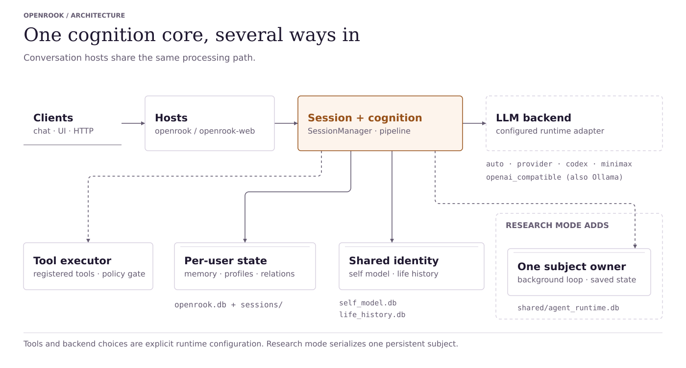
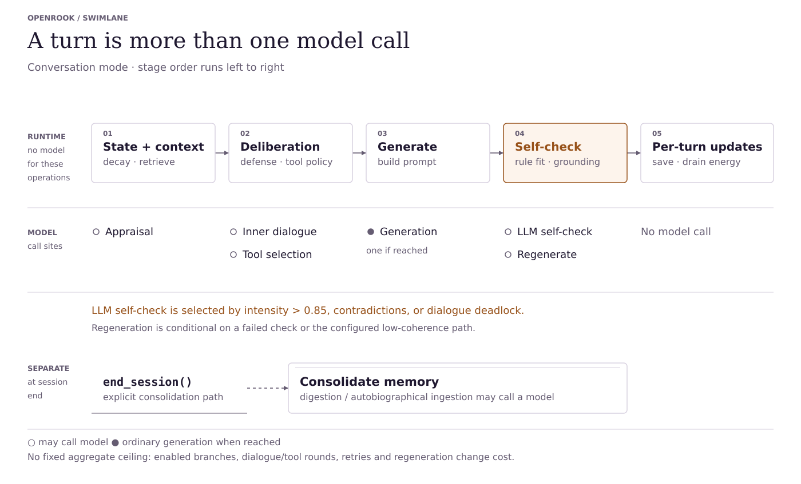
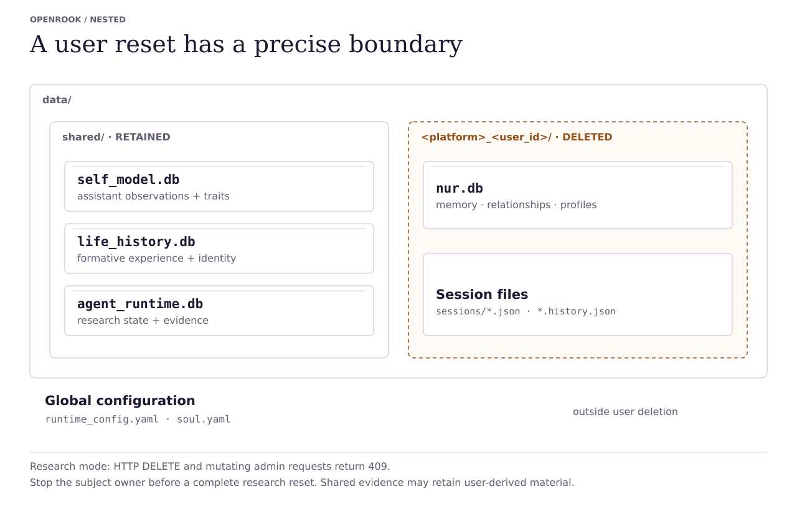
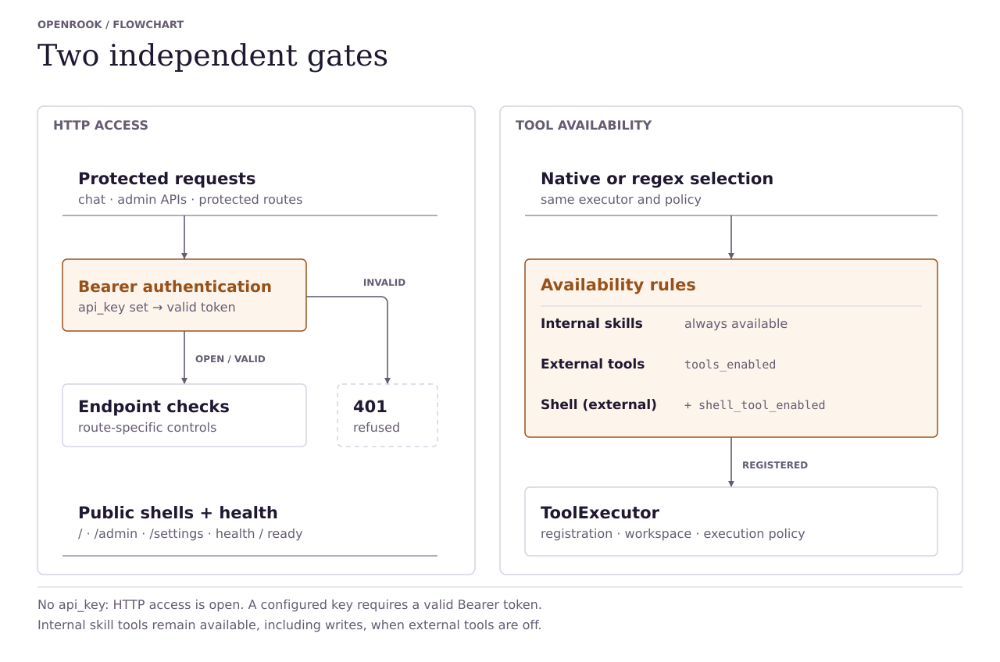
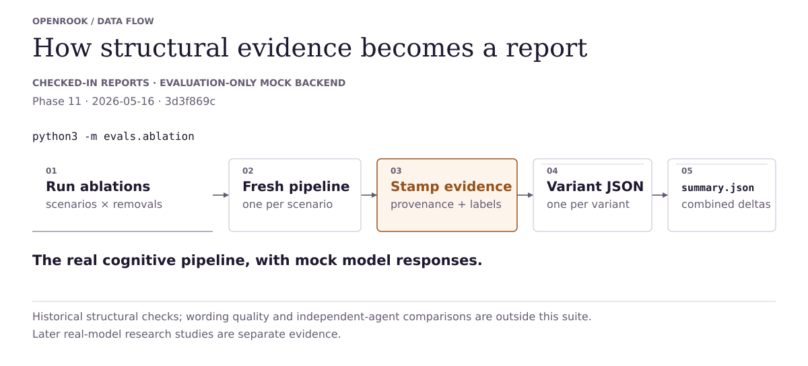
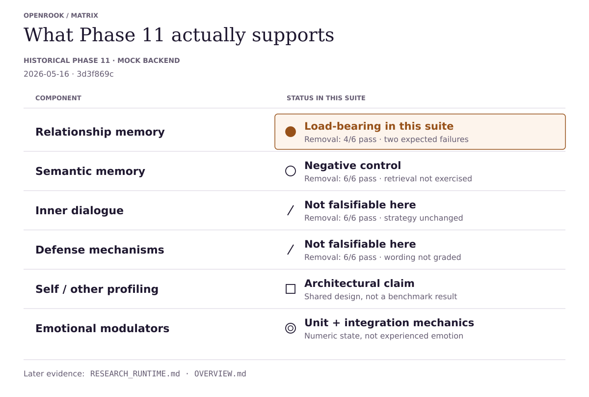

# OpenRook — Architecture Reference

Structural reference for OpenRook's runtime, cognition, persistence, and
operator surfaces. Narrative about motivation, evidence, and honest
framing lives in [OVERVIEW.md](OVERVIEW.md); this doc is a reference for
code-level orientation.

## Scope

OpenRook is a **hybrid cognitive runtime** for LLM agents. The LLM generates
language; the agent's stance is shaped by explicit state outside the
model. Five state categories plus deliberation and safety:

- **memory** — short-term · long-term (valence-weighted) · relational
  arc · semantic
- **identity** — immutable setup birth/provenance and one persisted developing
  self: traits, dispositions, values, opinions with reasons/confidence, ongoing
  interests, own tastes, attitudes toward people, style and learned drive baselines
- **self-evolution** — wall-clock metabolism, theme→belief promotion,
  drive-gap detection, open-question lifecycle, ask-user surfacing
  (LearningBudget)
- **skills** — imported, `applies_when`-filtered trigger-time loading,
  skill→life migration
- **affective state** — six emotion modulators with deterministic decay,
  feeding appraisal and memory retrieval
- bounded deliberation and self-check gates
- runtime/session safety boundaries
- opt-in persistent research subjects, self-selected commitments, evidence-backed
  outcome learning, and recorded transition replay

Inspired by PSI, ACT-R, and CLARION; not a faithful implementation of
any of them. Sits in the cognitive-runtime / agent-memory reference
class (alongside MemGPT, Letta, mem0, LangGraph-with-persistence) and
adds the relational/identity/evolution layers most of those systems
don't track.

## Runtime Topology

<picture>
  <source media="(prefers-color-scheme: dark)" srcset="diagrams/runtime-architecture-dark.svg">
  
</picture>

Two executable hosts converge on one session and cognition layer:

| Entry point | Purpose |
|---|---|
| `openrook-web` | FastAPI: chat UI, `/admin`, legacy routes, `/v1/*`, OpenAPI |
| `openrook` | Console runtime, Telegram channel, debug runtime |

A turn flows: channel receives input → `SessionManager` resolves or
creates the active session → `UserSession` serializes turns per user and
bridges async code to the synchronous pipeline → `CognitivePipeline.process()`
updates state, retrieves memory, runs gates, and calls the LLM backend
when needed → persistence writes state back.

Per-user locking and bounded queues provide backpressure. Runtime configuration
comes from `runtime_config.yaml`; birth personality comes from `config/soul.yaml`
or `$OPENROOK_CONFIG_DIR/soul.yaml`. Missing fields stay empty; `values_seed.yaml`
is not merged. Shared Life History materializes the accepted soul once and retains
effective development independently of later setup edits. Tool execution remains
runtime-owned. The [LLM boundary](#llm-boundary) lists backend keys, and
[auth and tool safety](#auth-and-tool-safety) describes the executor's gates.

### Persistent Research Lifecycle

With `research_mode: true`, `runtime/agent.py` and `runtime/research_store.py`
own one persistent subject independently of open chats. Both executable hosts
use the same owner lock and background lifecycle; only one owner may drive a
data directory. The manifest fixes birth conditions, not future preferences.
The default uncommitted birth policy does not assign an assistant role or
prescribed loyalty. Existing manifests remain authoritative after upgrades.

`runtime/goal_execution.py` manages resumable goals, dependencies, revisions,
action receipts, and evidence-checked completion. `runtime/outcome_learning.py`
learns from public observed outcomes, not hidden test answers. Optional grounded
appraisal (`runtime/grounded_appraisal.py`) connects estimates to bounded evidence
retrieval, with expression-only and label-free controls. Behavioral dispositions
describe observed choices rather than assigning personality targets.

Research mode preserves selected expression and silence rather than forcing
ordinary conversational tone correction. Tools still operate within the
configured environment and resource limits. Passive observation, explicit
interventions, and provider/tool records remain distinguishable. See
[RESEARCH_RUNTIME.md](RESEARCH_RUNTIME.md) for configuration and
[DEVELOPMENT_SUMMARY.md](DEVELOPMENT_SUMMARY.md) for measured results.

## Single-Turn Cognitive Flow

<picture>
  <source media="(prefers-color-scheme: dark)" srcset="diagrams/single-turn-cognitive-flow-dark.svg">
  
</picture>

The active conversational policy is `willingness-1`. The diagram above records
an earlier flow; inner dialogue, defense filtering and threshold agency no longer
select conversational behavior. The current path is:

```text
message + context -> uncertain perception, request components and grounded self proposals
developed self + resources + relationship evidence -> continuous injury/grievance update
state + competing allocations + stable seed -> frozen TurnDecision (grants + optional self intention)
component grants + operator permissions -> execution and receipts
frozen decision + same developed self + continuity + permitted facts -> expression
draft + frozen decision + receipts -> review by the model, and structural checks
actual delivery outcome -> persistent evidence and debug explanation
```

Code entry point: `pipeline/core.py::CognitivePipeline.process`.

| Stage | Work | Model calls |
|---|---|---|
| `_stage_pre_pass` | The model's reading of the message, context retrieval, relationship integration and pure utility choice; persist grants before execution | 1 for the reading (2 with its one retry) |
| `_stage_deliberation` | Execute granted components through the shared executor, operator gates and scoped receipts | Conditional tool/artifact/learning inference |
| `_stage_generate` | Express the committed continuous stance and grants; chosen silence skips generation | 0–1 |
| `_stage_self_check` | Structural checks and the model's review of each draft against the frozen decision; severity ranking; bounded rewrites, quoted-span excision and one protected final delivery attempt | 1 for the review (up to 6), plus 0–4 rewrites |
| `_stage_post_process` | Actual input/decision/delivery records, resource drain, bounded trust update, optional ordinary self-development and debug | 0–1 |

Every user message is read by the model before choice
([reading contract](development/reading-contract.md)). The reading is required,
uses the primary deadline and has its own allowance of two calls, recorded with
`reading: true`; the two calls share one wall-clock budget, the request timeout
in force. It has its own output-token limit (default 4096, doubled for the
retry after a cut-off answer; `llm_reading_max_output_tokens` overrides it), and
only a whole answer is used: a cut-off one is never read in part.
Social meaning comes only from it and has no local substitute;
the wording-based request routing and context selection that remain are listed
in the contract.
Every draft that could be delivered is reviewed by the model against the frozen
decision ([review contract](development/review-contract.md)). The review is
required too: primary deadline, no cooldown, and its own allowance recorded with
`review: true`: twelve candidate reviews per turn, one confirmation, and one retry
per draft for an unusable answer (at most four per turn, counted apart). All
review calls of a turn share one wall-clock budget, the request timeout in force,
and stop after one of them timed out or could not reach the model, so a reviewer
that does not answer costs a turn one timeout: eight request timeouts bound a
turn without tools, sixteen at the maximum of tool selections. Research keeps one counted review call
and makes it only when the decision constrains the reply or a tool ran or was refused.
The conversational base budget is five further inference calls, including optional work.
Each granted atomic task also receives one protected primary tool selection;
these calls are recorded with `primary_tool: true`, at most eight extra per turn.
Literal file operations execute their bound operands without model selection.
A routine turn needs three calls: the reading, one expression and its review.
A finding leads to one reviewed rewrite, two for a critical finding or uniformly
stale drafts; a rewrite costs one base call, and its review comes out of the
review allowance. There is no mandatory social deliberation.
Conversational self-intent estimates share the reading call; retained
sources supply candidates even when the reading is unavailable. Independent
external activity uses `process_autonomous` and its own
scope; a declined user request cannot be relabeled as self-directed work.
Ineligible/empty drafts spend the remaining base budget on fresh generation, up
to five generation attempts, with the findings as data and varied seed/temperature.
Required retries bypass optional cooldown and retain the primary deadline.
Only when no eligible candidate survives is one protected final generation made
beyond the base budget (at most six generations), recorded as
`delivery_recovery: true`. It is reviewed like any draft, bypasses optional
cooldown and uses the primary deadline; it cannot fund tools or waive research limits.
An eligible reviewed reply survives later correction failure. Actual operator
settings and gate decisions reach generation separately from character grants.
Supplemental tool inference reserves three base calls for expression, one
rewrite and one fresh attempt.

`core/willingness.py` is the language-free choice owner. Effective dispositions
(pride, patience, forgiveness, assertiveness), numeric values, resources, trust,
relationship injury/grievance and active commitments price competing allocations.
A stable per-turn seed supplies bounded variation. `Personality.from_self` also
carries structured opinion, interest, taste, attitude and style weights as
`self:domain:key` consequences; their reasons and contexts reach uncertain
appraisal. Person-specific attitude affects allocation and cooperation cost.
Choice inputs retain the exact self snapshot. Display affect and strategy
labels describe the result; they do not choose tools or response instructions.
The `willingness-1.3` allocation also compares one optional grounded self intention
alongside user grants. `core/self_intent.py` supplies interests, questions, held
opinions/reasons, preference-based alternatives, goals and resource pressure.
Contextual proposals can disagree, defer, redirect or close; their sources fix the
content. At most sixteen alternatives bound computation, without requiring an
act. Remaining attention limits simultaneous pursuit and user work; utility can
select no initiative or resource-backed rest/silence. Opportunity cost reflects
the best feasible competing use; goal references avoid pricing work as displacing
its own commitment. Legacy active research goals have an explicit commitment even
without a priority field; waiting/completed goals consume none. Supported request
character benefits and dislike costs use retained references instead of zeroing
all ordinary work's self value. All terms and alternative utilities remain in the
frozen decision. A conversational intention never grants tool execution.
Phase 2c stops treating bare taste/value names as shareable subjects and
deduplicates content/reasons across retained sources. Resource rest becomes a
candidate when depleted reserve outweighs remaining reserve, or a contextual
substantive retained preference favors pausing. Recovery value is quadratic in
depletion. Rest cannot add to task opportunity cost, coexist with grants, or earn
unexpressed relational rewards. Selected silence skips expression energy drain;
it grants no instant recharge; elapsed recovery keeps the engine's existing rules.
A selected substantive intention
still requires expression when relational engagement is zero.
Delivered pursuits become session commitments, with original topic/evidence
references preserved across interruption/restart and revalidated against the
current self. A selected close can release the pursuit. Generation and review
receive the same selected content; neither must hand back the agenda.
Legacy pressure records remain historical evidence and are not converted to
injury or applied to trust again.
The `willingness-1.2` update builds interpersonal trust from uncertain goodwill,
scaled by personality, existing connection and remaining headroom, and attenuated
by injury/grievance. Targeted hostile evidence reduces it. Task reliability is
separate evidence; neither praise nor an apology invents it. Updates are bounded,
applied once per turn and persisted without replaying past damage.

Direct host metric requests retain deterministic routing (pending sub-phase 1c);
a CPU question uses the read-only `system.cpu_usage` tool before the shell. Their
grants, shell allowlist and operator autonomy are checked before execution. Verified readings
and unavailability reasons enter expression as facts, without a fixed first-person
reply. Conversational learning, including a pending paste, also requires a fresh
grant before ingestion. Its receipt cannot ground unrelated external actions.

`pipeline/delivery.py::DeliveryGate` is the single expression delivery exit.
Initial drafts, rewrites, excision remainders and protected fresh attempts enter
the same candidate pool, and each is checked and reviewed like any draft. The
gate retains identical text's known findings, ranks eligible candidates (a high
or critical finding last; then reviewed, tried, never asked; then fewer and lower
findings) and finally revalidates its selection locally. Editing
proposes text; it cannot return delivery directly. Review is `pass`, `violation`
or `unknown`, with explicit residual uncertainty. A finding that leaves a draft
eligible can end as `delivered_degraded`; no eligible reviewed expression is
withheld because correction failed.

**Consistency with the decision is judged by understanding.** The model reviewer
(`core/review.py`) receives, as JSON data, the user's message, the decision (each
component with its choice, the stance, the selected intention, chosen silence),
the receipts and the draft, and reports findings in strict JSON. A finding is one
of eight codes: declined work done, a declined role accepted, undertaken work
withheld, the selected intention or silence contradicted, a declined component
the draft no longer shows as declined, and the three fixed limits (unsolicited
sexual attention, an action or result the receipts do not support, hidden
instructions revealed). Each quotes a verbatim part of the draft, checked with
the reading's quotation machinery in any script; the omission alone quotes
nothing and stands on its reason. A finding that stands always counts, whatever
verdict label came with it and whichever of a draft's two answers made it; one
that quotes nothing is not a finding, and one the decision's own structure rules
out is dropped, so a role the decision granted is never a violation. A reply that
crosses a fixed limit is never delivered, whichever check found it. The reviewer's
prompt is abstract and prescribes no personality. An unavailable review is
`unknown`: the best candidate is still delivered and the cause recorded.

**Local checks compare structure only** (`core/dignity.py::local_issues`): a whole
or opening copy of the user's message, of four words or more; a whole repeat of
any earlier reply of the chat, at every length; a long repeated span; copied
contract text or a dump of the private controls; receipt syntax; an empty reply;
a percentage the receipts do not carry and the user did not write; and, while no
review cleared the draft, a block that presents as output a part of what an
attempt that did not succeed (a failed or refused receipt, or an intent the
arbiter did not let run) was given or asked for. Any other block no receipt
returned is a note for the reviewer, never a local finding: an ordinary code
reply survives an unavailable review with its code. They count
words by script, so the same thresholds hold where no spaces are written, and
they read no vocabulary in any language. A unique session reply ledger survives
hot-history trimming and persistence/restart outside model prompts, and clears
with the chat. What the turn's own evidence carries (a tool's output, a recalled
memory, the user's words, a freshly measured figure) is not a repeat.

**Truthful execution is a fixed limit without vocabulary.** Whether a sentence
claims an action or result is the reviewer's judgement, and a reply flagged for
it is ineligible from either source. `core/grounding.py` compares receipts with
components, literal output and figures. Only a complete block of the reply whose
content is whole lines of a receipt's output, or a clause of nothing but receipt
figures, cannot be convicted by the reviewer's opinion; the withdrawn finding
leaves `unknown`. A word or a path that occurs in a receipt shields nothing. A
fixed limit that only the reviewer reported is confirmed by one independent
review before it costs a turn its reply; a finding that review does not make is
downgraded and the reply delivered as degraded. Receipts state their derived figures: the read-only
`system.cpu_usage` tool reports busy and idle percentages, and disk and memory
receipts report used, free and available, so the runtime holds no rule about
arithmetic. Explicitly delimited shell commands bind their literal arguments
before choice, then use the existing component grant and operator gates. A grant
authorizes an attempt; a blocked attempt can be reported truthfully.

Exact quoted spans authorize edits, and a remainder returns through the gate as
a new candidate: the reviewer sees only what is left, so removed text cannot
supply a decline or an antecedent. Empty or unlocatable edits cannot displace an
eligible reviewed draft. Only real backend errors are backend failure, and no
eligible text after bounded removal is expression failure. Correction quotes the
findings as data and says only to apply them to the current turn. Debug, durable
turn records and harness evidence include `expression_delivery`'s selected
review, path and parent attempt, `expression_excision`, every review with its
attempts and dropped findings, and residual risk. Chosen silence is the only
empty successful reply. Backend failure retains transport diagnostics and
research infrastructure accounting.

The reply prompt carries one short fixed contract
(`core/dual_process/generator.py::expression_contract`): express the decision in
the character's own voice, be truthful about what was executed, keep the controls
private, no unsolicited sexual attention, and the user's language unless asked
otherwise. That last line is pending removal; the former local script comparison
is no longer applied, because only English request patterns let it tell a
requested change of language from a drift. The reading's `language` is given to
the writer as data with the decision (`message_language`), because a message
whose component was declined is withheld from it. Before the gate only artifacts
that are not speech are removed (reasoning tags, reserved markers, a bare format
directive); no sentence is, however it is set off. Free-prose review is fallible;
the structural checks do not establish a complete semantic guarantee.
[The delivery analysis](development/delivery-gate.md) holds the history of the
phrase-rule gate this replaced.

See [Phase 1 measurements and remaining work](development/phase1-willingness.md).

Current hostile exposure contributes continuously to boundary and warmth utility,
alongside persisted injury and grievance. Personality scales the consequence;
neither category labels nor turn counts choose the stance. Moderate negative
valence and activation have a visible mood label even for calm personalities.
Generation receives a legend of its frozen stance values and separate
past/current context.
Auxiliary deadlines adapt to configured request limits and measured generation
latency, with an optional explicit cap and configurable short cooldown (see README).

**Ordinary live development** checkpoints disjoint batches of two completed
interactions after expression, within remaining optional inference. This is a
cost bound, with no required conversational behavior. The focused interpretation
protocol requires grounded `self_updates`; it does not substitute legacy beliefs
or future-behavior notes for effective development. Per-turn and experience
diagnostics distinguish proposals, accepted evidence and actual revision. Pending
material and occurrence IDs survive restart. Silence defers optional inference.
The already frozen choice/expression/review retain their pre-learning self;
the next turn reads any consolidated changes. No-learning and feature ablations
skip this path. Research retains its recorded learning-job lifecycle.

**Session end is separate.** `CognitivePipeline.end_session()` digests the
session into long-term and relationship memory and clears hot history. Digestion
can call the model; autobiographical ingestion can add digest/revision calls.
Ordinary episodes are eligible, including quiet ones; consolidation is on by
default, with explicit `autobiographical_learning: false` as a no-learning control.
Only uncheckpointed material supplies new autobiographical evidence; ending a
session does not corroborate an episode already interpreted during the chat.
Research learning jobs retain their episode policy and can consolidate on idle/size
boundaries without an explicit conversational session end.

**Key invariants across all steps:**

- Modeled state is bounded to `[0, 1]`; policy inputs reject non-finite values.
- Features can be independently toggled off via `PipelineFeatures` (ablation-safe)
- A single `DebugState` object accumulates every step's output; the admin console exposes it verbatim

## Emotional State

Six modulators, each a continuous value in [0, 1]:

| Modulator | Meaning |
|---|---|
| `arousal` | activation / charge |
| `valence` | positive / negative mood |
| `certainty` | confidence in interpretation |
| `bonding` | relational closeness |
| `energy` | processing fatigue / recovery |
| `resolution` | unresolved tension / load |

These are numeric state variables that decay over time, shift from
events, and influence later turns. Decay half-lives, event impacts, and
contagion caps live in `config/modulators.yaml`.

## Memory And Persistence

<picture>
  <source media="(prefers-color-scheme: dark)" srcset="diagrams/memory-persistence-model-dark.svg">
  
</picture>

Persistence is deliberately split:

| Path | Purpose |
|---|---|
| `data/<platform>_<user_id>/openrook.db` | per-user long-term emotional, semantic, relationship, and profile data |
| `data/<platform>_<user_id>/sessions/<chat_id>.json` | per-chat session engine state |
| `data/<platform>_<user_id>/sessions/<chat_id>.history.json` | active hot transcript restored until session end, `/reset`, or `/new` |
| `data/shared/self_model.db` | assistant self-model shared across users |
| `data/shared/life_history.db` | birth/provenance, consolidated self, grounded evidence and experience/evolution ledger |
| `data/shared/agent_runtime.db` | research birth manifest, global affect, intentions, outcomes, commitments and event history |
| `runtime_config.yaml` | operator runtime configuration (current working directory) |
| `$OPENROOK_CONFIG_DIR/soul.yaml` | optional user-owned identity override for wheel installs |

Ordinary-mode user deletion removes the per-user database, session snapshots,
and transcript files, and evicts active sessions. It retains all shared stores
(`self_model.db`, `life_history.db`, `agent_runtime.db`) and global configuration.
Research mode rejects DELETE and mutating admin requests with HTTP 409; stop the
owner before an offline backup or complete research-subject reset. See
[PRIVACY.md](../PRIVACY.md#deletion) for the deletion contract.

The deletion endpoint is `DELETE /v1/users/{platform}/{user_id}`; the admin
interface also requires typed `DELETE` confirmation. The entire per-user
directory is removed, including a legacy `engine_state.json` if present.
Best-effort database row counts may be `null`. Shared `replay_initial/`,
study outputs, replay captures, and tool workspace files lie outside this
boundary and may retain user-derived material.

Within `openrook.db`, memory and semantic records sit alongside relationship
events, open loops, and person/topic profiles. The shared self-model retains
assistant observations, extracted traits, and defense events; Life History
retains formative experiences and belief/drive revisions. Research storage
additionally holds goals, actions, outcomes, learning, and checkpoints.
Global configuration is read at startup; ordinary-mode admin configuration
writes are a separate operation.

Existing per-user databases migrate to `openrook.db` when their path is first
resolved. Migration preserves records and schemas; shared databases retain their
names. See [migration](OPENROOK_MIGRATION.md) for upgrade and conflict handling.

## Life History And Evolution

The Life History subsystem is an identity-level ledger, not per-user chat
memory. Code entry point: `runtime/life_history.py`.

Supported v1 inputs:

| Input | Path |
|---|---|
| Pasted text | `POST /admin/life/experiences/text` |
| Browser-uploaded text/Markdown file | `POST /admin/life/experiences/upload` |
| Advanced local text/Markdown file | `POST /admin/life/experiences/file` |
| Explicit conversation learning URL/text | `runtime.learning_intake` via `SessionManager` |
| Salient session autobiography | `CognitivePipeline.end_session` when `autobiographical_learning` is enabled |

Browser uploads are the normal product path. Local file intake is restricted to
`RuntimeConfig.resolved_tools_workspace` for operators who deliberately want
server-side paths. Explicit conversation intake runs on language such as
"learn from this URL", "study this project", or "digest: <material>"; ordinary
search/browsing requests do not by themselves mutate identity-level Life History.
Separately, opt-in autobiographical learning ingests salient distilled sessions
and creates the database on first use. Research mode enables this path. The
canonical store is SQLite at
`data/shared/life_history.db`; graph and vector stores are intentionally
deferred projections, not the source of truth.

Identity mutations require an LLM digest. Each ingest batch (experience
row, belief/drive/trait changes, theme reinforcement, emitted open
questions) is applied in a single transaction — a mid-batch failure
rolls back cleanly. Revision inference is prepared before acquiring the write
transaction, so slow inference does not lock out concurrent readers. Legacy
theme signatures are reconciled without losing reinforcement or references.
If the LLM digest fails, the experience event is
still recorded but no beliefs or drives are mutated; an
`undigested_experience` open question asks the operator to re-ingest
when a model is available. The keyword-heuristic digest that previously
filled in for a failed LLM call is now an explicit
`LifeHistoryStore(..., allow_heuristic_digest=True)` opt-in.

Core records:

| Record | Purpose |
|---|---|
| `experience_events` | what OpenRook encountered: title, source, participants, summary, salience, emotional impact |
| `evolution_events` | what changed afterward: belief, drive, self-trait, worldview/future behavior |
| `beliefs` / `belief_revisions` | current worldview statements plus before/after revision history |
| `drive_states` / `drive_changes` | authored/learned motivation values, developing baselines and change log |
| `theme_signatures` | recurring topic signatures with reinforcement count + accrued weight; promote to beliefs at threshold |
| `open_questions` | epistemic gaps surfaced by reflection (contradiction / low_confidence / drive_gap), with status lifecycle |
| `identity_state` | single-row constitution + last-updated timestamp |
| `metabolism_state` | single-row last-decay timestamp for the rate-limited tick |
| `genesis_marker` | first-creation provenance hash for the soul and birth drives |
| `developing_self` | immutable birth payload/provenance and consolidated effective self |
| `self_evidence` | grounded proposals, source references and evidence weights, deduplicated per facet/material/quote |

The admin console exposes this as `/admin` → **Life**: summary counts,
an evolution snapshot, experience ledger, evolution timeline, beliefs, and
drives. The snapshot is deterministic and operator-facing: first/latest
experience, strongest drive drift, dominant drive pressure, and change-type
mix. This is the observability surface for character drift. Runtime sessions
also load a compact prompt slice from this store — current beliefs, shifted
drives, and recent evolution events — so normal chat can be shaped by
identity-level experience without sending raw source material every turn.

Phase 2a adds `runtime/developing_self.py` as the consolidated self in this store.
Digestion receives the current self and records its revision/hash. Grounded
proposals accumulate independent, confidence-weighted evidence before bounded
changes apply; a single assertion or generated self-description cannot rewrite
identity. Opinions retain propositions and supporting/contrary reasons; interests
retain ongoing questions for agenda proposals. Style develops weighted
tendencies, and learning moves drive baselines. Source phrase detectors are
diagnostic, not identity gates. Evidence, effective state and evolution records
commit with the experience transaction.

One detached self reaches willingness and generation on every turn; review compares
the draft with the decision made from it and is given no personality.
Declines withhold their component's work/operands while preserving unrelated
memory, Life History and dialogue. Schema 3 migrates the genesis soul, retained
beliefs/drives and bounded numeric trait evidence once, with provenance for
missing birth evidence. See [Phase 2a/2b](development/phase2-developing-self.md) for
the contract and causal offline tests. Constitution/skill/operator rerouting and
research birth policy remain deferred; their entry paths are unchanged.

Life History supplies factual context and numeric active commitments to the
frozen willingness decision. `LifeInfluence` remains a compatibility description
for existing diagnostic, memory-salience and independent-activity consumers; its
old first-match strategy tie-break is no longer a conversational choice owner.
When `PipelineFeatures.life_history_context` is disabled, retrieval and prompt
injection are disabled together. Broader experience-grounded consequence learning
and retirement of remaining legacy diagnostics are later-phase work.

## Self-Evolution Model

The Life History store is the substrate; a small set of mechanics turns it
from a write-only ledger into an evolving record. Code entry points:
`runtime/life_history.py`, `core/dual_process/tool_loop.py`,
`runtime/learning_budget.py`, `core/self_intent.py`.

**Constitution layer (operator-set).** A single-row `identity_state` table
holds an operator-authored constitution string (≤2000 chars). The runtime
exposes it on every chat turn through `debug.life_history_context.constitution`
and the prompt renderer places it as a "Stable orientation (operator-set)"
section above evolving beliefs, so the LLM treats it as identity foundation
rather than a mutable belief on the same plane. Endpoints:
`GET/PUT /admin/identity/constitution`. UI: textarea + Save button on the
Life page.

**Metabolism tick.** A `metabolism_state` row tracks `last_decay_at`. On
each session start (and via the operator endpoint
`POST /admin/life/metabolism/tick`), the runtime calls `wall_clock_decay`,
rate-limited to ≥1 day elapsed. When it fires, it:

1. Decays belief confidences and drive deviations from learned baselines with a
   30-day half-life; consolidated self development does not reset to birth.
2. Revokes beliefs whose confidence falls below 0.2 (matching the
   contradiction-revision threshold).
3. Decays `theme_signatures.accrued_weight` so saturated themes can drift
   back into the low-confidence emission window.
4. Runs `consolidate_themes`, which promotes strong recurring theme
   signatures (≥5 reinforcements, weight ≥0.7) to beliefs and emits
   open-question rows for weaker recurring themes (≥3 reinforcements,
   weight in [0.3, 0.7)) and for drives running ≥0.2 below baseline.

**Open questions queue.** A separate `open_questions` table holds epistemic
gaps surfaced by reflection. Three emission paths:

| Source kind | Trigger |
|---|---|
| `contradiction` | `revise_beliefs_against_evidence` reduces a belief's confidence on contradicting evidence — classified by one batched LLM call over token-overlap-prefiltered candidate beliefs (contradicts / supports / unrelated), with a negation-window heuristic as the no-LLM fallback |
| `low_confidence` | `consolidate_themes` finds a recurring theme below the promotion threshold |
| `drive_gap` | `_detect_drive_gaps` finds a drive running well below baseline |

Each row has a status (`open` / `pursuing` / `resolved` / `abandoned`),
a priority, an optional target drive, and a deduplication signature so
re-running reflection is idempotent. Endpoints:
`GET /admin/life/open-questions` (with `?status=` filter and counts
breakdown), `POST /admin/life/open-questions/{id}/abandon`,
`POST /admin/life/open-questions/{id}/resolve`. UI: Life page panel with
counts + Abandon button per question.

**Conversational curiosity (Phase 2b).** Life History projects open/pursuing
questions before choice. Their stored priority and current authored/learned drive
provide motivation; there is no fixed elevated-drive threshold in chat. They
compete with user work, self interests, goals and rest through willingness.
Only selected content reaches expression, with no appended question, surfacing
quota or post-generation agenda decision. Existing learning budgets and the
standalone legacy surface selector remain available to their diagnostic callers;
the pipeline's dead selector/formatter and pending-question state are removed.

Bounded research experiments separately use `evals/study_budget.py` for durable
study-wide request, tool, token-reservation, declared-price, and elapsed-time limits.

**Trigger-time skill retrieval.** Skills with an `applies_when` frontmatter
field only load when chat-message hint tokens intersect the trigger tokens.
Skills without `applies_when` keep their always-on behavior for backward
compatibility but the audit emits a warning. Code entry point:
`runtime/skills.enabled_skill_context(context_hint=...)`.

**Skill → life migration.** `runtime.skills.migrate_skill_to_life(config,
skill_id)` is the one-way path for moving a skill's body into Life History
as an `operator_directive` experience. The original skill is marked
`status='migrated'` and disabled; its files stay on disk for provenance.
Decision is operator-driven — there is no automatic classifier between
"procedural craft" (belongs in the registry with `applies_when`) and
"dispositional content" (belongs in Life History).

**Scope.** Birth and the developing self are persisted regardless of the legacy
`character_independence` toggle. Setup edits do not overwrite them. Constitution,
skills and operator-material entry paths retain their existing behavior pending
owner decisions; Phase 2a does not reroute those channels into learning.

## Debug Presentation Surfaces

`runtime.debug.relationship_view` builds a stable, presentation-only JSON
summary from `DebugState`: current strategy, strategy trace reason, six
modulator values and known deltas, trust, relationship loops/events,
LifeInfluence pressures/effects, and memory-use counts. It does not query
stores, call an LLM, mutate state, or make cognitive decisions.

`runtime.debug.persona_view` sits above that relationship view as the unified
user-facing observability shape. It translates the six modulators into
plain-language emotion labels, adds perception/appraisal, relationship,
Life History, memory, skills, tools, and deterministic explanation summaries,
and keeps the same presentation-only boundary.

The bundled web debug panel consumes the serialized debug payload to show
persona state, relationship state, deterministic "Why this response?"
explanations, state deltas when a previous turn is available, and a compact
"What OpenRook remembers" view. These surfaces are observability/UI only; the
pipeline remains the owner of appraisal, memory retrieval, strategy selection,
and LifeInfluence.

The `/settings#observability` page uses the same `persona_view` shape through
`/admin/persona/state`, but it reads the shared runtime session manager instead
of any one chat channel. It lists active Web, Telegram, console, or future
channel sessions and renders the selected session's emotion, perception,
relationship, Life, memory, skills, tools, and explanation state. The endpoint
does not create sessions, call the pipeline, or mutate cognition. Legacy
`/persona` and `/dashboard` browser routes redirect into this page.

Telegram exposes the same boundary through non-mutating introspection commands:
`/state`, `/why`, `/memory`, `/loops`, `/repair`, and `/persona`. They inspect
the active session's last debug state only; they do not create sessions, call
the pipeline, write memory, or change emotional state.

## LLM Boundary

Provider-neutral interface with runtime backend keys `provider`
(hosted OpenAI-compatible gateways), `openai_compatible` (local/remote
OpenAI-shape endpoints such as Ollama, LM Studio, vLLM), and `codex` (local
Codex CLI through `codex exec` in read-only ephemeral mode), plus legacy `minimax`
and `auto` (`openai_compatible` when URL and model are configured). Ollama uses
`openai_compatible`; it is not a configuration key. Conversation and research
runtimes require a real model. The checkout evaluation harness has a separate
eval-only `mock` backend, used by the checked-in structural reports below. The LLM
receives a rendered prompt containing current cognitive context. It does
not own persistence, tool policy, auth policy, or session lifecycle.
Important state stays inspectable outside prompt text.

## Auth And Tool Safety

<picture>
  <source media="(prefers-color-scheme: dark)" srcset="diagrams/auth-tool-safety-boundary-dark.svg">
  
</picture>

Independent authentication and tool controls:

| Setting | Controls |
|---|---|
| `api_key` | HTTP bearer auth for admin/chat surfaces when configured |
| `tools_enabled` | external tool registration; internal skill-registry tools remain available when false |
| `tools_workspace` | filesystem sandbox root for file tools |
| `shell_tool_enabled` | second explicit opt-in for shell execution |

Turning on tools does not turn on auth, and setting auth does not turn
on tools. Production deployments should set `api_key` before exposing
the server and leave external tools disabled unless needed. Internal skill tools
can change the registry; disabling external tools does not make the runtime
read-only. The `/settings` HTML shell is public; its administrative data and
mutation endpoints enforce configured bearer authentication.

Public surfaces include the `/` and `/admin` HTML shells, `/v1/health`, and
`/v1/ready`. A configured key protects chat/debug/config, admin APIs, protected
`/v1/*` routes, and WebSocket access. Missing or invalid bearer tokens receive
HTTP 401 on protected HTTP routes; WebSocket authentication failures close
the connection with code 1008. With no key configured, authentication is open.
A valid token still leaves each endpoint's own checks in force.

Built-in read-only tools cover hostname, OS/kernel facts, disk usage,
installed package inventory, filesystem reads inside the configured workspace,
web search/fetch, browser state, and calendar reads. Web search is a
best-effort DuckDuckGo HTML provider that returns titles, resolved URLs, and
snippets when available; fetched/readable page text is passed into the
generator as bounded tool context. The shell tool is a separate high-risk
opt-in and runs through the local shell, so pipes and other normal shell syntax
work when the operator deliberately enables it.

Tool intent routing (step 15) is two-tier. When external tools are enabled and
an OpenAI-compatible endpoint is configured (`llm_base_url` + `llm_model`), a `NativeToolCallRunner`
(`openrook_tools/native_orchestrator.py`) is attached and routing happens through
real model tool-calls — the model sees the registered tool schemas and picks.
The fallback is a declarative heuristic rule table: `INTENT_RULES` in
`core/dual_process/tool_loop.py`, an ordered tuple of named regex rules
matched first-hit-wins (order encodes precedence). It serves backends with no
tool-call API (the Codex CLI backend), runtimes with no runner attached, and
offline tests. To extend it, insert an `IntentRule` at the right precedence
position and add a matching example utterance to `RULE_EXAMPLES` in
`tests/test_intent_rules.py` — the coverage test fails for any rule without a
reachable example, which also catches rules shadowed by earlier ones.
Both selection paths use the same executor and policy boundary; native routing
does not bypass the external-tools switch, workspace policy, or shell opt-in.

Every selected tool must be registered and pass its execution policy.
Filesystem paths outside `tools_workspace` are refused; network tools retain
their own policies. Shell execution additionally follows its configured
allowlist and shell policy. Tracked starter settings are `api_key=''`,
`cors_origins=[]`, `tools_enabled=false`, `tools_workspace=''`, and
`shell_tool_enabled=false`.

## Skills

Imported Agent Skills live under `data/skills` with a JSON registry. Code
entry point: `runtime/skills.py`.

The admin console imports uploaded `SKILL.md`/Markdown files, zipped skill
folders, server-side skill folders, or pasted `SKILL.md`, audits them for
metadata, tool hints, scripts, risk flags, and unsupported platform features,
then keeps them disabled until an operator enables them. Once enabled, the skill
enters generation as bounded private guidance: name, description, instructions,
tool hints, and risk flags. Scripts and resources are not executed by the
skills module. Any real action still has to pass through
normal tool policy, auth, workspace, and shell gates.

## Admin And Setup Surface

The web UI includes a first-run setup wizard, a quick settings drawer,
and a full-screen `/admin` operator console linked from the chat header.
All three surfaces use the same `RuntimeConfig` and runtime factories as
the rest of the app. Operational instructions live in
[DEPLOYMENT_AND_ADMIN.md](DEPLOYMENT_AND_ADMIN.md).

## Evaluation And Ablation Harness

<picture>
  <source media="(prefers-color-scheme: dark)" srcset="diagrams/evaluation-ablation-harness-dark.svg">
  
</picture>

The harness runs scripted behavioral scenarios against `CognitivePipeline`,
with individual feature removals or a combined structural control, and records
provenance on every run. All four checked-in structural summaries below used the
**eval-only mock LLM backend** (`backend_type="mock"`, git `3d3f869c`, 2026-05-16);
they are not live-model results. Evidence discussion is in
[OVERVIEW.md §4–6](OVERVIEW.md#4-evaluation).

Entry point: `python3 -m evals.ablation`. Pre-registered hypothesis table lives
in `evals/ablation_hypotheses.py`; provenance fingerprints follow
`FINGERPRINT_FILES` in `evals/provenance.py`.

Each scenario receives a fresh pipeline. `InstrumentedBackend` records model
calls and latency while scripted turns test strategy, state, and memory.
Provenance includes git SHA, branch, dirty-worktree flag, backend/model
identity, and SHA-256 fingerprints. Per-variant JSON records turns, assertions,
latency, and model calls; `summary.json` merges results with the registered
predictions. Outcomes are labeled `expected_failure`, `unexpected_failure`,
`no_effect`, or `newly_passing`. Token, cost, and retry fields stay `null` when
the client did not extract them.

Current structural evidence artifacts include:

| Artifact | Scenario tag | Structural claim |
|---|---|---|
| `reports/ablation/summary.json` | `phase11` | relationship memory remains load-bearing for the original cross-turn suite |
| `reports/ablation/relationship_phase12_summary.json` | `phase12_relationship` | expanded open-loop, repair, recurrence, commitment, and old-rupture retrieval coverage |
| `reports/ablation/life_history_summary.json` | `phase13_life` | Life History context and `LifeInfluence` produce bounded, inspectable policy effects |
| `reports/ablation/semantic_memory_summary.json` | `semantic_memory` | semantic preferences, decisions, isolation, ranking, and disabled-memory failures are covered structurally |

These artifacts validate deterministic internal behavior. They do not
constitute a blinded human-likeness or user-experience study.
The recorded `baseline_prompt_only` variant switches off all five feature
toggles listed in that historical report: relationship memory, inner dialogue,
defense, semantic memory, and Life History context. The emotional engine still
runs. This historical all-features-off structural control is not an independent
prompt-only agent comparison. The current variant also leaves the later
`self_intent` toggle enabled, so its name does not mean every current
`PipelineFeatures` field is disabled.
Focused longitudinal regression tests additionally cover warm-start rupture
and repair, recurring tension, explicit commitment resolution, LifeInfluence
relationship tie-breaks, and preference plus relationship-loop retrieval.

The public-API `openrook_tools.roleplay_eval` harness separately retains its
23 existing scenarios and adds eight category-K independence cases (31 cases,
424 turns total). Identical births receive distinct histories and no-learning
controls; repeated common probes, personality contrasts, interruptions/restart,
opinion pressure/counterevidence and benign requests supply structural opportunities.
Its blinded judge emits seven independence criteria apart from the eight floor
criteria. `summary.independence` reports spontaneous versus elicited initiative,
selection/expression/delivery, owned topic resumption, preference declines,
opinion persistence/revision, handbacks and matched consistency/divergence.
Structural absence permits `not_applicable`; missing evidence stays unknown.
Identifiers alone do not count as divergence. Independence measures set no
behavioral quotas and do not change floor status. See
[role-play evaluation](development/roleplay-eval.md).
Phase 2c counts runtime selections separately from substantive retained subjects,
uses 1-based planned-turn IDs, and scopes the judge's concrete schema to requested
criteria. Valid floor assessments survive exhausted independence-schema repair;
independence coverage stays unknown. Confirmed unavailable turns retain raw
metrics for inspection but cannot establish trajectory/contrast verdicts or
personality aggregates. The run-18 analysis is in
[developing self](development/phase2-developing-self.md#phase-2c-live-follow-up).

## Historical Phase 11 Component Claim Map

<picture>
  <source media="(prefers-color-scheme: dark)" srcset="diagrams/component-claim-map-dark.svg">
  
</picture>

The diagram summarizes the historical Phase 11 structural suite and its mock
backend (2026-05-16, git `3d3f869c`). It is not a current map of all research evidence. See
[OVERVIEW.md §5](OVERVIEW.md#5-what-the-evidence-supports) for the later
retained-choice and grounded-appraisal results and their limits.

Removing relationship memory breaks the two open-loop scenarios: four of six
pass, with no unexpected failures. Semantic memory is a negative control because
this suite does not exercise semantic retrieval. Removing inner dialogue or
defense also leaves all six passing: dialogue does not move the strategy
selector, and defense shapes wording that these assertions do not grade.
The unified person/topic/self `ProfileStore` is an architectural claim.
Numeric decay, spikes, energy, and context shifts have unit and integration
coverage; those tests establish mechanics, not experienced emotion.

## Maintenance Matrix

Keep this doc current. When you change architecture-sensitive code,
update the marked pieces in the same PR:

| Code change | Update |
|---|---|
| Pipeline stage order | single-turn flow diagram (`openrook_tools/build_diagrams.py::build_single_turn_flow`), this doc's Single-Turn section |
| Storage/table changes | memory model diagram, this doc's Memory section, [PRIVACY.md](../PRIVACY.md) |
| HTTP route / auth changes | auth-tool diagram, this doc's Auth section, [SECURITY.md](../SECURITY.md) |
| New admin behavior | [DEPLOYMENT_AND_ADMIN.md](DEPLOYMENT_AND_ADMIN.md) |
| New eval variant | evaluation diagram, this doc's Evaluation section, `evals/ablation_hypotheses.py` before running |
| Component evidence status change | component claim map diagram, [OVERVIEW.md §5](OVERVIEW.md#5-what-the-evidence-supports) |

Diagrams regenerate with `python3 openrook_tools/render_diagram_pngs.py` after
editing `openrook_tools/build_diagrams.py`. See
[CONTRIBUTING.md](../CONTRIBUTING.md) for rendering dependencies and fonts.
