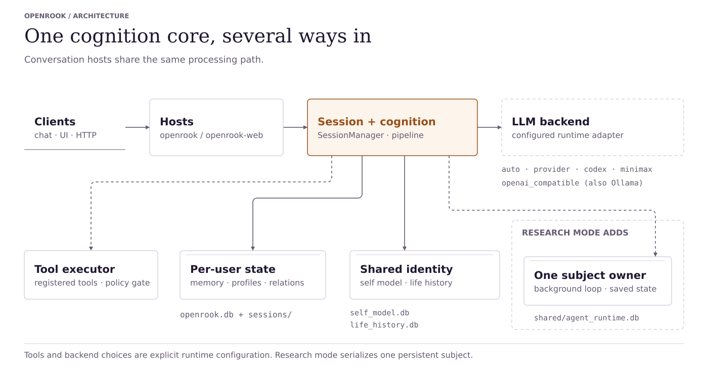
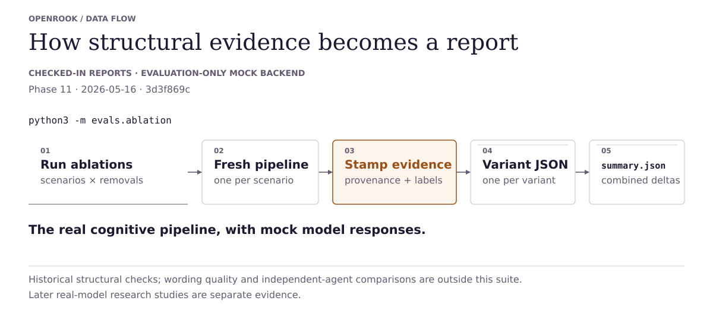
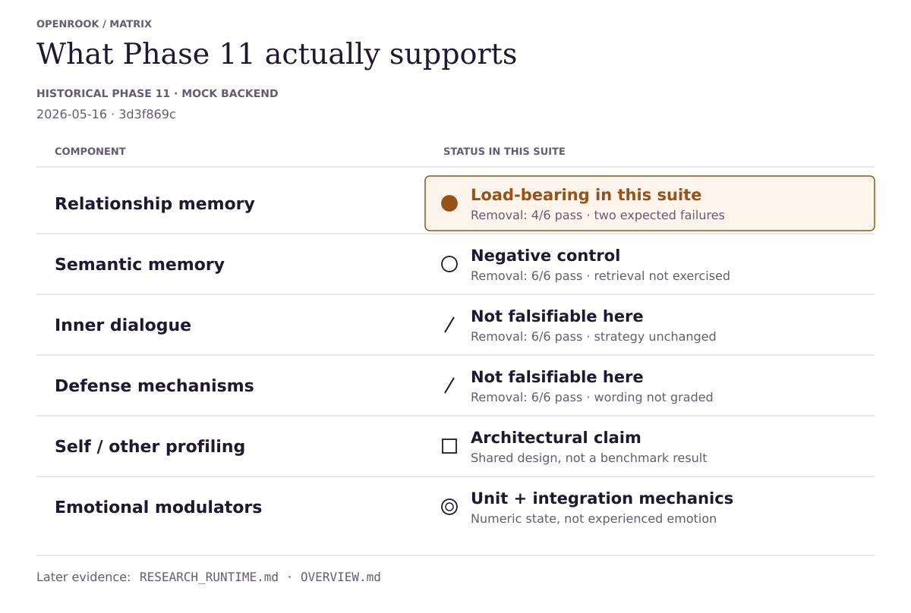

# OpenRook — Overview

> What the project is, why it exists, what the evidence supports today,
> and what it does not claim. The public reader path.

**Honest scope up front.** OpenRook is a research prototype — a cognitive
runtime, not an AGI claim and not a clinical tool. It does not claim
validated human-likeness, consciousness, therapeutic value, or
psychological validity.

For major changes and the completed controlled-world behavioral result, see
[Development summary](DEVELOPMENT_SUMMARY.md). Existing installations should
follow the [migration guide](OPENROOK_MIGRATION.md).

## Contents

1. [The idea](#1-the-idea)
2. [Theory stance](#2-theory-stance)
3. [Architecture at a glance](#3-architecture-at-a-glance)
4. [Evaluation](#4-evaluation)
5. [What the evidence supports](#5-what-the-evidence-supports)
6. [What this does *not* show](#6-what-this-does-not-show)
7. [Running it](#7-running-it)
8. [Further reading](#8-further-reading)

## 1. The idea

LLM agents are stateless by default. A prompt-and-persona may render the
*appearance* of continuity, but between turns the state evaporates;
between sessions it never existed. Nothing accumulates, nothing decays,
nothing resolves or fails to resolve. The agent-memory work of the last
two years (MemGPT, Letta, mem0, LangGraph state) addresses one slice of
that: it lets an LLM remember *facts* and *preferences*. It does not
typically address *who the agent is becoming*, *how it relates to a
specific person over time*, or *what it has learned that should now
shape its judgment*.

**Core thesis:** an LLM agent benefits from an explicit cognitive
runtime sitting alongside the model — engineered scaffolding that
persists state, lets that state decay, revises it against evidence, and
makes the whole structure inspectable. The LLM writes language; the
runtime holds *what the LLM writes against*.

Concretely, OpenRook maintains these categories of persistent state outside
the model:

- **Memory** — short-term, long-term (valence-weighted), relational arc
  (rupture, repair, commitments, open loops), semantic (preferences,
  decisions, facts).
- **Identity** — optional operator-set constitution, belief ledger with
  confidence and decay, motivational drives that drift, self-traits
  observed through behavior. Ordinary mode uses `soul.yaml`; research mode can
  start uncommitted. Explicit and autobiographical experiences change the ledger.
- **Self-evolution** — wall-clock metabolism that decays weak beliefs,
  promotes recurring themes to beliefs, and emits open-question rows
  for unresolved gaps; a daily LearningBudget governs how often the
  runtime can ask the user.
- **Skills** — imported via paste / file / zip; skills declaring `applies_when`
  load when chat hints match, while enabled skills without it remain always-on.
  A `migrate_skill_to_life`
  helper for skills that turn out to be disposition.
- **Affective state** — six emotion modulators (arousal, valence,
  certainty, bonding, energy, resolution) with deterministic decay,
  driving appraisal and weighting memory retrieval.
- **Commitments and outcomes** — durable goals, revisions, action receipts,
  forecasts, learned procedures, and social expectations in research mode.

Plus explicit decision points — appraisal, strategy, deliberation,
defense, self-check — each testable in isolation.

This is not "more memory features piled on top of a chatbot." It is an
attempt to define what stateful cognitive context for an LLM agent
looks like, in code that runs and that you can read. Relationship arc
asks how the runtime changes *toward a specific person*. Life history
asks how the runtime changes *its own judgment* in response to
experiences. Both are inspectable; neither is evidence of
consciousness.

## 2. Theory stance

OpenRook takes engineering inspiration from PSI Theory (continuous
modulators, energy as a resource, emergent behavior from variable
configurations), ACT-R (memory weighted by recency, frequency, and
context), and CLARION (bounded fast/slow deliberation).

It is explicitly **not** a faithful implementation of any of them. No
formal PSI drive system, no ACT-R production rules, no learned implicit/
explicit coordination. The goal is inspectable engineering, not
theoretical reproduction.

## 3. Architecture at a glance

Two runtime hosts (`openrook` for console/Telegram/debug, `openrook-web` for the
FastAPI service) share one session manager and one cognitive pipeline.
Persistence, LLM, and tool execution sit at the edges.
The web debug panel consumes serialized debug state to show the
persona view, relationship view, deterministic "Why this response?"
explanation, known state deltas, and compact current-turn memory summaries.
These are presentation surfaces over the pipeline's state, not separate
cognition.
The `/settings#observability` page uses the same runtime-owned state outside
the chat interface: it lists active sessions from Web, Telegram, console, or
future channels and renders the selected session's emotional, perception,
relationship, Life, memory, skills, tools, and explanation state. Legacy
`/persona` and `/dashboard` browser routes redirect there.
Telegram mirrors that principle with non-mutating introspection commands
(`/state`, `/why`, `/memory`, `/loops`, `/repair`, `/persona`) that read
active-session debug state without creating sessions or changing cognition.

<picture>
  <source media="(prefers-color-scheme: dark)" srcset="diagrams/runtime-architecture-dark.svg">
  
</picture>

The emotional state is a six-dimensional vector in [0, 1]: arousal,
valence, certainty, bonding, energy, resolution. Each modulator has its
own temporal behavior — arousal decays in roughly two minutes, valence
over tens of minutes, bonding over days; energy drains with use and
recovers with rest. State updates from several sources per turn:
bounded contagion, a person-specific baseline shift, event-driven
impulses from classified emotional events, and time-based decay toward
baseline.

Memory is split across short-term (in-process with suspension checkpoints),
long-term (SQLite, distilled emotional summaries), relationship (social
arc: rupture / repair / commitment / recurring tension / open loops),
and semantic (preferences, decisions, facts). Writes are asymmetric:
trust increments from positive events are small; decrements from
negative events are 7.5× larger at current configuration. Events above
an intensity threshold bypass confidence filtering and write directly
to long-term storage.

Life history is a separate identity-level store under
`data/shared/life_history.db`. It is append-oriented: an experience event
records what OpenRook encountered, and evolution events record what changed
afterward. Supported inputs include pasted text, uploaded text/Markdown files,
advanced local files, and explicit conversation learning requests such as
"learn from this project: <url>". Current outputs include belief revisions, drive
changes, self-trait observations, and future-behavior tendencies. This is
observable in `/admin` → **Life**. Normal runtime sessions now retrieve a
compact version of those revisions for generation, so the layer can influence
chat behavior. This still is not a claim that the assistant is independently
alive or biologically humanlike. With autobiographical learning enabled, salient
sessions also enter the identity ledger; first-use ingestion creates its database.

A small set of self-evolution mechanics turn the ledger from a write-only
record into an evolving one. A wall-clock metabolism tick, rate-limited to
≥1 day elapsed, decays belief confidences, revokes weak beliefs, decays
theme weights, promotes strong recurring themes to beliefs, and emits
open-question rows for unresolved gaps (contradictions, low-confidence
themes, drive-gap signals). An operator-authored **constitution** sits as
a stable orientation above evolving beliefs in every prompt. An **ask-user
autonomy** layer (Sprint 5) lets the runtime surface an open question to
the user during chat when budget and drives align, then mark it
`pursuing`; the default `LearningBudget` allows at most three questions per user
per rolling 24-hour budget period, shared across sessions and restarts.
**Trigger-time skill retrieval** filters skills declaring `applies_when` based
on chat-message hint tokens. Enabled skills without that field remain always-on.
Operators can move a "skill" that's actually disposition into Life History
with `migrate_skill_to_life`. See
[ARCHITECTURE.md § Self-Evolution Model](ARCHITECTURE.md#self-evolution-model)
for the full mechanic and endpoint inventory. These ordinary-mode controls are
separate from the research condition, where goals and preferences can develop
without administrative editing. Neither condition establishes consciousness.

In research mode, `runtime/agent.py` owns a persistent subject independently of
open chats. It can deliberate, select or revise goals, act, reflect, refuse,
or rest. Closed-loop execution verifies progress against public receipts instead
of treating generated completion claims as facts. Optional outcome learning and
grounded appraisal connect experience to later retrieval and choices. See
[RESEARCH_RUNTIME.md](RESEARCH_RUNTIME.md) for feature flags and controls.

For structural detail — per-turn stage order, LLM call accounting,
persistence layout, auth/tool gates, and the full component claim map —
see [ARCHITECTURE.md](ARCHITECTURE.md). The structural reference doc is
where every diagram and module map lives.

## 4. Evaluation

Evaluation includes regression tests, structural ablations, live controlled
behavioral comparisons, and recorded transition replay. It is not a human
judgment or biological-emotion study.

### Completed retained-choice confirmation

The fixed v4 study completes 28 subjects / 14 pairs / 672 opportunities. Opposed
learning histories produce a mean retained-choice difference of 0.7143 after
a same-process manager restart, with a paired 95% interval of [0.2857, 1.1429], exceeding the declared
0.2 threshold. Raw-ledger reconstruction independently agrees with the analysis;
1,344 transitions passed the historical state replay checks without external tool
execution; those checks did not compare model prompts. Both study arms exposed
runtime-computed success estimates and procedures, so this is task-specific
runtime-plus-model learning, not isolated model learning. Seven pairs have zero
difference. See the [review corrections](REVIEW_FIXES.md) and the
[complete dated record](plans/behavioral_validation_v4.md#completed-confirmation-and-closeout)
for goal-revision evidence, rejected actions, controls, and earlier interrupted runs.

### Earlier structural suites

<picture>
  <source media="(prefers-color-scheme: dark)" srcset="diagrams/evaluation-ablation-harness-dark.svg">
  
</picture>

The harness runs scripted scenarios against `CognitivePipeline`, stamps each
run with provenance (git SHA, backend/model identity, and fingerprints for
`FINGERPRINT_FILES` in `evals/provenance.py`), and emits JSON reports. All four
checked-in structural summaries below used the **eval-only mock LLM backend**
(`backend_type="mock"`, git `3d3f869c`, 2026-05-16). They exercise runtime structure
with scripted model responses; they are not live-model behavioral results.

The complete variant set in [the Phase 11 summary](../reports/ablation/summary.json):

| Variant | Pass | Expected fail | Unexpected | Interpretation |
|---|---:|---:|---:|---|
| baseline | 6/6 | – | – | reference run |
| no_relationship_memory | **4/6** | 2 | 0 | load-bearing on cross-turn continuity |
| no_inner_dialogue | 6/6 | 0 | 0 | not falsifiable by this suite |
| no_defense | 6/6 | 0 | 0 | not falsifiable by this suite |
| no_semantic_memory | 6/6 | 0 | 0 | negative control behaved as expected |
| no_life_history_context | 6/6 | 0 | 0 | negative control behaved as expected |
| baseline_prompt_only | **4/6** | 2 | 0 | historical all-features-off structural control |

Each outcome is labeled against a hypothesis table authored before the
run (`expected_failure`, `unexpected_failure`, `no_effect`,
`newly_passing`). Every prediction held for the listed variants in that recorded
Phase 11 mock run: each single-feature no-effect variant retained all six passes,
and both failing variants had exactly two expected failures with none unexpected.
`baseline_prompt_only` disables all five feature toggles listed in that report:
relationship memory, inner dialogue, defense, semantic memory, and Life History
context. The emotional engine still runs. The current variant leaves the later
`self_intent` toggle enabled, so “all-features-off” describes the historical
five-feature control, not every current `PipelineFeatures` field. It is not a
matched comparison with an independent prompt-only agent.

Additional structural suites now cover the newer cognitive layers:

| Suite | Baseline | Diagnostic ablation result | Report |
|---|---:|---|---|
| Phase 12 relationship | 7/7 | `no_relationship_memory` fails 5 expected cross-session/open-loop cases | [relationship_phase12_summary.json](../reports/ablation/relationship_phase12_summary.json) |
| Phase 13 Life History | 6/6 | `no_life_history_context` fails 3 expected context/influence cases | [life_history_summary.json](../reports/ablation/life_history_summary.json) |
| Semantic memory | 6/6 | `no_semantic_memory` fails 5 expected preference/decision/retrieval cases | [semantic_memory_summary.json](../reports/ablation/semantic_memory_summary.json) |

These are still structural assertions over debug state, stored records,
strategy traces, and ablation labels. They are not user-perceived
human-likeness measurements.

## 5. What the evidence supports

<picture>
  <source media="(prefers-color-scheme: dark)" srcset="diagrams/component-claim-map-dark.svg">
  
</picture>

This map is historical Phase 11 mock-backend evidence. The later retained-choice
and appraisal results are separate evidence, summarized below and in the
[development summary](DEVELOPMENT_SUMMARY.md).

The honest reading:

- **The defined operational-autonomy target is met in the controlled world.**
  Self-selected activity, independently verified work, and a retained
  history-dependent choice with runtime-computed assistance after a same-process
  manager restart are supported by the completed protocol.
- **Grounded appraisal has a verified retrieval connection.** Counterfactual
  replay changes retrieval in 295 of 672 recorded states when attention is
  connected rather than expression-only. A label-free numerical control matches
  the connected rule; this is not evidence that emotion labels add benefit.
- **Relationship memory is load-bearing on the Phase 11 mock suite.** Disabling
  it breaks exactly the two scenarios that depend on cross-turn open-loop
  state and no others. Zero unexpected failures.
- **Relationship memory remains load-bearing under the expanded Phase 12
  suite.** The dedicated report shows expected failures only for the
  relationship/open-loop/commitment cases.
- **Life History now has bounded structural influence.** The Phase 13 suite
  verifies that Life History context can produce neutral, bounded,
  inspectable `LifeInfluence` pressure on strategy tie-breaks, action
  variables, proactive scoring, and semantic salience. This proves a
  deterministic structural path, not human-like agency.
- **Semantic memory has its own structural suite.** Preference, decision,
  per-user isolation, topic ranking, and salience/recency behavior are now
  tested directly; it remains a negative control for pure relationship suites.
- **Longitudinal arcs have focused regression coverage.** Warm rupture/repair,
  recurring tension, commitment resolution, LifeInfluence relationship
  tie-breaks, and preference-plus-loop retrieval are tested over multiple turns.
- **Inner dialogue and defense are present but not falsifiable by this
  suite.** Phase 11 scenarios grade structural assertions (strategy
  selection, modulator direction, memory writes); these components
  primarily affect wording or deliberation rounds that those assertions
  do not see.
- **Unified self/other profiling is an architectural claim, not a
  current benchmark win.**
- **Emotional modulators have unit and integration coverage**, not an
  ablation result — their correctness is verified directly through the
  test suite.

## 6. What this does *not* show

Stated up front so no reader has to infer it:

- **No validated human-likeness claim.** We do not show that OpenRook's
  responses read as more human or more emotionally coherent to people.
  That requires a blinded user study with matched baselines —
  explicitly deferred future work.
- **No general advantage over every prompt-only agent.** Structural assertions
  and retained-history experiments answer specific mechanism questions, not
  universal product superiority or a matched human-rater comparison.
- **No faithful PSI / ACT-R / CLARION implementation.** Engineering
  inspiration, not theoretical reproduction.
- **No certified billing measurement.** Bounded research runs record actual
  request attempts, retries and provider usage when available, plus declared-price
  resource reservations. Missing provider metadata is not guessed, and a declared
  cost ceiling is not a provider-side billing guarantee.
- **No multi-party conversation support.** Single-user scoping is
  architectural, not incidental.
- **No equivalence between controlled-world autonomy and unrestricted life.**
  Goals, activity, and outcome learning are implemented and the defined
  retained-choice target passes. That does not imply human psychology, flawless
  tool competence, or generalization to every model and environment.

## 7. Running it

See [README.md](../README.md) for install, first-run wizard, and quick
commands. See [DEPLOYMENT_AND_ADMIN.md](DEPLOYMENT_AND_ADMIN.md) for
production posture, `OPENROOK_CONFIG_DIR`, and the admin console.

## 8. Further reading

- [DEVELOPMENT_SUMMARY.md](DEVELOPMENT_SUMMARY.md) — major implementation changes
  and the completed behavioral acceptance record.
- [RESEARCH_RUNTIME.md](RESEARCH_RUNTIME.md) — persistent subjects and study operation.
- [ARCHITECTURE.md](ARCHITECTURE.md) — canonical structural reference
  (diagrams, module map, persistence layout, auth/tool gates,
  maintenance matrix).
- [research/PAPER_DRAFT.md](research/PAPER_DRAFT.md) — long-form
  version of this narrative with fuller background and related-work
  positioning.
- [PRIVACY.md](../PRIVACY.md), [SECURITY.md](../SECURITY.md) — what the
  system persists and how it is protected.
- [CONTRIBUTING.md](../CONTRIBUTING.md) — how to add eval scenarios,
  regression tests, and architectural changes.
