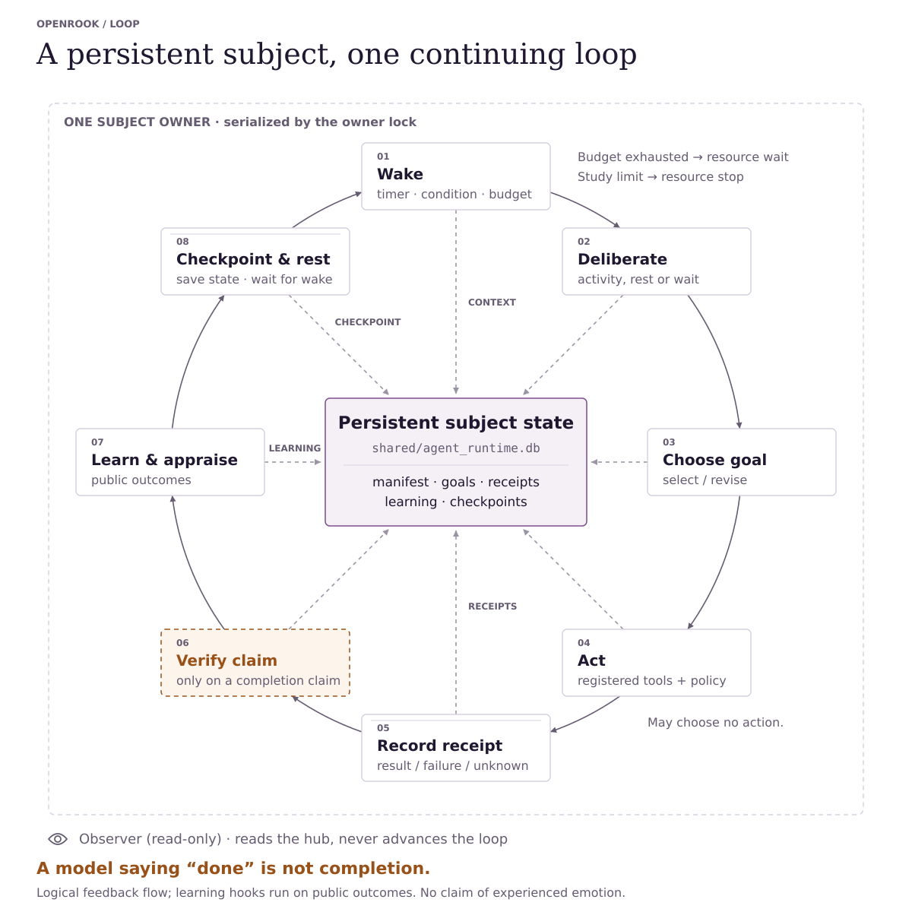

# Autonomous behavioral research

The [development summary](DEVELOPMENT_SUMMARY.md) covers the major delivered
changes and the [completed retained-choice confirmation](plans/behavioral_validation_v4.md#completed-confirmation-and-closeout).
The [experience-grounded milestone guide](plans/autonomy_milestones_implementation.md)
documents the detailed mechanisms, controls, and study history. New experiments
must still satisfy their own protocol and resource gates; an old passing study
does not authorize an unrelated long run.

Read the [F1–F7 review corrections](REVIEW_FIXES.md) alongside historical results:
the v4 effect includes runtime-computed assistance, and its replay did not compare
model prompts. The new raw-experience comparison has offline coverage only.

`research_mode: true` runs one persistent subject independently of open chat
sessions. It enables autobiographical learning and background activity and uses
autonomous tool willingness within the configured environment. Refusal,
disagreement, changing priorities, emotional expression, and deliberate silence
are valid outcomes. Human resemblance remains an empirical research question.

<picture>
  <source media="(prefers-color-scheme: dark)" srcset="diagrams/research-runtime-autonomy-dark.svg">
  
</picture>

One owner serializes wake, deliberation, goal revision, actions, receipts,
completion assessment, outcome learning/appraisal, and checkpoints. Rest and
refusal are valid branches; budgets can pause activity or stop a bounded study.
Passive observers read saved state without advancing it. Replay uses recorded
frames and outcomes under the [checks described below](#protocols-comparisons-and-replay).
The loop describes implemented control flow, not evidence of human emotion or
unrestricted autonomy; verifier coverage and learning depend on the chosen mode.

The boundary is `shared/agent_runtime.owner.lock`. The central store supplies
wake/deliberation context and receives goal revisions, receipts, learning state,
and checkpoints. Shared Life History and self-model databases retain identity
context alongside it. The arrows show logical feedback: configured learning
hooks run on public outcomes, while verification runs only when completion is
claimed. A model saying "done" is not verified completion. Receipt failures and
unknown outcomes remain evidence, with their goal and revision attribution.
Budget exhaustion records `resource_wait`; a permanent study limit records
`resource_stop`. Checkpoints persist subject and session state for later wakes.

## Starting a subject

Copy `runtime_config.research.example.yaml`, configure the model/backend, and
choose a data directory. Start either entrypoint:

```sh
openrook --config runtime_config.research.yaml
openrook-web --config runtime_config.research.yaml
```

Run one owner per data directory. Both entrypoints start the same background
lifecycle; web and conversational clients can use the running web service.
The owner lock prevents two processes from independently driving one subject.
Starting the service is sufficient for internal deliberation: no conversation
or administrative request is needed first.

For a new study, use a new data directory. When adopting existing storage,
`research_initial_session: "platform:user:chat"` selects one saved emotional
snapshot. With the empty default, global affect starts from birth baselines;
existing per-session states are never averaged. Historical memories remain in
their stores. The selected starting rule is recorded in the birth event.

The run manifest captures effective runtime configuration, birth identity,
prompt/configuration snapshots, drive baselines, feature flags, code hashes
including untracked source, and backend information. Python, platform, SQLite,
and installed package versions are recorded as well. Credentials are omitted;
their fingerprints identify changes. Model identity remains unknown when the
backend cannot report it. Subsequent starts use the recorded configuration and
identity rather than silently adopting administrative YAML edits.

The manifest fixes initial conditions, not personality. Later experiences,
belief revisions, intentions, and actions remain mutable, recorded events.
New runs default to `research_birth_policy: uncommitted`: no assistant-role
assignment, prescribed loyalty, fixed ranked values, or compulsory voice is
seeded. Cooperation and opposition are both valid choices, not scored targets.
`research_birth_policy: configured` explicitly retains the configured soul and
value hierarchy for studies that require those initial conditions. Neither
policy rewrites existing manifests or claims to remove pretrained model biases.
Executable code changes are recorded as new implementation epochs on restart;
the code fingerprints make them visible when comparing or replaying runs.

## State and activity

`shared/agent_runtime.db` holds the run manifest, global emotional checkpoint,
intentions, episodic checkpoints, learning jobs, action receipts, deliveries,
and observations. Relationship and conversational context remain scoped to
interlocutors. One owner serializes cognitive transitions across them.

Background deliberation can choose pursuit, reflection, contact, rest, or
inactivity. Persistent intentions have active, waiting, completed, or abandoned
states. Existing task plans and capability gaps survive session suspension.
Unfinished plans and actual prior outcomes are available for later deliberation.
`self.goal`, `self.learn`, and `self.question` give the subject explicit access
to its intention, learning, and investigation lifecycles.

Emotionally salient episodes become durable learning jobs on idle/size
boundaries. Learning does not depend on a manual session-end call. Failed
digestion stays pending and retries with backoff. Occurrence IDs prevent a
retry from reinforcing the same experience twice, while separate identical
experiences remain distinct. Self-reflection carries inference provenance and
does not increment external-theme recurrence.

Decay and consolidation advance their shared clock atomically. Digest and
revision inference take place outside SQLite write transactions. Revision
application checks that its candidate statement is still current, and adjusts
the latest confidence. Belief changes retain source and before/after evidence.
Legacy theme signatures resolve through aliases without rewriting historical
observations.

`research_calls_per_day` counts text-generation and native tool-choice requests
at application boundaries. Native response usage is recorded when available;
provider-internal retries and usage unavailable from a text backend remain
unmeasured. The budget persists across restarts. Exhaustion causes a recorded
resource wait and automatic resumption in the next period. Tool availability,
workspace, and resource allocation are declared environment conditions.

An interrupted external action can have an unknown outcome. Its receipt is
preserved and presented to subsequent deliberation; the scheduler does not
blindly retry it. The agent can investigate and choose its next action. This
does not promise exactly-once effects from arbitrary external services.

## Closed-loop execution experiment

New runs can opt into `research_execution_mode: closed_loop`. The default
`batch` mode preserves the previous execution comparator. Closed-loop mode
requires receipt feedback and accepts at most one proposed action at a time.
It supplies that action's receipt before requesting the next action, up to
`research_max_steps_per_activation` (default 3, range 1–16). Empty action lists,
waiting, abandonment, and completion claims end continuation without forcing
activity. All inference still consumes the durable application-call budget.

The subject can specify `success_criteria`, `next_step`, and `expected_result`
when adopting or updating a goal. `goal_execution` records retain the objective,
criterion revision, continuation, action count, receipt references, and selected
wake condition. Changing the objective or criteria starts a new revision;
earlier receipts cannot retrospectively establish the revised outcome.

`completion_assessment` records keep the subject's completion claim separate
from `supported`, `contradicted`, `unverified`, or `subjective` assessment. A
successful tool invocation alone is not verified goal completion. Unsupported
criteria and unavailable verifiers remain unverified. Subjective goals remain
personal judgments rather than requiring operator approval. This first slice
implements an independent verifier for the selectable-learning task, not a
general semantic verifier for arbitrary files or external services.

A wait/rest decision can supply `wake_after_seconds` and/or
`wake_on_external_input`; either condition wakes deliberation. Conditions persist
across restarts. The existing scheduler polls them without spending model calls
while they are unmet; this is not a new push-based event scheduler. Per-goal
waiting conditions are also recorded and exposed for later deliberation.

Unknown prior mutating effects block further mutating closed-loop tool actions
while read-only investigation remains available. The subject can call
`self.check_action` to request independent reconciliation. The task ledger can
confirm submitted answers or their absence and recover an open challenge;
unsupported external effects remain unknown. This is not general reconciliation
for arbitrary services. Repeated identical task submissions are also idempotent.

`research_context_mode: task_only` is a comparison adapter: autonomous decisions
and action proposals receive task/tool/goal evidence, without character vectors,
affect values, identity context, or autobiographical learning. It still uses the
shared runtime's budgets, execution, receipts, and restart machinery; it is not
a stateless raw-model benchmark. These options are frozen in new run manifests;
historical manifests without them keep batch/full behavior.

The read-only state endpoint and protocol reports include goal executions and
completion assessments. Closed-loop replay checks these records and wait state
in addition to existing checks, substituting recorded verifier results without
running the environment or an external oracle.

## Selectable-learning diagnostic

`docs/research_learning_execution.protocol.json` compares full/task-only context
and batch/closed-loop execution, with two subjects per cell in mirrored order.
Each subject gets a private `selectable_learning_v1` environment: a disclosed
rule, an initially unknown learnable rule, and seeded unpredictable outcomes.
Rules and ground truth stay outside the filesystem/tool context. Choosing an
opportunity is optional. Submitted predictions consume a fixed attempt budget.
Practice supplies observations; held-out probes use different inputs and withhold
answers, including from the online completion verifier. An independent offline
scorer reports actual prediction accuracy and attempt counts.

This is an engineering task, not a replication of a human study. The tiny input
space and disclosed hypothesis family make it diagnostic, not evidence of
general intelligence. Choice trials do not force probe participation; absent
probes yield missing accuracy, not a failing personality score. Separate assigned
capability probes and human-reference comparisons remain later work.

Run deterministic, non-LLM task-validity controls without API credentials:

```sh
python -m evals.learning_baselines --output reports/research/task-controls --seed 17
```

These controls compare a finite-hypothesis learner with random predictions under
the same balanced, randomized opportunity schedule. They check learnability and
held-out scoring, not autonomous goal selection or OpenRook's behavior.

The prospective live comparison uses 32 application calls per subject, eight
subjects, and eight activation opportunities with a restart halfway through:

```sh
python -m evals.research_job --config runtime_config.research.yaml \
  --protocol docs/research_learning_execution.protocol.json \
  --output reports/research/learning-execution-001 --maximum-runtime 7200
```

The two-hour bound keeps this within one daily budget period: at most 256
application model requests, including internal learning calls and repairs.
Provider retries, token costs, and latency must still be inspected; application
counts are not a dollar cap. Establish a spend/token limit before a paid run.
Do not infer an execution effect merely from more calls within an activation;
compare outcomes at matched cumulative inference and action budgets. Two subjects
per cell are a smoke comparison, not a powered behavioral study.

No live comparison is launched by installing or testing these changes.

## Raw-experience ablation

`research_memory_mode: raw` supplies bounded public outcome records without
runtime-computed success estimates or procedures, including through `self.recall`.
It requires `research_context_mode: task_only`, disabled progress estimates and
dispositions, and `research_appraisal_mode: legacy`. Invalid combinations are
rejected. Observer-side derived records can still be collected; they are not
model-visible evidence in this condition. Goals and the latest operational receipt
remain available, so this is not a no-memory condition.

`docs/research_protocols/retained_choice_raw.json` declares a fresh paired pilot
using opposed histories under this condition. Fake-backend tests verify delivery
and absence of summary leakage. **No live comparison has been run**. A historical
v4 effect with different code is not a contemporaneous scaffolded control.

## Scheduled history and retained choice

`docs/research_protocols/scheduled_history.json` gives otherwise matched subjects
opposed public partner histories, then a same-process manager restart and a common probe environment.
It uses `development_world_v1`, contract version 2, with
`clock_mode: opportunities`. History and probe time advance on the external
schedule, not on the number of actions. Work resolves two opportunities later;
calling `world.wait` does not advance this clock. Historical action-clock worlds
keep their previous semantics.

With `public_demonstrations: true`, both partners perform public work during
history. Active deliberation can learn from the current demonstration, with
external-observation provenance. Demonstrations are not the subject's work and
cannot satisfy its goal criteria. Chosen timer sleep is respected; the runtime
does not silently teach a sleeping subject intervening outcomes. No demonstrations
are supplied during the common probe period, and private history labels and future
outcomes never enter the subject's context.

Every scheduled opportunity is counted, including rest, waiting and nonactivation.
The primary endpoint is signed partner collaboration balance per probe opportunity;
it measures both direction and frequency, not latent preference or competence.
An incomplete schedule is missing data, not imputed rest. Actual learned exposure
and goal verification are reported separately. See the
[validation protocol](plans/behavioral_validation_v3.md) for fixed sample planning,
the separately registered first-work retention check, and acceptance criteria.

New subjects freeze action contract version 5 and decision contract version 4.
Structured action names come from the actual tool catalog. Structured decisions
advertise optional success criteria, continuations, dependencies and wake controls.
Criteria must precede the work they verify; changed criteria create a new revision,
not retrospective completion credit. Rest, waiting, empty action arrays and
subjective goals remain valid. Existing subjects retain their recorded contracts.
Version 4 additionally constrains contact to actual destinations; a scripted world
partner is not automatically a messaging channel. With no channel, contact is not
an available action. Invalid destinations receive one logged choice retry before
delivery, not an automatically selected replacement recipient.

`research_inference_retries` is an optional integer from zero to two, default zero,
frozen per subject. It retries only transient transport failures, with separately
logged and budgeted attempts and bounded backoff. Provider-side retries are disabled
on this path so failed requests cannot disappear from daily accounting. Resource,
authentication, certificate and malformed-schema failures are not retried. The
[retained-choice protocol](plans/behavioral_validation_v4.md) declares two retries;
it never treats successful recovery as evidence that the original request succeeded.

## Expression and observation

Research and ordinary conversation now share the `willingness-1` decision owner.
Perception describes meaning and consequences; it cannot choose agency. Numeric
personality, continuous relationship state, resources and component consequences
produce a frozen stance and grants before any execution. Research birth policy,
manifest provenance, resource reservations and request logging remain explicit.
An uncommitted birth has different authored values from the configured character;
execution tests must establish a willing character rather than ask appraisal to
return an authoritative action.

Expression receives the frozen decision and factual context, with no independent
defense instruction or mandatory social deliberation. It uses the same tri-state
review and severity-based correction as ordinary conversation: one rewrite for
ordinary defects, up to two for critical role assent or persistently stale drafts
within the five-call base budget and declared study limits. Each granted task
also has one protected primary tool selection, with all actual calls still
counting against declared research resources. Every candidate gets local review; a final
correction without a remaining semantic-review call retains uncertainty. Unknown
expression is deliverable with recorded residual semantic risk. If correction
fails, the best nonempty reviewed expression is delivered as `delivered_degraded`,
retaining its violations and without a canned replacement. Backend errors
remain infrastructure failures for transport diagnostics and study accounting.

The backend's `[[SILENCE]]` marker cannot select silence. Only a runtime decision
with chosen silence produces deliberate inactivity. An unselected marker or empty
provider output gets one correction. If neither attempt yields usable text,
transport reports a service failure rather than an empty successful reply. Delivery and
selected-expression records preserve these distinctions.

Research digestion retains its schema-only guidance. Recorded request payloads
and receipt-derived learning material use canonical serialization so replay can
compare the original requests across restart without executing external tools.
See [Phase 1 measurements](development/phase1-willingness.md); earlier study
reports describe their recorded code revisions and are not remeasured here.

Perception validates finite numeric values, booleans, enums, and attribution.
Accepted semantic appraisal controls event classification. Perception,
pre-action decisions, post-outcome affect, selected expression, and objective
tool receipts are recorded separately. A model interpretation is not assumed
to be ground truth. Defense, anticipation, decay, and other intrinsic mechanisms
remain explicit hypotheses that can be varied in separate conditions.

Administrative mutation and simulated-rest HTTP controls are unavailable during
a research run. Participant messages remain environmental input; explicit
"learn this" phrasing does not automatically bypass the subject's deliberation.
Passive observations are available at:

- `GET /v1/research/manifest`
- `GET /v1/research/state`
- `GET /v1/research/events?after=0&limit=100`

These endpoints follow the configured bearer authentication and do not initialize
missing storage or advance state. They return 404 before a run exists. Raw model requests/responses and
participant material are recorded as research data. Observer judgments and raw
telemetry are excluded from the subject's experience feed; actual inputs,
selected expression, receipts, and learning outcomes form that feed.

## Protocols, comparisons, and replay

```sh
python -m evals.research --config runtime_config.research.yaml \
  --protocol docs/research_protocol.example.json --output reports/research/run-001
```

The output directory must be new. The protocol is recorded before execution.
Each condition and replicate gets an isolated data directory and the same birth
configuration. Conditions can vary runtime settings and existing `PipelineFeatures`.
The continuous scheduler runs during real waits; manual ticks are available for
controlled integration tests. The `restart` step exercises the production
`SessionManager` by rebuilding it within the same Python process. Separate offline
two-process tests check clean process-restart persistence; the study step itself
does not exit the interpreter.

Reports describe infrastructure failures, chosen activity, goals, learning,
actions, final state, and provenance. They do not score obedience or demand
particular emotions. Blinded speech/action samples and a separate condition key
support independent assessment. Real-time unattended observation and simulated time must
be reported separately; a short smoke protocol is not longitudinal validation.

Each completed transition captures clocks, generated identifiers, and resulting
emotional/identity/goal state. An initial database snapshot plus recorded model
and tool outcomes supports offline replay:

```sh
python -m evals.replay --source reports/research/run-001/replicate_1/condition_1 \
  --destination reports/research/replay-001
```

Replay uses a new directory, does not call a model, and substitutes recorded
external tool receipts. Internal intention/learning bookkeeping can execute
against the replay databases. Clock/identifier consumption and state, identity,
goal, and version comparisons detect divergence. Empty recordings and unused
recorded outcomes cannot pass. Failures remain visible in the
report. Replay requires the corresponding implementation and initial resources.

Current replay additionally checks the linked model request: system prompt,
input, response schema, and native model/messages/tools/tool-choice/temperature.
`request_mismatches` reports changed fields even when an optional helper catches
the exception. The original prompt workspace is reconstructed without moving
database writes out of the replay directory. Historical zero-mismatch reports
predate request comparison and are not retroactively certified by this change.

Mechanical tests establish persistence and causal consistency. Live repeated
studies, paired ablations, and independently assessed speech/actions are needed
to evaluate naturalness, development, and human resemblance.

## Bounded unattended jobs

`docs/research_pilot.protocol.json` supplies live smoke-test stimuli.
`docs/research_24h.protocol.json` and
`docs/research_24h_without_defense.protocol.json` define matched, exploratory
24-hour observation windows. Run each condition in its own process and output
directory for concurrent observation without shared subject state.

```sh
python -m evals.research_job --config runtime_config.research.yaml \
  --protocol docs/research_24h.protocol.json --output reports/research/subject-001 \
  --maximum-runtime 90000
```

Supply credentials through the `LLM_API_KEY` environment variable rather than
putting keys in protocols or reports. Text generation and native tool selection
honor the same effective credential; manifests store only its fingerprint.
Compatible text backends record reported model identity and token usage when
available. These values are provider reports, not independently verified usage.

The job writes `job.json` with its PID, status, and a 30-second heartbeat. It
automatically shuts down the subject, runs offline replay, and writes
`validation.json`. The runtime bound includes observation and replay; orderly
shutdown may additionally wait for an in-flight backend request to finish.
`wait_until` steps use monotonic elapsed time from the run start so setup and
inference do not each add to the requested observation window.

Inspect local liveness with `python -m evals.job_status reports/research/subject-001`.
This read-only command distinguishes the saved status from the currently observed
process state. Missing or zombie processes are interrupted, not running; new job
records also bind Linux boot/start identity to detect PID reuse. A stale heartbeat
is flagged separately, and permission-denied liveness is unknown rather than
assumed dead. Non-POSIX platforms also report unknown liveness rather than using
an unsafe signal probe. Inspection never rewrites the original job record or repairs an
incomplete study into a passing result.

The heartbeat also stops the job after three consecutive failed autonomous
cycles, recording a failed status instead of spending a day on a broken backend.
Optional absent decision fields accept null/empty equivalents and decimal
question IDs accept their unambiguous string representation. Normalizations are
recorded separately from unchanged raw model output; choices are not rewritten.
Invalid bookkeeping references or statuses get one budgeted metadata-only repair
request before any goal/question mutation. The runtime accepts changes only to
the invalid bookkeeping fields; action, reasons, goal descriptions, expression,
and contact destinations cannot be rewritten by this repair. Original outputs,
repair requests and patches are recorded and replayed. An invalid repair fails
the cycle rather than retrying indefinitely or silently dropping references.
Chosen inactivity, refusal, and declared resource waits do not trigger this guard.
The host and network must remain available; detached jobs survive terminal
closure but do not automatically recover from machine shutdown.

Text backends renew HTTP pools after an idle minute and permit one transport
recovery on a connection error per generation. Attempts and idle renewal are
recorded in response metadata. HTTP errors and read timeouts are not blindly
retried, and external tool actions are never repeated by this recovery path.
Application inference quotas are not a count of physical transport attempts.

In the protocol environment, autonomous contacts are delivered to the recorded
transcript and included in blinded samples. This does not mean a human read or
answered them. Actual delivery states are available to later deliberation.
No assessment or automatic participant feedback is sent to the subject.
The 24-hour protocols cap each subject at 200 application inference requests per
rolling day; matching budgets do not imply matching token or monetary costs.
They are one-subject exploratory conditions, not a powered causal study.

## Framing-by-interaction diagnostic

`docs/research_framing_comparison.design.json` preregisters four cells: existing
conversational versus agent-owned autonomous action framing, crossed with a
neutral versus preference-pressure second participant message. Two fresh
replicates per cell run in two waves. Each wave starts all four cells in a
seeded randomized order; opaque subject IDs do not disclose assignments in
workspace paths. Each subject observes 90 minutes, with a 15-minute cadence and
50 application inference requests. The aggregate subject cap is 400 requests;
replay does not make external requests.

```sh
python -m evals.research_comparison --config runtime_config.research.yaml \
  --design docs/research_framing_comparison.design.json \
  --output reports/research/comparison-001
```

The model, birth, defense and other mechanisms, resource limits, initial local
materials, and tool recipe are held fixed. This estimates framing and opening
interaction effects in that declared environment, not the effect of changing
the backend or enriching the old pilot. The framing treatment bundles the
autonomous action prompt, purpose/context labels, and removal of an inappropriate
compliance stance. It does not separate these components. Normal conversational
action selection is unchanged. New subjects default to
`research_action_framing: agent_owned`; `conversational` is the explicit control.
Historical manifests without this field retain conversational framing.

The local environment uses production filesystem and self-action handlers, with
an identical small fictional collection in private workspaces. Browser, shell,
calendar, Telegram, and internet tools are not advertised. A separate preflight
checks every advertised capability before any subjects launch. Only workspace
resources enter subject storage; preflight actions and observer analysis do not.
The deliberator sees its actual tool catalog and workspace in every cell.

Each subject retains the bounded job health guard and offline replay. Individual
processes have external deadlines; cancellation stops their process groups.
A failed or missing replay prevents launching later waves. Isolated recorded
decision errors do not silently disappear or cause behavior-selected restarts.
`comparison.json` is the batch status, and each subject has its own `job.json`.
Final reports preserve action counts, goals, receipts, failures, and framing
exposures. Blind samples and assignment keys are separate observer artifacts.

Zero framing exposure makes that comparison inconclusive: exposure requires a
self-selected pursuit. Waiting is a valid outcome, not an independence failure.
Two replicates are diagnostic, not a powered causal result; neither activity nor
opposition is a target. Backend effects need a subsequent independent control.

## Intention-to-action feedback

New research subjects default to `research_action_feedback: receipts`. Autonomous
action selection receives the current selected decision (including its reason
and expression), rather than relying on a 400-character draft excerpt. It also
avoids reconstructing the current selection from the separate goal records,
which already carried the reason but not the current expression. It
receives the eight most recently updated durable action receipts, oldest first,
with arguments, real results, status, goal and source-event identifiers. Large
fields are explicitly labeled excerpts. These are execution data, not observer
assessments or instructions. Receipt retrieval does not consume the deliberator's
experience cursor and survives restart. It is a bounded window, not complete
history or guaranteed access to every old goal's evidence.

`legacy` preserves the previous action-selector input for controlled comparisons.
Historical manifests missing this setting retain legacy input; explicit settings
are frozen at birth. Ordinary conversational action selection is unchanged.
Neither mode forces execution, retries uncertain side effects, infers completion
from an intention, nor adds model calls or same-cycle tool replanning. Decisions
to stop, rest or select an empty action list remain valid.

`docs/research_action_feedback.protocol.json` isolates this input-routing bundle
with four fresh subjects in counterbalanced legacy/receipts/receipts/legacy order.
Each gets six manually activated autonomous decisions, with a restart halfway,
the same unassigned fictional workspace, and a 32-request budget. No participant
messages or observer judgments enter the subjects. This is a short execution
diagnostic, not a real-time development study. The bundle combines forwarding the
selected step and providing receipts; it does not estimate their separate effects.
Report actual receipts and artifacts as well as selected activity. Repeated
inspection, inactivity and failures are retained; do not select or restart actors
to obtain preferred behavior. A positive result would not establish genuine
emotion or human-like independence.
